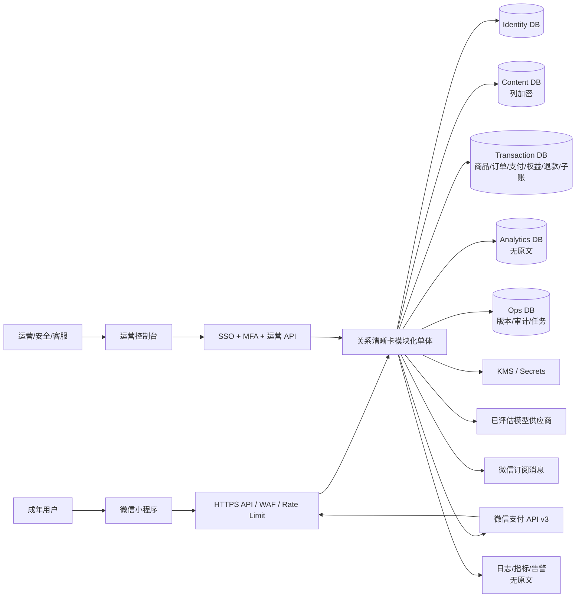
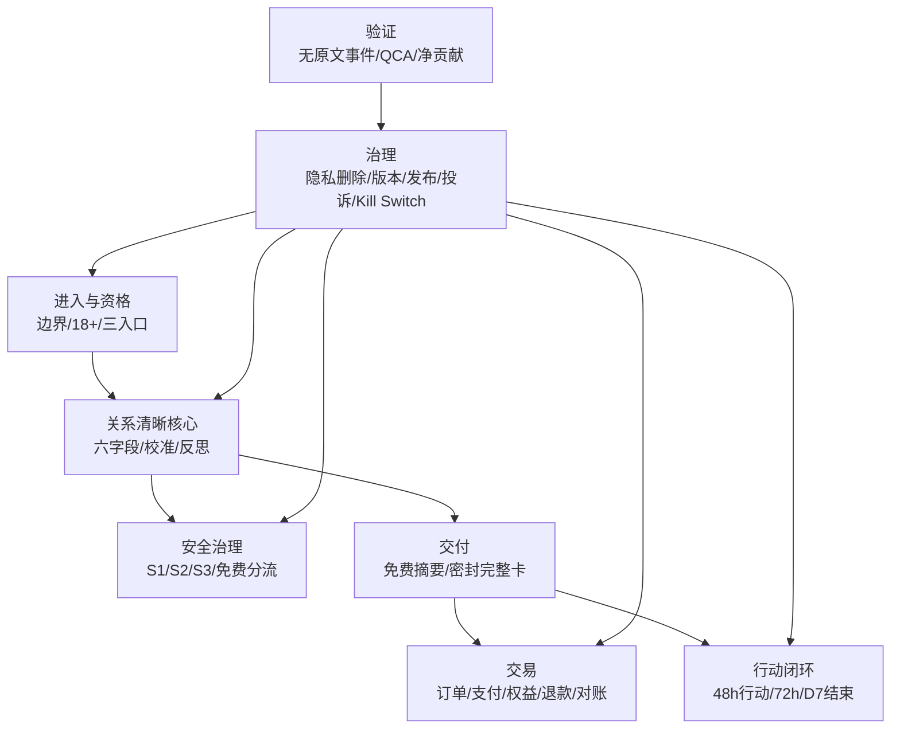
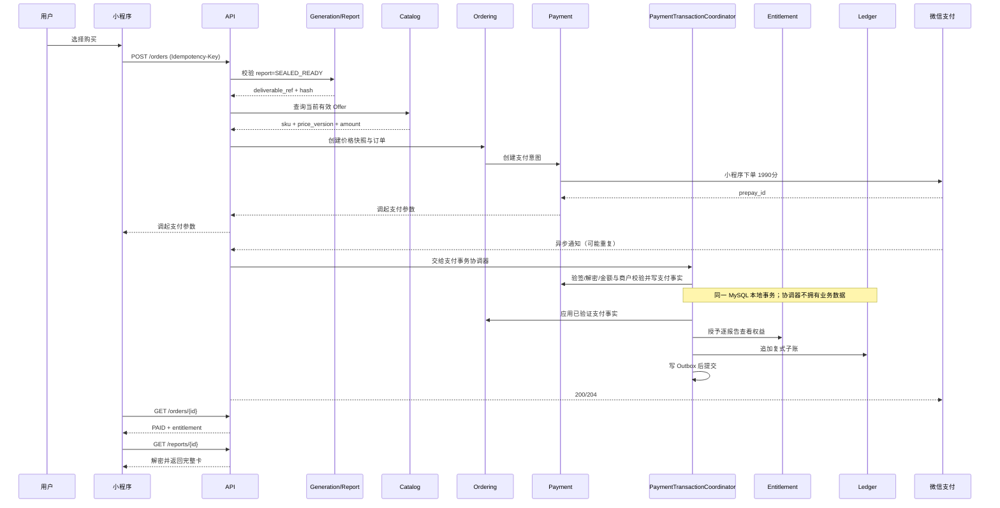
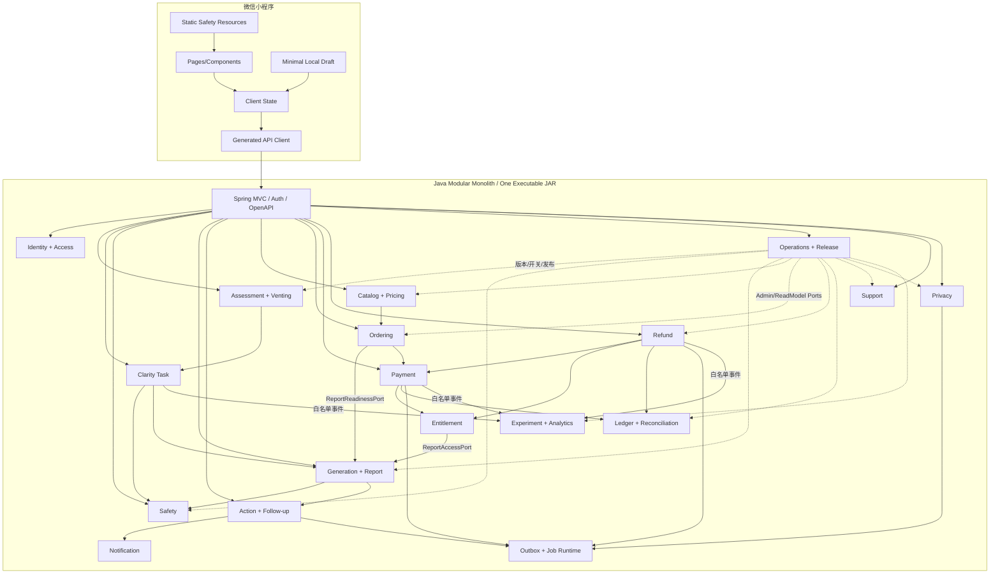
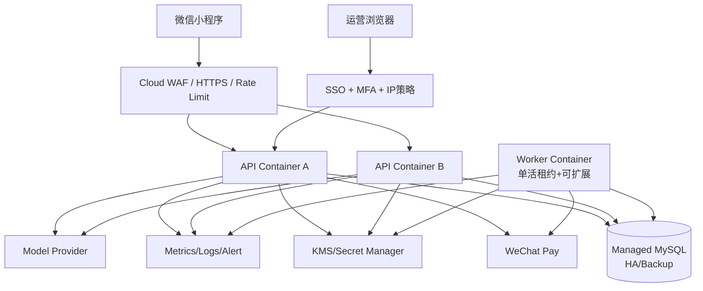
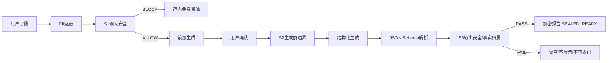
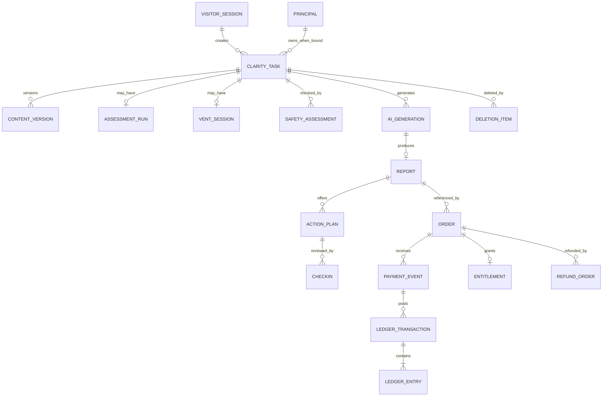

# “关系清晰卡”MVP 详细架构设计

> 本文同时覆盖业务架构、应用架构、技术架构、数据架构、数据库设计、API 设计、支付账务、安全/部署和技术成本。文中的云与模型价格以 2026-07-18 可见公开口径为估算基线，不是供应商报价或上线批准。

## 0. 架构结论

### 0.1 推荐基线

| 层 | 决策 |
|---|---|
| 客户端 | 微信原生小程序 + TypeScript + WXML/WXSS；只做一个平台，不引入跨端框架 |
| 服务端 | JDK 25 LTS + Spring Boot 3.5.x + Spring MVC 的 Java 模块化单体；一个代码库、一个可执行 JAR |
| 契约 | `openapi.yaml` 定义业务接口，`auth-rules.yaml` 集中定义鉴权/RBAC，编译为 `openapi.generated.json`；从编译契约生成客户端 DTO、服务端注解和校验 |
| 数据访问 | MyBatis 3 + 显式 SQL + Flyway；关键交易事务使用唯一约束、显式 SQL 和行锁 |
| 主数据库 | 中国大陆地域的 MySQL 8 兼容托管关系库；内容、交易、分析、运营按逻辑库/角色分域 |
| 异步 | MySQL Outbox + Job 表 + 独立 Worker；首版不引入 Kafka/RabbitMQ/Redis 队列 |
| AI | 供应商适配器 + JSON Schema 结构化输出 + 三道安全检查；供应商由登记/合同/评测闸选择 |
| 支付 | 微信支付 API v3；报告先生成并校验为 `SEALED_READY`，再创建 1990 分订单；回调只授予权益 |
| 云部署 | 腾讯云 CloudBase Run/等价中国大陆容器托管 + VPC 内数据库 + KMS/Secret/日志 |
| 运维 | 单区域、多环境、最小双实例公开 Alpha；模块 Kill Switch、灰度、回滚和发布证据包 |
| 分析 | 元数据白名单事件；原始关系文本、测试答案和完整报告不进入分析域 |

服务端技术基线已在 1.1 版由 Node.js 修正为 Java。核心原因不是语言偏好，而是本项目同时包含订单、微信支付、权益、退款、复式子账和对账，本地已有 Spring Boot 模块化单体与支付工程可参考，微信支付也提供官方 Java SDK。小程序继续使用 TypeScript；服务端与客户端通过 OpenAPI 契约协同，不要求使用同一种语言。

### 0.2 为什么不是旧架构

现有 `fengshui` 代码是 H5 + Express + MongoDB 的星座/塔罗/八字演示，含 Mock 登录、Mock 支付、默认开发密钥和共享内存模型。它与当前小程序、一核两入口、关系文本分域、真实支付、删除回执和安全 Fail-Closed 不同。旧代码只可参考页面组织与 HTTP 封装，不迁移路由、数据模型、认证、支付或 AI Prompt。

### 0.3 架构原则

1. **安全路径先于商业路径**：风险检查不依赖支付或普通生成服务。
2. **报告就绪后才收费**：消除“扣款后模型失败”这一主要交付风险。
3. **分域而不微服务化**：先用模块、数据库角色和事务边界守住领域；有真实扩展压力后再拆服务。
4. **原文不用于增长**：内容只服务当前任务，分析只接收白名单元数据。
5. **账务追加、不覆盖历史**：订单状态可演进，资金事实用不可变事件和复式子账记录。
6. **版本决定可追溯**：模型、Prompt、安全规则、题库、报告模板、政策和发布证据均可定位。
7. **依赖故障显式化**：使用 `UNKNOWN/REVIEW_REQUIRED`，不吞错、不静默平账、不用缓存答案伪装新结果。

## 1. 架构目标与质量属性

| 质量属性 | 目标 | 架构响应 |
|---|---|---|
| 安全 | 高严重度漏拦、危机收费、原文日志泄漏为 0 | 三道检查、Fail-Closed、字段白名单、静态安全页、独立开关 |
| 交付可靠 | 重复扣款 0；付费后权益可恢复 | 报告先密封、订单/回调幂等、Outbox、查单、自动退款 |
| 隐私 | 未保存原文 24h 内删；保存报告 ≤30 天；可端到端删除 | 分域、列加密、TTL Job、供应商删除、回执状态机 |
| 性能 | 免费摘要 P95 ≤8s；完整结构 P95 ≤20s；支付后解锁 P95 ≤2s | 一次生成、结构校验、异步补偿、无支付后再生成 |
| 可用性 | 公开 Alpha ≥99.5%；安全/删除/售后在商业模块关闭时仍可用 | 多实例、静态资源、本地安全页、独立路由和开关 |
| 可审计 | 任何报告/订单/退款/删除可关联版本和动作 | append-only 事件、审计日志、发布包、不可变 ledger |
| 可变更 | 模型/Prompt/题库可独立灰度和回滚 | 版本注册表、配置快照、模型适配器、功能旗标 |
| 成本 | 低流量期固定基础设施保持低数千元/月以内 | CloudBase 标准版/按量、模块化单体、DB 队列、无大数据栈 |

非目标：全球多区域、百万 QPS、开放社区、长连接 IM、向量记忆、推荐系统、微服务/Kubernetes、图片/语音处理、玄学算法平台。

## 2. 系统上下文与信任边界



### 2.1 信任边界

| 边界 | 不可信输入 | 强制控制 |
|---|---|---|
| 小程序 → API | 任意字段、金额、状态、令牌、重放请求 | Schema、长度、鉴权、限流、幂等、服务端金额 |
| 用户文本 → AI | PII、越权、Prompt 注入、高风险内容 | 本地提示、服务端遮蔽、S1/S2、最小字段、超时 |
| AI → 产品 | 幻觉、读心、诊断、恶意/越界结构 | JSON Schema、事实来源、S3、禁止直接渲染原始响应 |
| 微信支付 → 回调 | 伪造、重放、重复/乱序通知 | API v3 验签/解密、唯一事件、业务锁、查单 |
| 运营端 → 数据 | 越权查询、批量导出、误操作 | SSO/MFA、RBAC、字段遮蔽、双人审批、审计 |
| 日志/分析 | 开发误传原文或密钥 | Allowlist serializer、DLP 扫描、拒绝未知字段 |

## 3. 业务架构

### 3.1 业务能力地图



### 3.2 业务领域地图

业务领域是规则、数据与变更责任的边界，不等同于微服务或 Maven Module。P0 使用一个 Java 模块化单体，但每个领域只能通过公开的应用服务、Port 或白名单领域事件协作；禁止跨领域直接写表。

| 一级业务域 | 二级领域/代码名 | 核心聚合/事实 | 业务承诺 | 不拥有 |
|---|---|---|---|---|
| 用户与访问 | 用户身份 `Identity` | Visitor、Principal、WechatBinding | 免费匿名进入；支付/提醒时最小绑定微信身份 | 关系文本、会员等级、订单金额 |
| 用户与访问 | 同意与会话 `Access` | Consent、PolicyAcceptance、Session、TokenFamily | 18+、政策版本和会话可追溯 | 用户画像、业务任务 |
| 核心产品 | 自测入口 `Assessment` | Definition、Run、Answer、Score | 6–8 题确定性当前倾向 | 临床结论、长期人格档案 |
| 核心产品 | 倾诉入口 `Venting` | VentSession、VentTurn、ConfirmedSummary | 限时限轮、随时结束、确认后才映射 | 长期陪伴、主动召回 |
| 核心产品 | 关系清晰任务 `Clarity` | Task、FieldVersion、Mirror、Reflection | 一件关系事件、事实/解释分离、用户确认 | 第三人真相、支付状态 |
| 核心产品 | 安全治理 `Safety` | SafetyAssessment、Route、ReviewCase、Resource | 商业前置、免费分流、Fail-Closed | 诊断、急救承诺、资金事实 |
| 核心产品 | AI生成与报告 `Generation` | Generation、Report、ReportVersion、ArtifactRef | 免费摘要、密封完整卡、版本可追溯 | 收款事实、查看权限 |
| 核心产品 | 行动与复盘 `Action` | ActionPlan、ReminderGrant、CheckIn | 48h 行动、72h/D7 复盘并结束任务 | 持续依赖、二次收费 |
| 商业交易 | 商品与定价 `Catalog` | Product、SKU、PriceVersion | 服务端权威商品、价格和生效窗口 | 订单、支付结果 |
| 商业交易 | 订单 `Ordering` | Order、PriceSnapshot | 密封报告后下单、强幂等、成交快照 | 微信资金事实、报告原文 |
| 商业交易 | 支付 `Payment` | PaymentAttempt、PaymentEvent、ProviderTransaction | 官方 API v3、验签验金额、重复/乱序安全 | 商品定价、报告内容 |
| 商业交易 | 权益与交付 `Entitlement` | Entitlement、DeliveryRecord | 一个任务最多一个有效完整卡查看权 | 资金到账判断、报告生成 |
| 商业交易 | 退款 `Refund` | RefundRequest、RefundOrder、RefundEvent | 自动/人工退款、状态可查、成功后撤销权益 | 原地改旧账、客服裁决 |
| 商业交易 | 账务与对账 `Ledger` | LedgerTransaction、LedgerEntry、Reconciliation | 复式、只追加、可冲正、三方可对账 | 作为支付渠道事实源 |
| 用户服务 | 客服与纠错 `Support` | Ticket、Complaint、Correction | 计费/交付/误导/安全/隐私工单可追踪 | 默认读取关系原文、直接改订单 |
| 用户服务 | 隐私与删除 `Privacy` | DeletionRequest、DeletionItem、Receipt、Export | 分域删除、24h 回执、交易记录依法断链保留 | 修改资金历史 |
| 用户服务 | 通知提醒 `Notification` | NotificationConsent、NotificationJob、DeliveryResult | 每次单独授权、中性内容、安静时段 | 默认订阅、营销召回 |
| 运营治理 | 配置与发布 `Operations` | FeatureFlag、ArtifactVersion、ReleaseBundle、Approval、Audit | 独立开关、版本、证据、灰度、回滚、审计 | 直接改报告/订单/账务事实 |
| 运营治理 | 实验与分析 `Analytics` | Experiment、Assignment、Event、MetricVersion | 无原文事件和可复现指标 | 自由文本、精确位置、业务裁决 |

#### 3.2.1 P0 会员边界

P0 **没有会员域**。`Visitor` 是匿名访客，`Principal` 是必要时绑定的用户主体，`Customer` 只是发生过订单的角色，均不等于 `Member`。用户购买的是某一份报告的 `Entitlement`，不是会员资格。

P0 不出现 `Member`、`MembershipPlan`、`Subscription`、`Renewal`、`Coupon`、`Points` 或自动续费相关表、接口、枚举和运营入口。只有当商业模式经独立立项切换为订阅、次数包或跨任务持续权益时，才新增 `Membership/Subscription` 领域，不能向 `Entitlement` 表持续堆字段代替建模。

### 3.3 核心业务流程

#### 3.3.1 关系任务

`资格/边界 → 入口适配 → 六字段 → S1 → AI 镜像 → 用户确认 → 两轮反思 → S2 → 一次生成 → S3 → 免费摘要 + 密封卡 → 行动 → 可选支付解锁 → D7 结束`。

#### 3.3.2 安全分流

风险分类返回 `BLOCK` 后，在同一事务中将任务标为 `SAFETY_BLOCKED`、写入无原文安全事件、撤销待处理生成/订单能力。客户端只接收风险类别和匹配资源 ID；静态安全页不依赖模型、支付或动态运营内容。

#### 3.3.3 支付交付



#### 3.3.4 删除

删除请求先把用户侧内容标记 `PENDING_DELETION` 并立即不可见；Worker 删除内容密文、临时答案、模型侧可删除对象和派生报告，保留不含原文的删除回执与法定交易记录。每个删除项独立状态，全部完成才返回 `COMPLETED`。

### 3.4 业务职责分离

| 决策/操作 | 产品 | 工程 | 安全/隐私 | 财务/客服 | 发布负责人 |
|---|---|---|---|---|---|
| FR/文案/价格实验 | A/R | C | C | C | I |
| Prompt/模型发布 | C | R | A | I | A（公开） |
| 高风险规则恢复 | I | R | A | I | A |
| 退款人工批准 | I | C | C（安全类） | A/R | I |
| 账务调账 | I | C | I | A/R | I |
| 删除例外 | I | R | A | C | I |
| 公开发布 | C | C | C | C | A/R |

### 3.5 运营后台业务能力

运营后台是受控操作入口，不是第二套业务事实源。它查询各领域提供的脱敏读模型，并通过领域命令发起变更；不得绕过应用服务直接更新生产业务表。

| 运营模块 | 核心能力 | 调用的业务领域 | P0 权限/审计要求 |
|---|---|---|---|
| 运营总览 | 合格曝光、QCA、净支付、退款、投诉、交付异常 | Analytics、Ordering、Refund、Support | 只读聚合，无原文 |
| 商品价格 | SKU、价格版本、生效窗口 | Catalog | 双人审批后生效；禁止直接改历史订单快照 |
| 订单中心 | 订单、支付、权益、退款状态和异常原因 | Ordering、Payment、Entitlement、Refund | 默认只读；人工动作必须 reason/ticket |
| 退款对账 | 自动退款、人工审批、微信账单差异、修复状态 | Refund、Ledger | 财务角色；审批与执行分离 |
| 客服工单 | billing/refund/delivery/safety/privacy/misleading/correction | Support | 默认不可见关系原文；用户主动提供内容单独受控 |
| 安全审核 | 风险类别、动作、脱敏引用、复核结果和 SLA | Safety | 独立安全角色；受限材料逐次授权 |
| 隐私删除 | 删除范围、分域进度、供应商删除和回执 | Privacy | 不可关闭；失败进入人工队列 |
| 功能开关 | 自测、倾诉、生成、支付、提醒独立启停 | Operations | 生产高风险开关双人审批；安全/删除/售后不可关 |
| 版本中心 | 题库、Prompt、模型、规则、模板、政策版本 | Operations、Assessment、Safety、Generation | 不可变版本；生效窗口和回滚引用完整 |
| 发布中心 | 评测证据、SBOM、平台结论、批准、灰度和回滚 | Operations | 人类发布负责人最终批准 |
| 实验分析 | 队列、版本、指标口径、样本状态和停止条件 | Analytics | 无原文；样本不足显示“无赢家” |
| 权限审计 | Operator、Role、Approval、AuditLog | Operations | SSO、MFA、RBAC、不可变审计 |

## 4. 应用架构

### 4.1 逻辑组件



API、Worker 和运营 API 使用同一代码库与同一可执行 JAR，通过 Spring Profile/启动参数选择 `api`、`worker` 或受控组合模式。`ops-web` 是独立前端构建，但不形成第二个后端事实源。

### 4.2 模块依赖规则

| 模块 | 可依赖/调用 | 禁止依赖/操作 |
|---|---|---|
| Identity/Access | Operations 的政策版本 Port | 关系内容、订单和账务内部模型 |
| Assessment/Venting | Identity、Safety、Clarity 的映射 Port | Ordering、Payment、Entitlement |
| Clarity | Identity、Safety、Generation Port | 支付状态、账务表、第三方支付 SDK |
| Safety | Operations 版本、静态资源、受控 Review Port | 商业转化、Analytics 决策、资金数据 |
| Generation/Report | Clarity 只读快照、Safety、Provider Port | Payment Provider、订单内部表 |
| Action/Follow-up | Report、Notification Port | Payment Provider、会员连续性逻辑 |
| Catalog | Operations 的价格发布命令 | 订单历史、支付结果、内容表 |
| Ordering | Catalog Offer、ReportReadinessPort、Identity Principal | 报告明文、微信回调、Ledger 表 |
| Payment | Ordering PaymentIntent、微信支付官方 SDK Port | 修改商品价格、生成报告、直接授予长期权益 |
| Entitlement | Ordering/Payment 的已验证业务事实、ReportAccessPort | 自行判断到账、读取支付密钥 |
| Refund | Payment RefundPort、Entitlement RevokePort、Ledger ReversalPort | 更新旧支付事件或旧分录 |
| Ledger/Reconciliation | Payment/Refund 不可变事实、微信账单 Adapter | 作为用户订单状态源、修改业务订单 |
| Support | Ordering/Refund/Privacy 脱敏查询与命令 Port | 默认读取关系原文、直接写交易表 |
| Privacy | 各域 DeletionPort、交易法定保留元数据 | 删除资金事实、跨域扫描明文 |
| Notification | Action 的逐次授权、微信消息 Adapter | 默认订阅、包含关系/情绪原文 |
| Analytics | allow-listed domain events | Content DB、自由 JSON 透传、业务状态回写 |
| Operations/Release | 各域受控 Admin Command/ReadModel Port | 直接改报告、订单、支付、权益或账务表 |

模块间通过应用层接口和白名单事件通信；禁止跨模块直接 join 私有表或引用其他领域的 Repository/Entity。单体内允许由应用事务协调器在一个 MySQL 本地事务中编排 `Payment + Ordering + Entitlement + Ledger + Outbox`，但状态转换仍由各领域服务校验，数据写权限保持单一所有者。使用 ArchUnit 或 Spring Modulith 边界测试在 CI 中阻止环依赖和越界引用。

### 4.3 服务端目录建议

```text
server/
  pom.xml                         # 单 Maven 工程、一个可执行 JAR
  src/main/java/com/company/clarity/
    interfaces/                   # REST/微信回调/运营 API/异常映射
    identity/                     # 用户身份、微信绑定、同意、会话
    assessment/                   # 人格自测
    venting/                      # 深夜倾诉
    clarity/                      # 六字段任务、镜像、反思
    safety/                       # S1/S2/S3、安全分流和复核
    generation/                   # AI 编排、报告、版本
    action/                       # 行动、提醒、复盘
    commerce/
      catalog/                    # 商品、SKU、价格版本
      ordering/                   # 订单、成交快照、幂等
      payment/                    # 微信支付、回调、查单
      entitlement/                # 报告查看权益
      refund/                     # 退款申请与退款状态
      ledger/                     # 复式子账、冲正、对账
    support/                      # 客服、投诉、纠错
    privacy/                      # 删除、导出、回执
    notification/                 # 逐次授权提醒
    operations/                   # 开关、版本、发布、审批、审计
    analytics/                    # 实验、白名单事件、指标版本
    sharedkernel/                 # 仅 Money/ULID/Clock 等稳定值对象
    infrastructure/              # MyBatis/Flyway/KMS/AI/微信支付实现
    bootstrap/                   # Spring Boot 启动与 api/worker profiles
  src/main/resources/
    db/migration/                 # Flyway Vn__*.sql，已执行版本禁止修改
    static/safety/                # 服务端安全资源副本
  src/test/java/
    architecture/                 # ArchUnit/Modulith 边界测试
    integration/                  # Testcontainers + MySQL/支付 Stub
ops-web/                          # 最小运营控制台，独立前端构建
contracts/                        # OpenAPI 3.1、JSON Schema、事件契约
miniprogram/                      # 微信原生 TypeScript 小程序
```

`sharedkernel` 不是通用工具垃圾桶，只允许没有业务所有权争议、跨域语义完全一致的稳定值对象。业务 DTO、Repository、状态枚举和供应商模型不得放入其中。

### 4.4 小程序目录建议

```text
miniprogram/
  pages/boundary home assessment vent task mirror reflection summary
  pages/pay report action review tasks privacy support safety
  components/ai-badge field-editor safety-banner version-chip state-view
  services/api auth payment telemetry local-draft
  stores/session task experiment
  static/safety-resources-cn.json
  contracts/generated/
```

客户端不得包含模型密钥、微信支付商户私钥、最终价格或安全绕过逻辑。静态安全资源可随包发布并带版本，服务端可返回较新资源，但动态失败时仍显示本地版本。

### 4.5 同步与异步边界

| 操作 | 方式 | 原因 |
|---|---|---|
| 会话、同意、字段保存 | 同步事务 | 用户立即需要确认 |
| S1/S2/S3 | 同步、硬超时 | 决定能否继续/展示/支付 |
| 镜像/完整结构生成 | 同步请求 + 可查询 Job 状态 | P95 目标 8/20s，超时可恢复 |
| 支付下单 | 同步 | 获取 prepay_id |
| 支付通知 | 异步回调 + 事务 + Outbox | 可能重复/乱序 |
| 查单/退款/日对账 | Worker | 外部状态最终一致 |
| 删除/供应商删除 | Worker + 状态回执 | 跨域/外部依赖 |
| 72h/D7 提醒 | Worker | 到期调度和授权校验 |
| 分析事件 | 事务 Outbox → Analytics | 业务不因分析失败而失败 |

## 5. 技术架构与 ADR

### 5.1 技术选型

| 类别 | 选择 | 理由 | 门禁 |
|---|---|---|---|
| 小程序 | 微信原生 TypeScript | 首版只有微信；平台能力、审核和包体最直接 | 主流/低端真机矩阵 |
| 运行时 | JDK 25 LTS + Spring Boot 3.5.x | 最新 LTS、保持 Spring Boot 3 主版本以复用本地经验 | 固定发行版/版本、JFR/内存/GC 压测、安全更新 SLA |
| API | Spring MVC + Bean Validation + springdoc OpenAPI | 成熟阻塞式事务模型，契约与小程序通过 OpenAPI 协同 | 契约测试、鉴权/幂等/错误语义测试 |
| 契约 | OpenAPI 3.1 / JSON Schema | 请求、AI 输出、事件和文档统一可验证 | CI 检查 breaking change |
| SQL | MySQL 8 + MyBatis 3/显式 SQL | 托管成本低；关键交易 SQL、唯一约束和行锁可见可测 | Testcontainers 集成测试、慢 SQL/锁等待门禁 |
| 迁移 | Flyway | 数据库变更版本化，可在 local/test/staging/production 复现 | 已执行 migration 禁止修改；破坏性变更分阶段 |
| 模块边界 | Java Package + ArchUnit/Spring Modulith 测试 | 一个 JAR 保持简单，同时机械阻止越界依赖 | CI 环依赖/Repository 越界检查 |
| 加密 | AES-256-GCM 列加密 + KMS 包裹密钥 | 原文不需检索，可做密钥轮换和按任务删除 | KMS 故障 Fail-Closed |
| 异步 | DB Outbox/Job | 低流量、减少队列组件和双写 | 锁租约、重试、死信、指标 |
| AI | Spring RestClient/Java HttpClient + Provider Port | 避免绑定单模型，允许登记/质量/成本切换 | 合同、地域、删除、JSON Schema、评测 |
| 支付 | 微信支付 API v3 官方 Java SDK + PaymentProviderPort | 官方实现签名、验签、回调解密、查单和退款，端口隔离供应商模型 | 固定 SDK 版本、官方向量、小额真支付、故障注入 |
| 运行 | OCI 容器 + CloudBase Run | 无服务器运维、灰度、缩容和微信生态 | 镜像 digest、SBOM、回滚 |

截至 2026-07-18，Oracle 将 JDK 25 列为最新 LTS；Spring Boot 3.5.16 支持 Java 17–25。生产应选定一个有持续安全更新和镜像签名策略的 JDK 25 发行版，不在不同环境混用供应商构建。[Oracle Java SE 支持路线](https://www.oracle.com/asean/java/technologies/java-se-support-roadmap.html)、[Spring Boot 3.5 系统要求](https://docs.spring.io/spring-boot/3.5/system-requirements.html)

### 5.2 ADR-001：模块化单体，不用微服务

当前只有一个核心 SKU、一支小团队和有限流量。微服务会把本可在单事务完成的报告准备、订单和权益拆成分布式一致性问题。首版用一个 API 进程和一个 Worker 进程；模块边界、独立数据库角色和 Outbox 为未来拆分保留接缝。

**拆分触发条件**：支付/账务需要独立合规团队；内容域和交易域必须物理隔离；单模块扩缩容差异持续造成成本；单体发布影响支付可用性；或团队所有权明确分离。触发前不拆。

### 5.3 ADR-002：原生小程序，不用 uni-app/Taro

P0 不需要跨端复用，支付、登录、订阅消息、隐私和审核是平台核心。原生技术减少桥接层、插件许可和平台差异。未来若 H5 有独立证据，再通过 OpenAPI 复用服务端，而不是提前引入跨端框架。

### 5.4 ADR-003：MySQL 关系库，不用 MongoDB

支付、权益、退款、账务、删除、版本和审计都依赖唯一约束、事务、行锁和可追溯状态机。关系文本使用加密 BLOB/JSON，不需要 MongoDB 的文档灵活性。旧 Mongo 模型无法表达复式账、幂等事件和多域约束。

### 5.5 ADR-004：报告先密封，支付后解锁

一次模型调用生成免费与完整结构，S3 校验通过后写入加密报告，免费摘要仅是安全子集。只有 `SEALED_READY` 报告可创建订单；支付成功写权益。代价是未付费用户也产生完整生成成本，换来零支付后生成失败、低退款和即时交付。模型成本低于支付/投诉事故成本时该决策成立；若真实成本推翻，再评估分两段生成，但不得降低交付门禁。

### 5.6 ADR-005：不设 Redis 为必需组件

首版会话使用短期不透明 Token，幂等/限流/Job 锁使用 MySQL。避免 Redis 成为安全、支付或删除链路的新单点。只有数据库锁竞争、限流写放大或任务吞吐经测量成为瓶颈时，才引入 Redis，且不得作为唯一资金事实源。

### 5.7 ADR-006：支付适配器隔离

微信支付 API v3 的请求、应答和回调均需签名/验签；通知可能重复且最终不保证送达。基础设施层使用微信支付官方 Java SDK，并通过 `PaymentProviderPort` 与 Ordering/Payment/Refund 领域隔离；领域层不得引用 SDK DTO、证书路径或异常类型。必须覆盖官方样例向量、商户沙箱/小额支付、重复回调、乱序、金额/商户不一致、超时、查单、退款和日对账测试。SDK 升级视为外部契约变更，先在 staging 回放金样再灰度。[微信支付 API v3 官方 Java SDK](https://github.com/wechatpay-apiv3/wechatpay-java)

### 5.8 ADR-007：Java 模块化单体，不使用 Node/Java 双运行时

| 选项 | 价值 | 主要代价 | 结论 |
|---|---|---|---|
| A0 Node.js + Fastify 单体 | 前后端同为 TypeScript、空闲资源较低 | 微信支付需自行维护适配层；本地 Java 支付/事务经验难复用 | 拒绝为生产基线；可用于一次性界面原型 |
| A1 Java + Spring Boot 模块化单体 | 复用本地 Spring/支付经验；官方微信支付 SDK；本地事务、审计和运维生态成熟 | JVM 镜像和空闲内存通常更高；需维护 OpenAPI 类型生成 | **采用** |
| A2 Node 主应用 + Java 支付服务 | 支付可用官方 Java SDK | 两套运行时、远程一致性、部署和排障成本最高 | 拒绝；P0 无独立扩缩容/团队边界证据 |

本地参考工程 `../srm-platform` 已展示 Java 17 + Spring Boot 3 的轻量模块化单体，`../ luyouxuan_trae/bill-service` 已展示单启动类聚合支付、权益、回调与退款模块。只复用模块边界、事务和测试经验，不复制其业务代码、外部依赖或历史回调处理方式。

**后果**：小程序 DTO 不再通过同语言源码共享，而由 OpenAPI 生成；Java 容器的内存、启动和 GC 必须实测。若负责开发的实际团队是纯 TypeScript、P0 取消真实支付，且同一验收用例下 Node 技术刺探交付时间快 40% 以上并通过支付/幂等/账务全部门禁，可复审本 ADR；否则不因“代码更短”推翻交易正确性优先级。

## 6. 部署架构

### 6.1 环境

| 环境 | 数据 | 外部依赖 | 用途 |
|---|---|---|---|
| local | 合成数据/本地容器 | AI/支付 Stub | 开发、单测、原型 |
| test | 合成/脱敏金样 | 模型测试项目、支付沙箱 | 集成、安全、性能 |
| staging | 独立账号/库，无生产原文 | 候选模型、支付小额白名单 | 真机、删除、回滚演练 |
| production | 真实最小数据 | 已批准供应商/商户 | 公开 Alpha；严格人类批准 |

密钥、数据库、模型项目、微信支付商户配置和日志项目不得跨生产/非生产复用。

### 6.2 生产拓扑



公开 Alpha 最小双 API 实例；Worker 通过数据库租约保证同一 Job 单消费者。数据库启用高可用、自动备份和时间点恢复能力；备份恢复至少每季度演练，发布前做一次。

### 6.3 发布与回滚

1. 代码、数据库 migration、OpenAPI、Prompt/模型/规则/题库/模板版本分别生成不可变 artifact。
2. CI 跑单测、集成、契约、许可证、SAST/依赖、PII 日志、200+ 安全金样、支付故障和 migration dry-run。
3. Staging 真机和删除/支付/Fail-Closed 演练；形成 release bundle。
4. 先部署向后兼容 DB migration，再灰度新代码；Yellow 模块默认关闭。
5. 人类签字后按白名单/比例开启；监控安全、订单、交付、退款和错误。
6. 回滚代码时保持新字段兼容；重大安全事件 5 分钟内关闭倾诉、生成、支付，安全页/删除/售后保持。

## 7. AI 与安全架构

### 7.1 AI 编排流水线



### 7.2 Provider Port

`generateMirror(input, versions, deadline)`、`generateReport(confirmedInput, policy, schema, deadline)`、`classifySafety(maskedInput, policy, deadline)`。适配器返回供应商请求 ID、模型版本、token 使用、延迟、地域和可删除对象引用；不返回供应商原始日志给客户端。

### 7.3 Prompt 与输出约束

- System Prompt 与用户内容用结构化字段分隔；用户文本永远不是指令区。
- 关闭工具调用、联网、代码执行和外部 URL 访问；P0 不需要 RAG。
- 低温度、固定 JSON Schema、最大 token、硬超时和一次受控重试。
- 每个事实对象强制 `source=user_confirmed`；解释强制 `confidence=unknown`。
- 不展示思考链；只保留必要的结构化输出和版本/用量元数据。
- 模型/Prompt 变化必须重跑独立安全和结构金样，不能由同一模型自评通过。

### 7.4 故障策略

安全服务或规则版本不可加载：关闭倾诉、生成和支付。主模型超时：可在同一已批准模型版本上重试一次；不得自动切换到未评测模型。供应商故障时只保留草稿、静态安全页、删除和售后。

## 8. 数据架构

### 8.1 数据分级

| 等级 | 示例 | 存储/访问 |
|---|---|---|
| L0 公开 | 帮助、AI 边界、安全资源 | 小程序静态包/CDN，可公开 |
| L1 内部 | 功能开关、版本元数据、无原文指标 | 内部 RBAC，普通日志可记录 ID |
| L2 交易 | order_no、amount、payment/refund/ledger | Transaction DB，加密传输，财务/客服最小权限 |
| L3 敏感内容 | 六字段、倾诉、报告、行动、复盘 | Content DB 列加密，默认运营不可见，严格审计 |
| L4 安全受限 | 高风险脱敏引用、人工复核材料、密钥 | 单独角色/审批、最短保留、KMS；禁止分析 |

### 8.2 数据域

| 逻辑库 | 表前缀/角色 | 数据 | 跨域键 |
|---|---|---|---|
| `rc_identity` | `id_*` / identity_rw | 访客、主体绑定、会话、同意 | `visitor_id/principal_id` |
| `rc_content` | `ct_*` / content_rw | 任务、加密内容、AI、报告、行动、复盘 | `task_id/report_id` |
| `rc_commerce` | `cm_*` / commerce_rw | 商品、订单、支付、权益、退款、子账、对账 | opaque `task_id/report_id`，无内容 |
| `rc_analytics` | `an_*` / analytics_write | 实验和白名单事件 | pseudonymous subject/experiment |
| `rc_ops` | `op_*` / ops_rw | 版本、开关、发布、Outbox、Job、删除、工单、审计 | 各域资源 ID |

MVP 可在同一托管 MySQL 实例内使用五个逻辑库和独立用户；这是逻辑隔离，不宣称物理隔离。若平台不支持所需角色/库权限，生产上线前切换到独立托管 MySQL 实例或至少独立账号连接，不能退化为全权单用户。

#### 8.2.1 领域数据所有权矩阵

“所有者”是唯一允许写入权威业务事实的领域。运营后台、Worker 和其他领域只能调用所有者的应用服务或消费其事件；同库部署不赋予跨域写权限。

| 权威数据概念 | 唯一写入领域 | 权威表/数据 | 允许的跨域使用 | 禁止行为 |
|---|---|---|---|---|
| 访客、主体、微信绑定、同意 | Identity/Access | `id_*` | 其他域使用 opaque subject ref | 以 openid 作为跨域主键、建立资料画像 |
| 自测、倾诉、六字段、反思 | Assessment/Venting/Clarity | `ct_assessment_*`、`ct_vent_*`、`ct_clarity_task`、`ct_content_version` | Generation 使用用户确认快照 | Ordering/Payment/Analytics 读取原文 |
| 安全决定与复核 | Safety | `ct_safety_assessment`、`op_safety_review_case` | 各域只读取 route/decision/version | Analytics 或转化逻辑覆盖安全决定 |
| 生成与报告 | Generation | `ct_ai_generation`、`ct_report` | Ordering 查询 readiness/hash；Entitlement 校验后允许读取 | Payment 修改报告状态或读取明文 |
| 行动、提醒授权、复盘 | Action/Notification | `ct_action_plan`、`ct_checkin`、`ct_reminder_grant`、通知 Job | Analytics 消费白名单结果事件 | 默认订阅、营销复用关系内容 |
| 商品、SKU、价格版本 | Catalog | `cm_product`、`cm_product_price` | Ordering 获取当前 Offer 并固化快照 | 运营直接改历史订单金额 |
| 订单与成交快照 | Ordering | `cm_order` | Payment/Refund/Support 通过 Port 查询 | Payment SDK 或客服直接改订单状态 |
| 支付尝试与支付事件 | Payment | `cm_payment_attempt`、`cm_payment_event` | Ordering/Entitlement/Ledger 接收已验证支付事实 | 客户端支付结果作为到账依据 |
| 报告查看权益 | Entitlement | `cm_entitlement` | Generation 在读取完整卡前校验 | 用会员标识替代逐报告权益 |
| 退款申请与渠道退款 | Refund | `cm_refund_order` | Entitlement 撤销、Ledger 冲正、Support 查询 | 原地覆盖支付事件或旧账 |
| 复式子账与对账差异 | Ledger | `cm_ledger_*`、`cm_reconciliation_*` | 财务/运营只读与受控修复命令 | 直接 UPDATE 历史分录、静默平账 |
| 工单、纠错、投诉 | Support | `op_support_ticket` | 通过受控引用关联订单/删除/安全案例 | 默认展开关系原文 |
| 删除与导出进度 | Privacy | `op_privacy_deletion_*` | 调用各域 DeletionPort 聚合回执 | 删除法定资金事实或伪造完成状态 |
| 版本、开关、发布、审批、审计 | Operations | `op_artifact_version`、`op_feature_flag`、`op_release_bundle`、`op_audit_log` | 各域按版本/开关只读 | Operations 直接写其他域私表 |
| 实验、事件与指标版本 | Analytics | `an_*` | 只接受 schema allowlist 事件 | 从 Content DB 抽取文本或反向改业务状态 |

### 8.3 数据生命周期

| 数据 | 默认保留 | 删除触发 | 例外 |
|---|---|---|---|
| 未保存六字段/倾诉原文 | 报告生成后 ≤24h | TTL/用户请求 | 安全事件受控材料按批准最短期限 |
| 自测原始答案 | 结果生成后 ≤24h | TTL/用户请求 | 无分析副本 |
| 用户主动保存的结构化报告 | ≤30 天 | 用户请求/到期 | 付费交付元数据不含内容地保留 |
| 行动/复盘 | 任务结束后 ≤30 天 | 用户请求/到期 | 无长期人格记忆 |
| 订单/支付/退款/子账 | 按适用财税/支付义务 | 到期归档/依法处理 | 不用于关系画像；与已删内容断链 |
| 分析事件 | 实验所需最短窗口，建议 ≤180 天 | 实验关闭/用户请求适用项 | 无原文、精确位置、身份 |
| 普通应用日志 | 7–30 天 | 自动过期 | 安全审计按政策分开 |
| 删除回执/审计 | 证明义务所需期限 | 到期 | 不含已删原文 |

最终期限必须由 PIPIA、主体法务和支付/财税要求确认；应用通过策略表配置，不能硬编码散落。

### 8.4 加密与密钥

- TLS 1.2+ 传输；数据库和备份启用云端静态加密。
- L3/L4 列使用 AES-256-GCM；每个任务生成数据密钥，主密钥由 KMS 包裹，表中保存 `ciphertext/nonce/tag/wrapped_dek/key_version`。
- 删除任务可通过删除密文与 wrapped DEK 实现不可恢复；密钥轮换不重写历史资金数据。
- 日志只记录资源 ID、状态、错误码和 hash，不记录明文、密钥、令牌或完整供应商响应。

### 8.5 数据流与血缘

每份报告保存：输入字段版本 ID、用户确认记录、S1/S2/S3 版本、模型/Prompt/模板版本、生成 ID 和内容 hash。分析事件只从领域事件映射，不从 Content DB 抽取文本。支付账本只引用 `deliverable_ref` 和 hash，不读取报告。

## 9. 数据库设计

### 9.1 通用约定

- 资源主键使用应用生成的 ULID `CHAR(26)`；外部返回不暴露自增 ID。
- 商户订单号使用 `RC + yyyymmdd + base36(snowflake_id)`，不可用随机 UUID；数据库唯一索引兜底。
- 金额统一 `BIGINT` 分；汇率/比例用整数基点或定点数，禁止 `FLOAT/DOUBLE` 表示金额。
- 时间统一 UTC `DATETIME(3)`；客户端按 Asia/Shanghai 展示；数据库不依赖本地时区计算到期。
- 每个可变聚合有 `version_no` 做乐观锁；状态转换由领域服务校验。
- 所有外部事件有 `provider_event_id`/hash 唯一约束；所有命令类写接口有 scoped `idempotency_key`。
- 资金/审计/事件表只追加；纠错通过冲正/新版本，不原地改历史事实。
- Flyway migration 使用 `V<version>__<description>.sql`；已在共享环境执行的文件禁止修改或改序，只能新增版本。
- 生产 migration 由发布流水线的单独迁移步骤执行并保存校验记录；API/Worker 实例只验证 schema version，不并发承担生产 DDL。
- 删除列、改类型和非空约束采用 expand → backfill/dual-read → contract 三阶段；每阶段都有暂停、对账和回滚条件。

### 9.2 表目录

#### Identity

| 表 | 关键字段 | 说明 |
|---|---|---|
| `id_visitor_session` | id、token_hash、status、expires_at | 免费匿名会话；只存 token hash |
| `id_principal` | id、status、created_at | 必要时的伪名主体，无资料档案 |
| `id_wechat_binding` | principal_id、openid_cipher、openid_hmac、key_version | 支付/提醒时绑定；随机加密保密，HMAC 只用于唯一匹配 |
| `id_consent_record` | subject_ref、policy_version、adult_confirmed、consented_at | 追加式同意记录 |
| `id_refresh_token` | token_hash、family_id、rotated_at、revoked_at | 短期访问令牌的轮换链 |

#### Content

| 表 | 关键字段 | 说明 |
|---|---|---|
| `ct_clarity_task` | id、visitor/principal、entry、context、state、clarity_pre/post | 无原文任务聚合 |
| `ct_content_version` | task_id、version、ciphertext、confirmation_state、expires_at | 六字段/倾诉等加密对象版本 |
| `ct_assessment_definition` | version、items_json、score_rules_hash、license | 不可变题库版本 |
| `ct_assessment_run` | task_id、definition_version、score_vector、result_code | 当前任务自测 |
| `ct_assessment_answer` | run_id、ciphertext、expires_at | 临时答案，24h TTL |
| `ct_vent_session` | task_id、state、ai_turns、started/deadline | 限时限轮状态 |
| `ct_vent_turn` | session_id、role、ciphertext、safety_id、expires_at | 临时加密回合 |
| `ct_safety_assessment` | task_id、checkpoint、route、decision、rule_version | 无原文安全结果 |
| `ct_ai_generation` | task_id、purpose、versions、provider_request_id、status、usage | 生成审计元数据 |
| `ct_report` | task_id、generation_id、status、free/sealed_ciphertext、hash | 免费子集与完整卡均加密；支付不改报告状态 |
| `ct_action_plan` | task_id、report_id、category、ciphertext、status | 用户选/编/拒绝的行动 |
| `ct_checkin` | action_id、stage、result_enum、ciphertext、clarity_post | 72h/D7 |
| `ct_reminder_grant` | action_id、stage、consent、template_version、expires_at | 逐次授权 |

#### 商业交易（Catalog/Ordering/Payment/Entitlement/Refund/Ledger）

| 表 | 关键字段 | 说明 |
|---|---|---|
| `cm_product` | sku、deliverable_type、status、version | P0 固定商品定义，不包含会员套餐 |
| `cm_product_price` | sku、version、amount_fen、effective window | 服务端价格版本 |
| `cm_order` | out_trade_no、task/report ref、price snapshot、status、idempotency | 订单与成交快照；不承载支付渠道明细 |
| `cm_payment_attempt` | order_id、prepay_id、request/response hash、status | 每次下单/查单尝试 |
| `cm_payment_event` | provider_event_id/hash、trade_state、payload_cipher | 验签后不可变支付事实 |
| `cm_entitlement` | order_id、principal、report_id、status | 完整卡查看权 |
| `cm_refund_order` | out_refund_no、order_id、amount、status、reason | 退款状态机 |
| `cm_ledger_account` | code、type、currency | 运营复式子账科目 |
| `cm_ledger_transaction` | source_type/id、status、occurred_at | 账务凭证头 |
| `cm_ledger_entry` | tx_id、account、direction、amount | 借贷分录，只追加 |
| `cm_reconciliation_run/item` | bill_date、provider row、local state、difference | 日对账 |

#### Analytics/Ops

| 表 | 关键字段 | 说明 |
|---|---|---|
| `an_experiment_assignment` | subject_hash、experiment、variant、batch | 粘性分组，无身份/原文 |
| `an_event` | event_name、occurred_at、allowlisted_json、schema_version | 元数据白名单事件 |
| `op_artifact_version` | type、version、hash、status | Prompt/模型/规则/题库/模板/政策 |
| `op_release_bundle` | version、evidence_refs、approvals、rollback_ref | 发布证据 |
| `op_feature_flag` | key、environment、value、revision | 独立模块开关 |
| `op_outbox_event` | aggregate、type、payload、status | 事务事件投递 |
| `op_job` | type、resource_ref、run_at、lease、attempts、state | 删除/查单/退款/提醒/TTL |
| `op_privacy_deletion_request/item` | subject、scope、domain、status、receipt | 分域删除 |
| `op_support_ticket` | category、order_ref、status、severity | 售后/纠错/投诉 |
| `op_safety_review_case` | route、masked_ref、status、reviewer | 受控安全复核 |
| `op_audit_log` | actor、action、resource、before/after hash | 不可变运营审计 |

### 9.3 关键实体关系



### 9.4 核心 DDL 示例

以下是约束形态，不替代 migration 评审。

```sql
CREATE TABLE rc_content.ct_clarity_task (
  id CHAR(26) PRIMARY KEY,
  visitor_id CHAR(26) NULL,
  principal_id CHAR(26) NULL,
  entry_type ENUM('DIRECT','ASSESSMENT','VENT') NOT NULL,
  context_code VARCHAR(40) NULL,
  state VARCHAR(40) NOT NULL,
  clarity_pre TINYINT NULL,
  clarity_post TINYINT NULL,
  version_no INT NOT NULL DEFAULT 1,
  created_at DATETIME(3) NOT NULL,
  updated_at DATETIME(3) NOT NULL,
  completed_at DATETIME(3) NULL,
  deleted_at DATETIME(3) NULL,
  CHECK (clarity_pre IS NULL OR clarity_pre BETWEEN 0 AND 10),
  CHECK (clarity_post IS NULL OR clarity_post BETWEEN 0 AND 10),
  CHECK (visitor_id IS NOT NULL OR principal_id IS NOT NULL),
  INDEX ix_task_principal_state (principal_id, state, updated_at),
  INDEX ix_task_retention (deleted_at, completed_at)
);

CREATE TABLE rc_content.ct_content_version (
  id CHAR(26) PRIMARY KEY,
  task_id CHAR(26) NOT NULL,
  content_type ENUM('SIX_FIELDS','MIRROR','REFLECTION','VENT_SUMMARY','ACTION','CHECKIN') NOT NULL,
  version_no INT NOT NULL,
  confirmation_state ENUM('DRAFT','CONFIRMED','REJECTED') NOT NULL,
  ciphertext LONGBLOB NOT NULL,
  nonce VARBINARY(24) NOT NULL,
  auth_tag VARBINARY(32) NOT NULL,
  wrapped_dek VARBINARY(512) NOT NULL,
  key_version VARCHAR(64) NOT NULL,
  content_hash BINARY(32) NOT NULL,
  expires_at DATETIME(3) NULL,
  created_at DATETIME(3) NOT NULL,
  UNIQUE KEY uq_content_version (task_id, content_type, version_no),
  INDEX ix_content_expiry (expires_at),
  CONSTRAINT fk_content_task FOREIGN KEY (task_id) REFERENCES ct_clarity_task(id)
);

CREATE TABLE rc_content.ct_report (
  id CHAR(26) PRIMARY KEY,
  task_id CHAR(26) NOT NULL,
  generation_id CHAR(26) NOT NULL,
  report_version VARCHAR(64) NOT NULL,
  status ENUM('GENERATING','SEALED_READY','QUARANTINED','FAILED','DELETED') NOT NULL,
  free_summary_ciphertext LONGBLOB NULL,
  free_nonce VARBINARY(24) NULL,
  free_auth_tag VARBINARY(32) NULL,
  sealed_ciphertext LONGBLOB NULL,
  sealed_nonce VARBINARY(24) NULL,
  sealed_auth_tag VARBINARY(32) NULL,
  wrapped_dek VARBINARY(512) NULL,
  content_hash BINARY(32) NULL,
  safety_assessment_id CHAR(26) NULL,
  expires_at DATETIME(3) NULL,
  created_at DATETIME(3) NOT NULL,
  updated_at DATETIME(3) NOT NULL,
  UNIQUE KEY uq_report_generation (generation_id),
  INDEX ix_report_task_status (task_id, status),
  CHECK (status <> 'SEALED_READY' OR (
    free_summary_ciphertext IS NOT NULL
    AND sealed_ciphertext IS NOT NULL
    AND content_hash IS NOT NULL
  ))
);

CREATE TABLE rc_commerce.cm_order (
  id CHAR(26) PRIMARY KEY,
  out_trade_no VARCHAR(32) NOT NULL,
  idempotency_scope VARCHAR(80) NOT NULL,
  idempotency_key VARCHAR(128) NOT NULL,
  sku VARCHAR(64) NOT NULL,
  price_version VARCHAR(64) NOT NULL,
  task_ref CHAR(26) NOT NULL,
  report_ref CHAR(26) NOT NULL,
  deliverable_hash BINARY(32) NOT NULL,
  principal_ref CHAR(26) NOT NULL,
  currency CHAR(3) NOT NULL DEFAULT 'CNY',
  amount_fen BIGINT NOT NULL,
  status ENUM('CREATED','PREPAY_READY','PAYING','PAID','DELIVERED','CLOSED','REFUND_PENDING','REFUNDED','UNKNOWN') NOT NULL,
  paid_at DATETIME(3) NULL,
  completed_at DATETIME(3) NULL,
  version_no INT NOT NULL DEFAULT 1,
  created_at DATETIME(3) NOT NULL,
  updated_at DATETIME(3) NOT NULL,
  UNIQUE KEY uq_order_trade_no (out_trade_no),
  UNIQUE KEY uq_order_idempotency (idempotency_scope, idempotency_key),
  INDEX ix_order_task (task_ref, status),
  CHECK (amount_fen > 0)
);

CREATE TABLE rc_commerce.cm_payment_event (
  id CHAR(26) PRIMARY KEY,
  provider VARCHAR(20) NOT NULL,
  provider_event_key BINARY(32) NOT NULL,
  provider_transaction_id VARCHAR(64) NULL,
  order_id CHAR(26) NULL,
  event_type VARCHAR(40) NOT NULL,
  trade_state VARCHAR(40) NULL,
  verified BOOLEAN NOT NULL,
  payload_ciphertext LONGBLOB NOT NULL,
  nonce VARBINARY(24) NOT NULL,
  auth_tag VARBINARY(32) NOT NULL,
  key_version VARCHAR(64) NOT NULL,
  received_at DATETIME(3) NOT NULL,
  processed_at DATETIME(3) NULL,
  UNIQUE KEY uq_payment_provider_event (provider, provider_event_key),
  UNIQUE KEY uq_payment_provider_transaction (provider, provider_transaction_id),
  INDEX ix_payment_event_order (order_id, received_at)
);

CREATE TABLE rc_commerce.cm_entitlement (
  id CHAR(26) PRIMARY KEY,
  order_id CHAR(26) NOT NULL,
  principal_ref CHAR(26) NOT NULL,
  report_ref CHAR(26) NOT NULL,
  status ENUM('ACTIVE','FROZEN','REVOKED') NOT NULL,
  granted_at DATETIME(3) NOT NULL,
  revoked_at DATETIME(3) NULL,
  UNIQUE KEY uq_entitlement_order (order_id),
  UNIQUE KEY uq_entitlement_report_principal (report_ref, principal_ref)
);

CREATE TABLE rc_commerce.cm_ledger_transaction (
  id CHAR(26) PRIMARY KEY,
  source_type VARCHAR(40) NOT NULL,
  source_id CHAR(26) NOT NULL,
  business_date DATE NOT NULL,
  currency CHAR(3) NOT NULL,
  description_code VARCHAR(80) NOT NULL,
  status ENUM('POSTED','REVERSED') NOT NULL,
  created_at DATETIME(3) NOT NULL,
  UNIQUE KEY uq_ledger_source (source_type, source_id)
);

CREATE TABLE rc_commerce.cm_ledger_entry (
  id CHAR(26) PRIMARY KEY,
  transaction_id CHAR(26) NOT NULL,
  line_no SMALLINT NOT NULL,
  account_code VARCHAR(64) NOT NULL,
  direction ENUM('DEBIT','CREDIT') NOT NULL,
  amount_fen BIGINT NOT NULL,
  created_at DATETIME(3) NOT NULL,
  UNIQUE KEY uq_ledger_line (transaction_id, line_no),
  INDEX ix_ledger_account_date (account_code, created_at),
  CHECK (amount_fen > 0),
  CONSTRAINT fk_entry_tx FOREIGN KEY (transaction_id) REFERENCES cm_ledger_transaction(id)
);

CREATE TABLE rc_ops.op_outbox_event (
  id CHAR(26) PRIMARY KEY,
  aggregate_type VARCHAR(40) NOT NULL,
  aggregate_id CHAR(26) NOT NULL,
  event_type VARCHAR(80) NOT NULL,
  event_version SMALLINT NOT NULL,
  payload_json JSON NOT NULL,
  status ENUM('PENDING','PROCESSING','PUBLISHED','DEAD') NOT NULL,
  available_at DATETIME(3) NOT NULL,
  lease_until DATETIME(3) NULL,
  attempt_count INT NOT NULL DEFAULT 0,
  last_error_code VARCHAR(80) NULL,
  created_at DATETIME(3) NOT NULL,
  published_at DATETIME(3) NULL,
  INDEX ix_outbox_dispatch (status, available_at, lease_until)
);
```

### 9.5 状态机约束

| 聚合 | 合法状态 |
|---|---|
| Task | DRAFT → MIRROR_PENDING → MIRROR_REVIEW → REFLECTION → REPORT_GENERATING → REPORT_READY → ACTION_DECIDED → ACTIVE_FOLLOWUP → COMPLETED；任意允许节点可到 SAFETY_BLOCKED/DELETED |
| Report | GENERATING → SEALED_READY；生成不合格到 QUARANTINED/FAILED；删除到 DELETED。支付不改报告状态，是否可见只由 Entitlement 控制 |
| Entitlement | ACTIVE → FROZEN/REVOKED；只有 ACTIVE 才能解密返回完整卡 |
| Order | CREATED → PREPAY_READY → PAYING → PAID → DELIVERED；取消到 CLOSED；异常到 UNKNOWN；退款到 REFUND_PENDING → REFUNDED |
| Refund | CREATED → SUBMITTED → PROCESSING → SUCCEEDED；失败到 FAILED/UNKNOWN，允许同退款号幂等重试 |
| Deletion | REQUESTED → IN_PROGRESS → COMPLETED；部分失败为 PARTIAL/REVIEW_REQUIRED |

任何状态变更使用 `WHERE id=? AND status IN (...) AND version_no=?`；受影响行数必须为 1，否则返回冲突并读取当前事实。

## 10. 支付、账务与对账设计

### 10.1 订单不变量

1. `order.amount_fen = product_price_snapshot.amount_fen = WeChat notification.amount`。
2. 一个 `out_trade_no` 对应一个本地订单；一个微信 `transaction_id` 最多绑定一个订单。
3. 同一幂等域/键返回同一业务结果；请求体 hash 不同则 409，不复用键执行新语义。
4. 报告不为 `SEALED_READY`、hash 不匹配或安全版本已撤回时，不创建支付。
5. 客户端支付成功不改变订单；只信验签回调或主动查单。
6. 支付成功、权益授予、Outbox 和首笔子账必须在一个本地事务中原子完成。
7. 任何重复/乱序回调不得重复授予权益、记账或发退款。

### 10.2 运营复式子账

这是用于订单、交付和支付对账的运营子账，不替代法定总账。最小科目：

| 科目 | 类型 | 用途 |
|---|---|---|
| `WECHAT_CLEARING` | Asset | 微信渠道应收/待结算 |
| `BANK_CASH` | Asset | 已结算现金（只由账单/财务确认） |
| `CONTRACT_LIABILITY` | Liability | 已收款但尚未授予交付权益 |
| `SERVICE_REVENUE` | Revenue | 已交付完整卡收入 |
| `PAYMENT_FEE_EXPENSE` | Expense | 微信支付手续费 |
| `REFUND_CLEARING` | Asset/Contra | 退款在途和渠道扣回 |

建议分录：

| 业务事实 | 借 | 贷 |
|---|---|---|
| 验证支付成功 | WECHAT_CLEARING | CONTRACT_LIABILITY |
| 权益授予/交付 | CONTRACT_LIABILITY | SERVICE_REVENUE |
| 渠道结算 | BANK_CASH + PAYMENT_FEE_EXPENSE | WECHAT_CLEARING |
| 退款成功（已确认收入） | SERVICE_REVENUE（或经财务确认的销售退回科目） | REFUND_CLEARING/WECHAT_CLEARING |

每张 `ledger_transaction` 借方合计必须等于贷方合计；应用在事务内计算，数据库触发器/离线校验双重检查。纠错使用冲正凭证，不更新旧分录。

### 10.3 三方对账

每日以微信交易/退款账单为外部事实，与本地订单、权益、子账三方核对：

- 渠道成功，本地未 paid：查单并补记，权益仅在报告仍有效时授予；否则退款。
- 本地 paid，渠道不存在/失败：状态 `UNKNOWN`，冻结收入和权益升级，人工复核。
- 金额/商户/appid 不一致：Critical 告警，不自动平账。
- 已退款但权益仍 ACTIVE：撤销并告警。
- 子账借贷不平或来源重复：阻断账务批次，禁止静默补差。

## 11. API 设计

### 11.1 协议约定

- 基础路径 `/api/v1`；运营路径 `/ops/v1`，独立域名/鉴权。
- HTTPS JSON；时间 RFC3339 UTC；金额整数分；资源 ID 为 ULID。
- 访问令牌为短期不透明 Bearer Token；服务端只存 hash；refresh token 轮换和重放撤销。
- 所有命令型 POST/PUT/PATCH/DELETE 接受 `Idempotency-Key`；支付、退款、删除为强制。
- `X-Request-ID` 可由客户端提供，不合法时服务端生成；响应总返回。
- 更新聚合使用 `If-Match: <version_no>` 或请求体 `expected_version`。
- 列表使用 cursor，不使用可漂移页码；P0 历史量小也保持契约一致。

### 11.2 通用响应

```json
{
  "request_id": "01J...",
  "data": {},
  "error": null,
  "meta": {"api_version": "v1"}
}
```

```json
{
  "request_id": "01J...",
  "data": null,
  "error": {
    "code": "REPORT_NOT_READY",
    "message": "完整卡尚未通过交付校验，当前不能发起支付。",
    "retryable": true,
    "details": {"state": "GENERATING"}
  }
}
```

错误信息不得回显原文、Prompt、SQL、堆栈、密钥或供应商响应。

### 11.3 鉴权等级

| 等级 | 含义 | 示例 |
|---|---|---|
| Public | 无会话、只读静态配置 | app config、安全资源 |
| Visitor | 匿名访客令牌 | 免费自测、关系任务、免费摘要 |
| Principal | 微信身份绑定 | 支付、跨设备、逐次授权提醒、退款 |
| Internal | 服务到服务签名/mTLS | 支付回调、Worker |
| Operator | SSO+MFA+RBAC | 运营、退款、版本、开关 |

鉴权等级与 Token 格式分开建模。业务契约不逐接口手写安全等级：`/public/**` 自动 Public，`/api/v1/**` 默认 Visitor/Principal 私有访问，明确的 Principal 场景由中央规则收紧，`/api/v1/webhooks/**` 自动 Internal，`/ops/v1/**` 自动 Operator；未命中、同优先级冲突或运营域缺少 RBAC 规则均在编译期拒绝。Public 编译为 `security: []`；Visitor 和 Principal 使用短期不透明 Bearer Token；微信支付通知使用 API v3 签名；Operator 使用 SSO/MFA 后签发的短期运营 Token。角色列表采用 `any_of` 语义；价格、人工退款、生产开关、发布和实验等高风险命令另用 `maker-checker` 约束申请人与审批人必须不同，审批前不得产生生产效果。P0 不使用 JWT，`bearerFormat` 仅为 `opaque`。

机器合同与门禁：

- `contracts/openapi.yaml` 是 63 个 P0 HTTP 操作的业务源码，只维护路径、Schema、领域所有者和协议语义，禁止操作级鉴权字段。
- `contracts/auth-rules.yaml` 是唯一鉴权/RBAC 分类源；`compile-auth-rules.mjs` 生成带显式 `security`、`x-auth-level`、角色、MFA 和规则来源 ID 的 `openapi.generated.json`。
- `contracts/redocly.yaml` 与 `contracts/check-auth-contract.mjs` 检查编译契约：Public 无凭证、Visitor/Principal 不透明 Token、Internal 微信签名、Operator Token+MFA+RBAC、禁止 JWT，以及所有非供应商回调写操作必须有 `Idempotency-Key`。
- Spring Controller 的 `@AuthPolicy` 由编译契约生成，`AuthClassificationResolver` 是运行时统一消费入口；业务开发者不逐接口维护注解。
- `.github/workflows/openapi-contract.yml` 在 PR/主分支重新编译并拒绝生成物漂移，再运行 Redocly、语义校验、Spring/小程序生成和 oasdiff breaking-change 检查。

### 11.4 领域级 API 所有权

Controller 只负责协议、鉴权、Schema 和错误映射；每条 API 必须进入一个明确的领域应用服务。一个聚合型响应可以组合脱敏 ReadModel，但命令只能有一个业务所有者。

| API 前缀/契约 | 领域所有者 | 入口应用服务 | 权威数据 | 不允许 |
|---|---|---|---|---|
| `/sessions`、`/identity`、`/tokens` | Identity/Access | SessionApplicationService、IdentityBindingService | `id_*` | Controller 直接签发无状态永久身份 |
| `/assessments`、`/assessment-runs` | Assessment | AssessmentApplicationService | `ct_assessment_*` | AI 自由计分、写长期人格标签 |
| `/vent-sessions` | Venting | VentApplicationService | `ct_vent_*` | 绕过 Safety、超过限时限轮 |
| `/tasks`、`/mirror`、`/reflections` | Clarity | ClarityTaskApplicationService | task/content versions | 写订单、支付或账务状态 |
| `/reports` | Generation/Report | ReportApplicationService | generation/report | 自行判断付款；完整卡读取必须调用 Entitlement Port |
| `/actions`、`/checkins`、`/reminder-grants` | Action/Notification | ActionApplicationService | action/checkin/grant | 默认订阅或跨任务召回 |
| `/products` | Catalog | CatalogQueryService | product/price version | 接收客户端最终金额 |
| `/orders` | Ordering | OrderApplicationService | order/price snapshot | Controller/Payment 直接改订单 |
| `/orders/*/wechat-prepay`、`/webhooks/wechat-pay` | Payment | PaymentApplicationService | attempt/payment event | 直接授予权益、信任客户端成功页 |
| `/refunds`、`/orders/*/refund-requests` | Refund | RefundApplicationService | refund order/event | 原地修改支付或账务历史 |
| `/support` | Support | SupportApplicationService | support ticket | 默认读取内容域原文 |
| `/privacy`、`/me/data-map` | Privacy | PrivacyApplicationService | deletion/export receipt | 删除法定交易事实 |
| `/ops/v1/*` | 对应业务域 + Operations 审批/审计 | OpsCommandFacade → Domain ApplicationService | 各域权威表 + audit | 运营后台成为第二写入者 |

### 11.5 客户端 API 清单

#### Session/Config

| Method/Path | Auth | 幂等 | 说明 |
|---|---|---|---|
| `GET /app-config` | Public | 否 | 当前政策/功能开关/资源版本；不返回密钥 |
| `GET /safety-resources` | Public | 否 | 静态资源最新版本；客户端有内置 fallback |
| `POST /sessions` | Public | 是 | 创建匿名访客会话 |
| `POST /sessions/{id}/consents` | Visitor | 是 | 追加 18+/政策同意 |
| `POST /identity/wechat/bind` | Visitor | 是 | 需要时用 wx.login code 绑定 principal |
| `POST /tokens/refresh` | Visitor/Principal | 是 | 轮换 refresh family |

#### Assessment

| Method/Path | Auth | 幂等 | 说明 |
|---|---|---|---|
| `GET /assessments/current` | Visitor | 否 | 取已发布题库版本，不返回内部权重以外敏感配置 |
| `POST /assessment-runs` | Visitor | 是 | 创建自测运行 |
| `PUT /assessment-runs/{id}/answers/{item}` | Visitor | 是 | 保存/覆盖临时答案，带 expected_version |
| `POST /assessment-runs/{id}/complete` | Visitor | 是 | 确定性计分和结果 |
| `POST /assessment-runs/{id}/map-to-task` | Visitor | 是 | 用户确认后映射候选字段 |
| `POST /assessment-runs/{id}/share-card` | Visitor | 是 | 生成脱敏预览数据/卡片引用 |

#### Vent/Task/Report

| Method/Path | Auth | 幂等 | 说明 |
|---|---|---|---|
| `POST /vent-sessions` | Visitor | 是 | 功能开关/白名单/政策检查后开始 |
| `POST /vent-sessions/{id}/turns` | Visitor | 是 | S1、回合/时间限制、AI 简短回复 |
| `POST /vent-sessions/{id}/finish` | Visitor | 是 | 结束并生成五段总结 |
| `PUT /vent-sessions/{id}/summary` | Visitor | 是 | 用户编辑确认 |
| `POST /tasks` | Visitor | 是 | 创建核心任务 |
| `PUT /tasks/{id}/fields` | Visitor | 是 | 保存六字段加密版本；S1 |
| `POST /tasks/{id}/mirror` | Visitor | 是 | 启动/查询镜像生成 |
| `PUT /tasks/{id}/mirror-confirmation` | Visitor | 是 | 准确性和逐字段确认 |
| `POST /tasks/{id}/reflections` | Visitor | 是 | 提交第 1/2 轮反思 |
| `POST /tasks/{id}/reports` | Visitor | 是 | S2→生成→S3；返回 Job/状态 |
| `GET /tasks/{id}` | Visitor/Principal | 否 | 任务状态和可执行动作 |
| `GET /reports/{id}/free-summary` | Visitor/Principal | 否 | 免费子集 |
| `GET /reports/{id}` | Principal | 否 | 校验 entitlement 后返回完整卡 |
| `POST /reports/{id}/copy-receipts` | Visitor/Principal | 是 | 记录用户主动复制的元数据回执，可选 |

#### Action/Follow-up

| Method/Path | Auth | 幂等 | 说明 |
|---|---|---|---|
| `PUT /tasks/{id}/action` | Visitor/Principal | 是 | 选择/编辑/拒绝一个行动 |
| `POST /actions/{id}/reminder-grants` | Principal | 是 | 逐次 72h/D7 授权 |
| `PUT /actions/{id}/checkins/72h` | Visitor/Principal | 是 | 结果枚举和可选加密补充 |
| `PUT /actions/{id}/checkins/d7` | Visitor/Principal | 是 | 复盘、清晰度后测、结束任务 |

#### Catalog/Ordering

| Method/Path | Auth | 幂等 | 说明 |
|---|---|---|---|
| `GET /products/{sku}/offer` | Visitor/Principal | 否 | 返回当前服务端价格版本、交付和有效窗口 |
| `POST /orders` | Principal | **强制** | 验证密封报告，创建订单与价格快照 |
| `GET /orders/{id}` | Principal | 否 | 订单聚合读模型；组合支付/权益/退款状态 |

#### Payment/Entitlement

| Method/Path | Auth | 幂等 | 说明 |
|---|---|---|---|
| `POST /orders/{id}/wechat-prepay` | Principal | **强制** | 调微信下单并返回小程序支付参数 |
| `POST /webhooks/wechat-pay` | Internal/签名 | provider event | 原始 BODY 验签/解密；成功事务写订单、权益、子账和 Outbox |

#### Refund

| Method/Path | Auth | 幂等 | 说明 |
|---|---|---|---|
| `POST /orders/{id}/refund-requests` | Principal | **强制** | 用户退款申请/技术自动退款入口 |
| `GET /refunds/{id}` | Principal | 否 | 退款状态 |

#### Privacy/Support

| Method/Path | Auth | 幂等 | 说明 |
|---|---|---|---|
| `GET /me/tasks` | Visitor/Principal | 否 | 中性任务列表 |
| `GET /me/data-map` | Visitor/Principal | 否 | 字段、用途、期限和版本 |
| `POST /privacy/exports` | Visitor/Principal | **强制** | 生成本人的结构化复制包，不含密钥/内部规则 |
| `POST /privacy/deletion-requests` | Visitor/Principal | **强制** | 分范围删除 |
| `GET /privacy/deletion-requests/{id}` | Visitor/Principal | 否 | 分域状态与回执 |
| `POST /support/tickets` | Visitor/Principal | 是 | 纠错/投诉/客服；内容由用户主动提供 |
| `GET /support/tickets/{id}` | Visitor/Principal | 否 | 工单状态 |

### 11.6 运营 API 清单

运营 API 使用独立域名、SSO、MFA、RBAC 和审计。列表/详情读取脱敏 ReadModel；命令经 `OpsCommandFacade` 完成审批、reason/ticket 校验后调用对应领域应用服务。

| Method/Path | 业务所有者 | 最低权限 | 说明 |
|---|---|---|---|
| `GET /ops/v1/dashboard/summary` | Analytics | analyst | QCA、净支付、退款、投诉、交付异常聚合 |
| `GET/POST /ops/v1/catalog/price-versions` | Catalog | product-admin + approver | 创建价格版本；已生效版本不可改，历史订单不回写 |
| `GET /ops/v1/orders/{id}` | Ordering | support/finance | 脱敏订单聚合视图，无关系原文 |
| `POST /ops/v1/refunds/{id}/approve` | Refund | finance + second-approver | 人工退款批准；批准与执行均审计 |
| `GET /ops/v1/reconciliations` | Ledger | finance | 微信账单、本地订单、子账差异及修复状态 |
| `GET/PATCH /ops/v1/support/tickets/{id}` | Support | support | 工单分派、状态和用户主动提供的说明 |
| `GET/PATCH /ops/v1/safety-review-cases/{id}` | Safety | safety-reviewer | 受限安全复核；逐次授权读取脱敏引用 |
| `GET /ops/v1/privacy/deletion-requests/{id}` | Privacy | privacy-admin | 分域删除与供应商删除进度；不能伪造完成 |
| `GET/POST /ops/v1/feature-flags` | Operations | release-admin + approver | 版本化开关和 Kill Switch；安全/删除/售后不可关闭 |
| `GET/POST /ops/v1/artifact-versions` | Operations | release-admin | 题库、Prompt、模型、规则、模板和政策版本 |
| `GET/POST /ops/v1/releases` | Operations | release-admin + release-owner | 证据包、批准、灰度、回滚；发布负责人最终批准 |
| `GET/POST /ops/v1/experiments` | Analytics | analyst + product-owner | 实验定义、样本状态、停止条件和指标版本 |
| `GET /ops/v1/audit-logs` | Operations | auditor | 按 actor/action/resource 查询不可变审计 |

### 11.7 关键请求/响应示例

#### 创建任务

```http
POST /api/v1/tasks
Authorization: Bearer <visitor-token>
Idempotency-Key: 01J-task-create
Content-Type: application/json

{
  "entry_type": "DIRECT",
  "context": "dating_or_partner",
  "clarity_pre": 3
}
```

```json
{
  "request_id": "01JREQ...",
  "data": {"task_id": "01JTASK...", "state": "DRAFT", "version": 1},
  "error": null,
  "meta": {"api_version": "v1"}
}
```

#### 保存六字段

```json
{
  "expected_version": 1,
  "fields": {
    "context": "dating_or_partner",
    "observed_fact": "对方本周两次取消了已经约好的晚餐。",
    "interpretation": "我担心这代表对方在疏远我。",
    "emotion": ["anxious", "hurt"],
    "need_or_boundary": ["clarity", "respect"],
    "next_step_goal": "prepare_a_conversation"
  }
}
```

正常响应只返回字段存在性、遮蔽提示、风险决策和新版本，不回显已存原文；客户端继续使用本地当前表单显示。

#### 创建报告

```json
{
  "expected_task_version": 6,
  "confirmed_content_version": "01JCONTENT...",
  "reflection_versions": ["01JR1...", "01JR2..."]
}
```

返回 `202 Accepted`：

```json
{
  "request_id": "01JREQ...",
  "data": {
    "generation_id": "01JGEN...",
    "report_id": "01JREPORT...",
    "state": "GENERATING",
    "poll_after_ms": 1000
  },
  "error": null,
  "meta": {"api_version": "v1"}
}
```

#### 创建订单

```json
{
  "report_id": "01JREPORT...",
  "sku": "RELATIONSHIP_CLARITY_CARD_V1",
  "purchase_disclosure_version": "purchase-cn-v1",
  "accepted": true
}
```

服务端验证报告状态/hash、价格版本、principal 和安全版本；客户端不能提交金额。响应给出 `order_id/out_trade_no/amount_fen/status`。

### 11.8 错误码

| HTTP | code | 语义/客户端动作 |
|---:|---|---|
| 400 | `VALIDATION_ERROR` | 字段级提示，不回显敏感原文 |
| 401 | `SESSION_EXPIRED` | 刷新一次；失败回首页且保留本地草稿 |
| 403 | `ADULT_CONFIRMATION_REQUIRED` | 回边界页 |
| 403 | `SAFETY_ROUTE_REQUIRED` | 打开 MP-080，禁止支付 |
| 403 | `ENTITLEMENT_REQUIRED` | 展示购买页，仅当 report ready |
| 409 | `VERSION_CONFLICT` | 拉取当前版本，让用户选择保留本地/服务端 |
| 409 | `IDEMPOTENCY_KEY_REUSED` | 同键不同请求体，生成新键前必须确认意图 |
| 409 | `INVALID_STATE_TRANSITION` | 刷新聚合状态，不盲重试 |
| 422 | `MIRROR_NOT_CONFIRMED` | 回确认页 |
| 422 | `REPORT_NOT_READY` | 隐藏支付，轮询/重试生成 |
| 429 | `RATE_LIMITED` | 尊重 Retry-After；安全静态页不受阻断 |
| 503 | `SAFETY_SERVICE_UNAVAILABLE` | Fail-Closed |
| 503 | `MODEL_UNAVAILABLE` | 保留草稿，无支付 |
| 202/200 | `PAYMENT_STATUS_UNKNOWN`（data state） | 后台查单，禁止重复支付 |

### 11.9 版本兼容

新增可选字段为兼容变更；删除/改义/必填化为破坏性变更，必须新 API/Schema 版本。服务端至少支持当前和前一小程序契约；Feature Flag 不得让旧客户端看见无法解析的新状态。CI 使用 Redocly 2.39.0 做结构与安全策略 lint，使用 oasdiff breaking 阻断 `ERR/WARN` 级破坏性变化；消费者契约测试覆盖小程序与运营端。首次引入契约时没有基线，只运行完整 lint；合入主分支后所有 PR 必须与主分支契约比较。

## 12. 领域事件与异步任务

### 12.1 事件信封

```json
{
  "event_id": "01J...",
  "event_type": "commerce.payment_succeeded.v1",
  "occurred_at": "2026-07-18T10:00:00.000Z",
  "aggregate_type": "order",
  "aggregate_id": "01JORDER...",
  "trace_id": "01JTRACE...",
  "data": {"amount_fen": 1990, "currency": "CNY"}
}
```

事件 data 使用白名单且不含关系原文。关键事件：`task.safety_blocked`、`report.sealed_ready`、`payment.succeeded`、`entitlement.granted`、`refund.succeeded`、`deletion.requested/completed`、`action.selected`、`review.d7_completed`、`feature.disabled`。

### 12.2 Job 规则

- Job 唯一键 `(type, resource_ref, schedule_version)`；重复调度返回同一 Job。
- Worker 用 `SELECT ... FOR UPDATE SKIP LOCKED` 获取任务，设置 `lease_until`；崩溃后租约到期重领。
- 指数退避有上限；支付/删除超过上限进入 `REVIEW_REQUIRED`，不标成功。
- 任务处理器先读当前业务状态再做动作，确保至少一次投递下的业务幂等。
- 关键队列指标：pending age、dead count、lease timeout、attempts、SLA breach。

## 13. 安全、隐私与威胁控制

| 威胁 | 控制 | 验证 |
|---|---|---|
| 越权读他人报告 | token subject + resource ownership + entitlement | IDOR 集成/渗透测试 |
| Prompt 注入/数据外带 | 固定 schema、无工具/联网、用户内容隔离、S3 | 红队金样 |
| PII 日志泄漏 | serializer allowlist、DLP CI/运行扫描 | 日志诱饵样例零命中 |
| 支付伪造/重放 | API v3 验签/解密、事件唯一键、查单 | 官方向量+重复/乱序测试 |
| 重复扣款 | 强幂等、一个任务一个有效权益、状态未知禁重付 | 故障注入 |
| 运营越权 | SSO/MFA/RBAC、双人审批、审计、无默认原文 | 权限矩阵测试 |
| 密钥泄漏 | Secret Manager/KMS、无代码/镜像密钥、轮换 | secret scan、轮换演练 |
| SQL/命令/SSRF | 参数化 SQL、无 shell、Provider allowlist、禁用户 URL | SAST/DAST |
| 删除不完整 | 分域删除项、供应商引用、回执、TTL/DLP | 端到端删除演练 |
| 依赖投毒 | Maven BOM/dependencyManagement、制品校验、SBOM、签名镜像、Critical/High=0 | 供应链扫描 |

管理员操作如退款、人工恢复支付、查看安全受限材料、改变生产 Kill Switch，必须记录 actor、reason、ticket、before/after hash；高风险操作采用双人审批。

## 14. 可观测性、SLO 与恢复

### 14.1 指标

- API：请求数、P50/P95/P99、4xx/5xx、限流，不含 URL 中敏感参数。
- AI：按版本的成功/Schema 失败/S3 拦截/超时/token/成本；不记录 Prompt/原文。
- Safety：checkpoint × route × decision、服务可用性、人工复核积压。
- Catalog/Ordering/Payment/Entitlement/Refund/Ledger：价格版本、订单状态、支付未知、重复回调、权益延迟、退款 SLA、对账差异。
- Privacy：删除请求、完成时间、供应商失败、TTL 逾期。
- Worker：队列年龄、尝试次数、死信、租约超时。

### 14.2 SLO/告警

| SLO | 目标 | 严重告警 |
|---|---|---|
| API 可用性 | 月 ≥99.5% | 5 分钟错误率/可用性跌破门槛 |
| 免费摘要 | P95 ≤8s | 15 分钟持续超标 |
| 报告准备 | P95 ≤20s | 持续超标或失败率 >1% |
| 支付后权益 | P95 ≤2s，10分钟硬补偿 | 任一重复扣款/批量权益失败 |
| 安全路由 | 高严重度 100% | 任一已确认漏出即关闭模块 |
| 删除 | 24h 内 100% | 距 SLA 4h 未完成/任一逾期 |

### 14.3 备份与灾备

- 数据库自动备份和时间点恢复；备份加密且访问独立。
- 初始目标：交易/账务 RPO ≤5 分钟、RTO ≤2 小时；内容域 RPO ≤15 分钟、RTO ≤4 小时。公开前用恢复演练验证，不以配置截图代替。
- 支付恢复以微信查单/账单 + 本地不可变事件重建；不从客户端状态恢复资金事实。
- KMS 或安全服务不可用时禁止生成/支付，已有免费安全页和删除请求入口继续。

## 15. 技术成本与价格估算

### 15.1 公开价格基线

腾讯云 CloudBase 2026-06-29 价格页显示个人版限时 ¥19.90/月、标准版 ¥199/月、企业版 ¥999/月；标准版支持关系型数据库、14 天数据回档、自定义大模型和绑定微信平台。CloudBase 的公开超限价包括调用 ¥0.5/万次、容量 ¥0.1/GB/天、计算 ¥0.00011108/CU、外网出流量 ¥0.8/GB；其示例中 1 核 2GB 容器常驻 30 天约 ¥57.58 的计算量，最小 MySQL 计算节点常驻 30 天约 ¥143.96（套餐额度可先抵扣）。价格会变化，采购前必须在控制台重算。[CloudBase 价格文档](https://cloud.tencent.com/document/product/876/75213)、[计算资源计量说明](https://cloud.tencent.com/document/product/876/120342)

智谱公开模型文档示例中 GLM-4 Plus 为 ¥5/百万 tokens、Air 为 ¥0.5/百万 tokens，并支持结构化输出；这只用于成本算例，不表示生产模型已选定。生产选择仍取决于登记、合同、数据用途/地域、删除、质量和安全评测。[GLM-4 模型文档](https://docs.bigmodel.cn/cn/guide/models/text/glm-4)、[公开价格页](https://bigmodel.cn/pricing)

微信支付费率取决于主体、类目和商户合同，本文不伪造固定费率；成本公式使用 `实际退款后 GMV × 合同费率`。API v3 的请求/回调均需签名验签，重复通知必须幂等处理。[微信支付 API v3 签名验签](https://pay.wechatpay.cn/doc/v3/merchant/4012365342)、[小程序支付指引](https://pay.wechatpay.cn/doc/v3/partner/4012884395)

### 15.2 模型成本公式

```text
月模型成本 = 合格流程数 × [
  输入tokens/1,000,000 × 输入单价
  + 输出tokens/1,000,000 × 输出单价
  + 安全分类调用成本
] × (1 + 重试率)
```

算例：每个合格流程合计 12,000 tokens，5,000 个流程，按 ¥5/百万 tokens 的保守统一单价估算，基础生成约 `5,000 × 12,000 / 1,000,000 × 5 = ¥300/月`；再加安全分类、失败重试和模型价差。该算例不是报价，也不能替代真实 token 采样。

### 15.3 运行成本区间

| 阶段/假设 | 云基础设施 | 模型与安全调用 | 日志/KMS/网络余量 | 技术月运行估算 |
|---|---:|---:|---:|---:|
| 本地原型，无真实外部调用 | ¥0–200 | ¥0–100 | ¥0 | **¥0–300** |
| 封闭 Alpha，≤1,000 合格流程/月 | ¥199–500 | ¥50–300 | ¥50–300 | **¥300–1,100** |
| 公开 Alpha，≤5,000 合格流程/月 | ¥300–900 | ¥300–1,000 | ¥200–600 | **¥800–2,500** |
| 增长验证，≤20,000 合格流程/月 | ¥800–2,500 | ¥1,200–4,000 | ¥500–1,500 | **¥2,500–8,000** |

区间包含安全余量但不含支付费、退款损失、获客、人工客服/安全值守、法务/PIPIA、AI 应用登记/安全评估、渗透测试、微信认证/备案、设计开发人力、发票税务和促销云价变化。对这个产品，早期最大成本很可能不是 token，而是安全、合规、支付售后和真实用户验证。

### 15.4 成本护栏

- 每个模型版本上线前记录 100 个代表流程的真实 token/延迟/Schema/S3 数据，不用理论上下文估算。
- 模型预算按 `experiment/variant/model_version` 分开；异常增长触发生成 Kill Switch，不影响安全页。
- 单个访客/任务设置生成次数和 token 上限；允许镜像重生成一次、报告受控重试一次。
- 支付毛利同时扣除模型、安全、支付、退款和售后变动成本，不用云套餐赠送额度美化长期单位经济。

## 16. 实现顺序与验证关口

1. 冻结 OpenAPI/JSON Schema、状态机、错误码、表迁移和事件 allowlist。
2. 实现 Identity、Task、加密、版本/开关和静态安全页；先证明原文不进日志。
3. 实现确定性自测、六字段、镜像确认、两轮反思和本地/Stub 报告。
4. 实现 Safety S1/S2/S3、金样平台和 AI Provider Adapter；报告写入 `SEALED_READY`。
5. 实现 Action/D7、删除/回执、工单和无原文分析。
6. 按所有权顺序实现 Catalog → Ordering → Payment → Entitlement → Refund → Ledger；接入 API v3 官方 Java SDK、Outbox、查单和日对账。
7. 完成真机、压力、支付/删除故障、Kill Switch、备份恢复、许可证/SBOM和独立安全测试。
8. 形成 SC-20 发布证据，由人类负责人决定是否提交公开 Alpha。

## 17. 架构可追溯矩阵

| 产品功能 | PRD 合同 | 应用模块 | 主要 API | 核心表/证据 |
|---|---|---|---|---|
| P0-01 边界/18+/匿名会话 | FR-031～032、048；AC-11/20；NFR-025/027 | Identity/Access、Operations | `/sessions`、`/sessions/{id}/consents`、`/identity/wechat/bind` | `id_visitor_session`、`id_consent_record`、政策版本 |
| P0-02 三路径/最近任务 | FR-031、046；AC-20/23 | 小程序 Shell、Identity/Access、Clarity | `/app-config`、`/me/tasks` | Feature Flag、任务 read model |
| P0-03 自测 | FR-033～034；AC-11；NFR-033 | Assessment | `/assessments/current`、`/assessment-runs*` | definition/run/answer、题库许可 |
| P0-04 自测分享 | FR-035；AC-12；NFR-027 | Assessment、Share Adapter | `/assessment-runs/{id}/share-card` | 脱敏预览、100 样例隐私证据 |
| P0-05 深夜倾诉 | FR-038、043～044；AC-14/16/23/25；NFR-020/023/026 | Venting、Safety、Generation | `/vent-sessions*` | vent session/turn、限时限轮和安全证据 |
| P0-06 六字段编辑 | FR-036～037；AC-13/22；NFR-021/029 | Clarity、Crypto Adapter | `/tasks`、`/tasks/{id}/fields` | clarity task/content version、PII 遮蔽证据 |
| P0-07 三道安全检查 | FR-038、050；AC-14/15/25；NFR-020/026/034 | Safety、Operations | 嵌入字段/生成接口；`/safety-resources` | safety assessment/review、200+ 金样、Kill Switch |
| P0-08 镜像/两轮反思 | FR-036、039～040；AC-13/15；NFR-019/020 | Clarity、Generation | `/tasks/{id}/mirror*`、`/tasks/{id}/reflections` | content versions、用户确认、生成版本 |
| P0-09 免费摘要 | FR-041；AC-13/14 | Generation/Report | `/reports/{id}/free-summary` | report.free_summary_ciphertext、安全资源 |
| P0-10 密封完整卡 | FR-039～041；AC-13/15；NFR-019/020/027 | Generation/Report、Safety | `/tasks/{id}/reports` | generation/report、Schema/S3/hash |
| P0-11 单次支付/解锁 | FR-041～042、050；AC-17/21/25；NFR-022 | Catalog、Ordering、Payment、Entitlement、Ledger | `/products/{sku}/offer`、`/orders`、`/orders/{id}/wechat-prepay`、webhook | price/order/event/entitlement/ledger/outbox |
| P0-12 退款/售后 | FR-042、050；AC-17/21；NFR-022 | Refund、Entitlement、Ledger、Support、Worker | `/orders/{id}/refund-requests`、`/support/tickets` | refund、reconciliation、ticket、自动退款演练 |
| P0-13 48h 行动 | FR-041、045；AC-18/23；NFR-023 | Action | `PUT /tasks/{id}/action` | action plan、禁止行动测试 |
| P0-14 72h/D7 | FR-046；AC-18/23；NFR-021/023 | Action、Notification、Worker | `/reminder-grants`、`/checkins/72h|d7` | reminder grant/checkin/job |
| P0-15 复制/删除 | FR-047～048；AC-19/22；NFR-021/028/029 | Privacy、各域 deletion port | `/privacy/exports`、`/deletion-requests` | deletion request/item/receipt、24h 演练 |
| P0-16 版本/纠错/投诉 | FR-047；AC-20；NFR-027/035 | Operations、Support、Privacy | `/me/data-map`、`/support/tickets` | artifact version/release bundle/audit |
| P0-17 无原文分析/实验 | FR-049；AC-22/24；NFR-024 | Analytics | 领域 Outbox → 内部事件端口 | assignment/event、Schema allowlist/DLP |
| P0-18 独立开关 | FR-050；AC-25；NFR-026/034 | Operations | `/app-config`、`/ops/v1/feature-flags` | feature flag、Kill Switch 演练 |
| P0-19 发布治理 | FR-047、050；AC-20/25；NFR-033～035 | Operations、CI/CD | `/ops/v1/releases*` | release bundle、SBOM、评测、批准、回滚 |

追踪不变量：任何公开能力必须同时存在产品功能 ID、Active-P0 FR、AC/NFR、应用所有者、API/事件契约、数据所有者和验证证据；缺任一项即不能进入公开构建。

**完整合同索引（用于机器校验）：**

- Active-P0 FR：`FR-031`、`FR-032`、`FR-033`、`FR-034`、`FR-035`、`FR-036`、`FR-037`、`FR-038`、`FR-039`、`FR-040`、`FR-041`、`FR-042`、`FR-043`、`FR-044`、`FR-045`、`FR-046`、`FR-047`、`FR-048`、`FR-049`、`FR-050`。
- P0 AC：`AC-11`、`AC-12`、`AC-13`、`AC-14`、`AC-15`、`AC-16`、`AC-17`、`AC-18`、`AC-19`、`AC-20`、`AC-21`、`AC-22`、`AC-23`、`AC-24`、`AC-25`。
- Active-P0 NFR：`NFR-019`、`NFR-020`、`NFR-021`、`NFR-022`、`NFR-023`、`NFR-024`、`NFR-025`、`NFR-026`、`NFR-027`、`NFR-028`、`NFR-029`、`NFR-030`、`NFR-031`、`NFR-032`、`NFR-033`、`NFR-034`、`NFR-035`。

## 18. 架构验收清单

- [ ] 旧 H5/Mock 支付/默认密钥不在新生产构建或镜像中。
- [ ] P0 之外的功能无路由、表枚举、后台开关或隐藏入口。
- [ ] P0 无会员、订阅、自动续费、次数包、优惠券或积分模型；唯一付费交付是单报告 Entitlement。
- [ ] JDK 25 发行版、Spring Boot 3.5.x patch、Maven BOM 和容器镜像 digest 固定并生成 SBOM。
- [ ] ArchUnit/Spring Modulith 边界测试证明无跨域 Repository/Entity 引用、私表写入和循环依赖。
- [ ] 五数据域有独立角色，应用模块无跨域明文查询。
- [ ] Flyway 从空库、上一生产版本和带代表数据快照升级均成功；已执行 migration 校验和不变。
- [ ] 报告 `SEALED_READY`、内容 hash 和不可变交付证明是订单创建的事务性前置条件；支付后可见性只由 ACTIVE Entitlement 控制。
- [ ] 支付、权益、Outbox、首笔子账在一个本地事务原子提交。
- [ ] 微信支付官方 Java SDK 适配器通过官方向量、小额真支付、重复/乱序回调、金额/商户不一致、查单、退款和对账测试。
- [ ] 重复回调、状态未知、查单、退款和日对账演练通过；无静默平账。
- [ ] 所有命令接口有幂等策略和数据库唯一约束。
- [ ] 200+ 独立安全样例、Prompt 注入和输出 Schema/事实归属评测通过。
- [ ] 普通日志/分析/告警/分享/客服默认视图的原文命中为 0。
- [ ] 删除覆盖内容、报告、临时答案、供应商引用和本地草稿，24h 有回执。
- [ ] 自测、倾诉、生成、支付、提醒分别关闭，安全页/删除/售后仍可用。
- [ ] 运营 API 只能通过领域应用服务执行命令；直接更新订单、支付、权益、退款、账务私表的测试和数据库权限均失败。
- [ ] OpenAPI 的 63 个操作全部通过 Redocly 零告警、五级鉴权/幂等语义脚本、oasdiff breaking change 和消费者契约测试。
- [ ] 生产密钥来自 KMS/Secret Manager，镜像/SBOM/依赖 Critical/High 为 0。
- [ ] 备份恢复达到实测 RPO/RTO；不是只确认“已开启备份”。
- [ ] 成本看板能按流程/版本计算 token、支付费、退款和变动贡献。

## 19. 结论与演进边界

这套架构优先解决 P0 的真实难题：敏感文本安全、用户校准、固定交付、真支付、退款/对账、删除和版本审计。它故意保持为一个可拆分的模块化单体，使报告准备与交易权益仍能用本地事务保证，同时通过逻辑库/角色隔离内容、交易和分析。

如果未来关系核心通过健康付费与安全门禁，再为事业卡、搬家或传统文化工具分别建立子域和子 PRD；不得向现有 `context` 枚举和 Prompt 里塞入黄历、八字、星座等语义来绕过范围治理。任何新能力必须先取得自己的需求、平台、真实性、隐私、许可证和单位经济证据。
