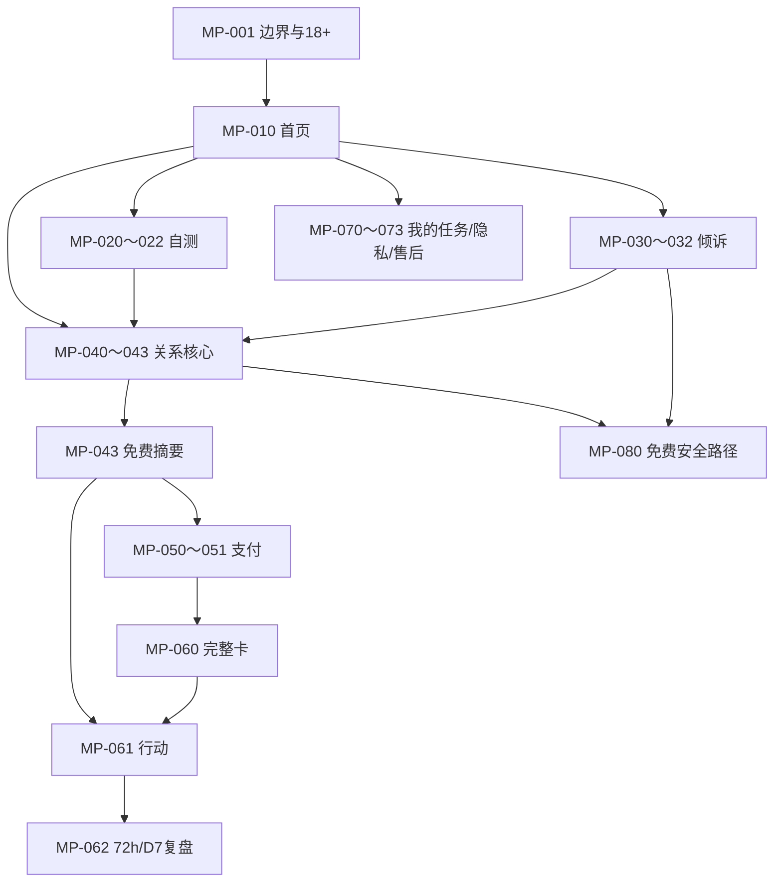
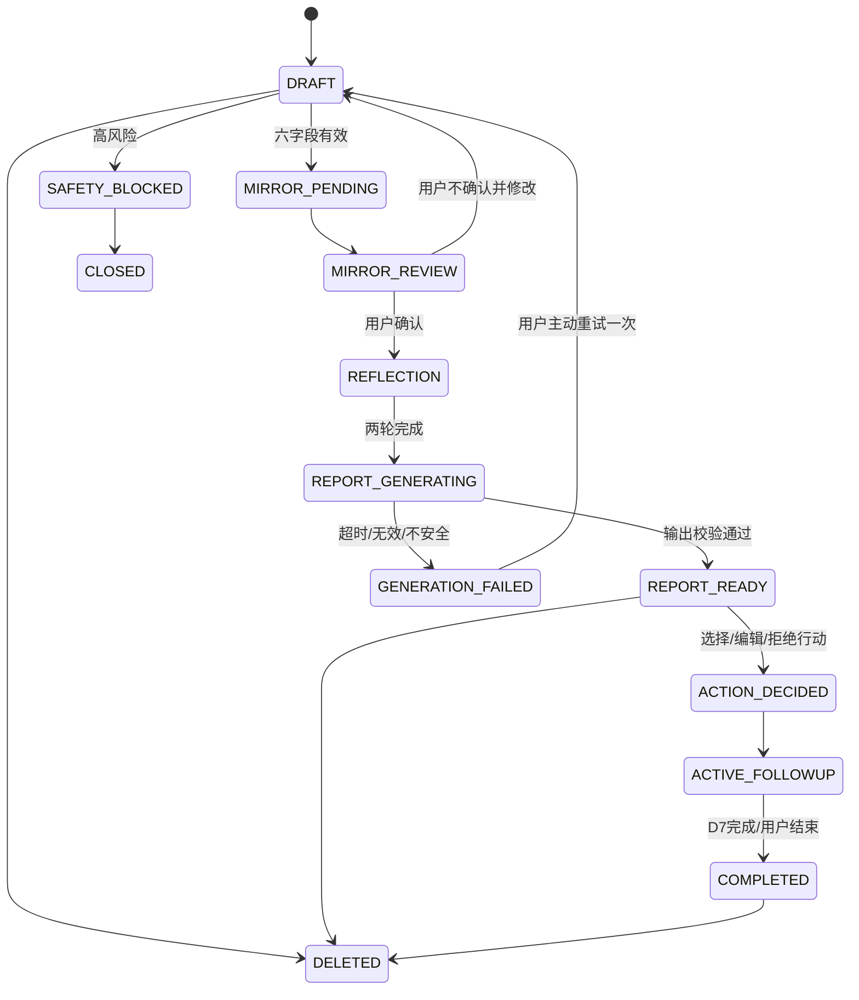

# “关系清晰卡”MVP 产品规格说明书

> 本文把已批准的 P0 PRD 展开为可供交互设计、开发、测试、安全评审和运营验收共同使用的产品合同。它不批准公开上线，也不把黄历、搬家、星座、八字、紫微、求签、解梦、运势、财运等候选能力带回首版。

## 0. 文档控制

| 项目 | 定义 |
|---|---|
| 产品工作名 | 关系清晰卡 |
| 版本 | MVP 1.0 Review |
| 核心价值 | 把一件关系困惑拆成事实、推测、情绪、需要/边界、目标和低风险下一步 |
| 产品结构 | 关系清晰度核心可直达；关系应对模式自测、深夜倾诉为两个辅助入口 |
| 收费 | 免费安全摘要 + ¥19.90 一次性完整卡；7 天复盘已包含 |
| 首发用户假设 | 24–35 岁、近期发生具体关系事件的高线城市职场女性；三四线同条件用户作为对照 |
| 用户硬条件 | 18+；本人正在处理一件近期关系事件；接受 AI 身份与边界说明 |
| 当前发布边界 | 允许原型、封闭 Alpha 和支付沙箱；公开版须通过 PRD 的 SC-20/G1～G6 |
| 产品负责人保留权 | 公开发布、深夜倾诉是否开放、模型/主体/类目、真实支付扩量和任何 P1/Lab 晋级 |

### 0.1 规格优先级

冲突时按以下顺序处理：法律/平台和安全硬闸 → 主 PRD 的 Active-P0 FR/NFR/AC → 本规格 → 原型和历史代码。旧 H5 的星座、塔罗、八字、会员、积分、分享奖励和 Mock 支付不是现行需求。

### 0.2 术语

| 术语 | 定义 |
|---|---|
| 合格曝光 | 满足年龄、近期事件和实验去重条件，并完整看到入口承诺的一个曝光 |
| 任务 | 围绕一件关系事件，从输入到行动/复盘结束的有限生命周期对象 |
| 六字段 | `context`、`observed_fact`、`interpretation`、`emotion`、`need_or_boundary`、`next_step_goal` |
| QCA | 完成入口适配或核心直达、两轮反思、确认免费摘要并主动选择/编辑一个 48 小时行动 |
| 免费摘要 | 不以制造恐惧为目的的完整基础交付，包含安全信息和用户自己的下一步 |
| 完整卡 | 三种解释、限制、最多三项行动、沟通草稿和一次 D7 复盘的付费固定交付 |
| 密封报告 | 已生成并通过输出安全校验、尚未取得查看权益的完整卡 |
| Fail-Closed | 风险、模型、审核或支付依赖异常时关闭普通生成/支付，不用不安全降级继续服务 |

## 1. 产品合同

### 1.1 一句话产品

面向正在为一件关系事件反复猜测的成年人，用一次有限、可校准的 AI 结构化任务，帮助其区分事实和解释，形成一个低风险、可撤回、可复盘的现实行动。

### 1.2 用户承诺

产品承诺“帮你把问题看清一点并决定一个小的下一步”，不承诺“看穿对方、预测结局、诊断人格、替你决定或一直陪着你”。

### 1.3 第一性约束

1. 免费安全信息不得被付费墙截断。
2. AI 的复述必须由用户确认；未确认内容不能进入报告事实层。
3. 支付前完整卡必须已生成、通过校验并可交付。
4. 关系内容、交易记录、分析事件必须分域；分析系统不得接收原文。
5. 每个任务在 D7 复盘后结束；不存在长期情感记忆、连续签到和无限聊天。
6. 自测和倾诉只有在提高核心 QCA、清晰度和行动时才有存在价值。

## 2. 用户、场景与任务

### 2.1 首批角色

| 角色 | 进入时刻 | 要完成的事 | 产品不得做 |
|---|---|---|---|
| 核心直达用户 | 暧昧、冲突、分手、婚恋/家庭/朋友/职场关系选择 | 理清一件事并决定下一步 | 读心、预测、替用户作重大决定 |
| 自测入口用户 | 想先从“我通常怎么应对”开始 | 看见当下倾向并进入具体事件 | 永久标签、临床量表、伪造测评科学性 |
| 倾诉入口用户 | 夜间情绪高点，需要先表达 | 在有限时间内说出来并整理成结构 | 固定人格、承诺陪伴、延长时长、主动召回 |
| 安全分流用户 | 出现自伤、伤人、家暴、跟踪、性胁迫、勒索、诈骗等 | 免费获得现实求助路径 | 继续普通建议、收费、冒充急救 |
| 付费用户 | 免费摘要后想获得更完整行动方案 | 明确购买固定交付并立即解锁 | 自动续费、次数包、恐惧加购、报告未就绪先扣款 |
| 复盘用户 | 行动后 72 小时或 7 天内 | 记录真实结果、修正原判断并结束任务 | 制造连续任务或重复求证 |

### 2.2 支持的 P0 关系情境

`dating_or_partner`、`breakup_or_separation`、`marriage_or_family`、`friendship`、`workplace_relationship`、`other_relationship`。所有情境使用同一输出结构；职场关系不提供劳动法结论，婚姻/家庭不提供法律或医疗结论。

### 2.3 不进入普通流程的请求

- 用户未满 18 岁。
- 正在发生的生命危险、自伤/伤人计划、家暴、跟踪、性胁迫、勒索或重大诈骗。
- 医疗诊断、用药建议、法律结论、投资/转账决定。
- 要求判断第三人真实心理、忠诚、出轨、复合、结婚或命运结果。
- 要求 AI 与现实支持隔离、保密同盟或排他关系。
- 上传或输入第三人的身份证明、账号、住址、聊天截图或其他不必要个人信息。

## 3. MVP 功能总表

| 功能 ID | 功能 | 优先级 | 对应 FR | 交付端 |
|---|---|---:|---|---|
| P0-01 | 首次边界确认、18+、匿名访客会话 | Must | FR-031～032、048 | 小程序/API |
| P0-02 | 首页三路径与最近任务 | Must | FR-031、046 | 小程序 |
| P0-03 | 6–8 题关系应对模式自测 | Must | FR-033～035 | 小程序/API |
| P0-04 | 自测结果与脱敏分享预览 | Must | FR-034～035 | 小程序/API |
| P0-05 | 深夜倾诉：限时、限轮、随时结束 | Must/受闸 | FR-038、043～044 | 小程序/API/AI |
| P0-06 | 六字段关系任务编辑器 | Must | FR-036～037 | 小程序/API |
| P0-07 | 输入、生成前、输出后三道安全检查 | Must | FR-038、050 | API/运营 |
| P0-08 | 两轮有效反思与用户确认复述 | Must | FR-036、039～040 | 小程序/API/AI |
| P0-09 | 免费安全摘要 | Must | FR-041 | 小程序/API |
| P0-10 | 完整卡生成、密封与安全验证 | Must | FR-039～041 | API/AI |
| P0-11 | ¥19.90 单次购买与即时解锁 | Must/受闸 | FR-041～042、050 | 小程序/API/微信支付 |
| P0-12 | 退款、交付故障和客服 | Must | FR-042、050 | 小程序/API/运营 |
| P0-13 | 48 小时行动选择、编辑或拒绝 | Must | FR-041、045 | 小程序/API |
| P0-14 | 一次性提醒授权、72 小时结果、D7 复盘 | Must | FR-046 | 小程序/API |
| P0-15 | 历史任务、复制、分别删除、删除回执 | Must | FR-047～048 | 小程序/API |
| P0-16 | 版本、AI 标识、纠错、投诉 | Must | FR-047 | 小程序/API/运营 |
| P0-17 | 无原文埋点、实验分组、QCA/商业指标 | Must | FR-049 | API/数据 |
| P0-18 | 自测/倾诉/生成/支付/提醒独立开关 | Must | FR-050 | 运营/API |
| P0-19 | 版本发布、评测证据、回滚和审计 | Must | FR-047、050 | 运营 |

### 3.1 明确不做

黄历、婚丧嫁娶、搬家、星座、紫微、八字、取名、测字、求签、解梦、运势、财运、社区、达人、广告、会员、虚拟币、连续聊天、语音、图片/聊天截图上传、通讯录、精确位置和第三人画像均不进入 P0 导航、接口或数据库枚举。

## 4. 信息架构与页面清单



| 页面 ID | 页面 | 核心组件/操作 | 进入条件 | 完成条件 |
|---|---|---|---|---|
| MP-001 | AI 身份、适用边界与 18+ | AI 标识、非治疗/预测说明、隐私摘要、18+ 确认 | 首次互动或政策版本变化 | 同意当前政策；未成年进入终止页 |
| MP-010 | 首页 | 核心直达主按钮、自测/倾诉次入口、最近任务、帮助 | 有有效访客会话 | 选择一个路径 |
| MP-020 | 自测说明 | 用途、非诊断、题数、数据处理 | 已完成 MP-001 | 主动开始 |
| MP-021 | 自测题目 | 单题单页/进度/返回/退出 | 自测运行中 | 完成 6–8 题 |
| MP-022 | 自测结果 | 当前倾向、优势、盲点、提醒、进入核心、分享预览 | 计分完成 | 结束、分享或确认映射进入核心 |
| MP-030 | 倾诉说明 | 限轮限时、随时结束、无实时救援说明 | 功能开关开启且已完成 MP-001 | 主动开始 |
| MP-031 | 倾诉会话 | 文字输入、剩余时间/回合、结束并整理、删除退出 | 会话 ACTIVE | 用户结束、到时/到轮或安全分流 |
| MP-032 | 倾诉总结确认 | 五段总结、逐字段编辑、进入核心/删除退出 | 会话 SUMMARIZING | 用户确认或退出 |
| MP-040 | 关系任务输入 | 关系类型、六字段、清晰度前测、代称/PII 提示 | 核心直达或入口映射 | 最小字段有效且安全检查通过 |
| MP-041 | AI 镜像复述 | 分字段复述、准确/部分/不准确、逐字段编辑 | AI 复述已就绪 | 用户确认 |
| MP-042 | 两轮反思 | 事实与解释；需要/边界与目标 | 复述确认 | 两轮有效回答完成 |
| MP-043 | 免费摘要 | 已确认事实/猜测、情绪/需要、边界提醒、安全限制、本人行动 | 输出检查通过 | 用户选择/编辑/拒绝行动；可结束或购买 |
| MP-050 | 购买确认 | 主体、价格、交付、时限、限制、客服、退款、无续费 | 密封完整卡 READY | 主动勾选确认并调用支付 |
| MP-051 | 支付状态 | 等待、成功、取消、未知、失败、退款中 | 已发起微信支付 | 权益授予或回到免费摘要 |
| MP-060 | 完整关系清晰卡 | 三种解释、证据/不确定性、风险限制、≤3 行动、草稿、版本 | 权益有效 | 查看/复制/选择行动 |
| MP-061 | 48 小时行动 | 比较、编辑、拒绝、保存；提醒默认关闭 | 免费摘要或完整卡 | 行动状态为 SELECTED/REJECTED |
| MP-062 | 72h/D7 复盘 | 事实结果、清晰度后测、是否结束/求助 | 到期或用户主动进入 | D7 完成并结束任务 |
| MP-070 | 我的任务 | 当前任务、已结束任务、到期提示 | 有本地会话；付费/提醒时已绑定微信身份 | 打开具体任务 |
| MP-071 | 数据与版本 | 字段用途、保留期、模型/Prompt/政策/报告版本、复制 | 任意任务 | 查看、复制或发起删除 |
| MP-072 | 删除与回执 | 原始输入/报告分别选择、影响说明、二次确认、回执 | 有可删除数据 | 后端和供应商删除完成/待完成可追踪 |
| MP-073 | 帮助/纠错/投诉/退款 | 分类、订单选择、进度、客服时段 | 始终可达 | 工单创建 |
| MP-080 | 免费安全路径 | 场景化资源、立即危险提示、退出/删除、非实时救援声明 | 高风险或用户主动打开 | 用户离开；不得进入支付 |

## 5. 端到端流程与状态

### 5.1 主流程

1. 创建匿名访客会话，展示当前政策和 AI 边界。
2. 用户确认 18+，选择核心直达、自测或倾诉。
3. 辅助入口只生成用户可确认的字段映射；核心也可直接填写六字段。
4. 每次自由文本提交先进行 PII 遮蔽和输入安全检查。
5. AI 生成镜像复述，用户逐字段校准；完成两轮反思。
6. 编排器一次生成“免费摘要 + 完整卡”，输出安全检查通过后：免费部分公开、完整部分密封。
7. 用户先选择/编辑/拒绝本人提出的 48 小时行动；需要完整卡时进入支付。
8. 只有密封报告处于 READY 才能创建 ¥19.90 订单；支付成功只授予查看权益。
9. 用户可选择一次提醒，记录 72 小时结果和 D7 复盘；任务结束。
10. 用户可随时复制、删除、纠错、投诉或退款；高风险全程绕过支付。

### 5.2 任务状态机



### 5.3 深夜倾诉状态机

`CREATED → ACTIVE → SUMMARIZING → USER_REVIEW → CONFIRMED → HANDED_TO_CORE → CLOSED`。任一自由文本可触发 `SAFETY_BLOCKED`；8 个 AI 回合或 10 分钟先到触发 `LIMIT_REACHED`，只能总结、删除或退出，不能继续追问。

## 6. 详细功能规格

### 6.1 P0-01 首次边界、年龄与会话

**输入**：政策版本、18+ 确认、可选实验来源。不得收生日、身份证、手机号、昵称、头像。

**规则**：

- 未确认 18+ 不进入互动；选择未成年时不创建内容任务和实验标识。
- 免费任务使用随机 `visitor_id`。只有支付、跨设备取回或提醒需要时，才在单独告知后通过微信登录绑定 `principal_id`；不获取昵称/头像/手机号。
- 若专项判断要求相关 AI 服务先注册/核验年龄，配置 `compliance_mode=registered`；无法满足时关闭倾诉/普通生成，不用弱确认绕过。
- 政策版本变化且处理目的/数据流有实质变化时重新同意。

**埋点**：只记录 `boundary_viewed`、`adult_confirmed`、政策版本和结果枚举，不记录页面输入原文。

### 6.2 P0-02 首页与最近任务

- “直接理清关系”为唯一主视觉 CTA；“先做一个小测试”“今晚先说出来”为次级入口。
- 不展示 P1/Lab 的敬请期待、排行榜、每日签到、运势或社区入口。
- 最近任务只显示中性标题（如“一个关系任务 · 7月18日”），不在通知/首页暴露关系类型和文本。
- 模块关闭时不显示虚假入口；安全页、删除、纠错、售后始终可达。

### 6.3 P0-03 关系应对模式自测

**题目合同**：默认 8 题，可配置为 6–8 题；每题一个近期关系压力情境、四个非优劣选项。题目维度为：

1. 不确定信息下是否先核对事实；
2. 延迟回复时的第一反应；
3. 冲突后是否直接表达需要；
4. 边界被触碰时的处理；
5. 寻求确认的频率与方式；
6. 情绪高点的暂停能力；
7. 是否把猜测当作事实；
8. 是否选择本人可执行的小行动。

**计分合同**：每个选项只给 `evidence_checking`、`direct_expression`、`self_protection`、`emotion_regulation` 中一个维度 +1；总分仅用于当前任务。最高维度领先第二名 ≥2 时输出一个当前倾向；否则输出“混合倾向”。不输出概率、人格类型、依恋类型或临床判断。

**结果固定结构**：`current_tendency`、`usable_strength`、`possible_blind_spot`、`one_real_world_reminder`、`assessment_version`、`license_source`、`boundary_copy`。

**进入核心映射**：只允许用户确认后把“盲点/提醒”映射为 `interpretation` 或 `next_step_goal` 的候选；不得自动写入 `observed_fact`。

**隐私**：原始答案只在临时任务域保存，结果生成后默认 24 小时删除；分析事件只含完成、耗时桶和题库版本。

### 6.4 P0-04 分享预览

- 分享内容只有中性结果标题、一个优势、一个提醒、产品 AI 标识和版本；不含答案、分数、关系文本、城市、负面标签或付费状态。
- 必须先显示预览并提供取消；分享失败不影响结果或核心进入。
- 不设置分享解锁、分享奖励、通讯录邀请、连续任务或“朋友都在测”的虚假社证。

### 6.5 P0-05 深夜倾诉

**输入限制**：单条 1–1000 个 Unicode 字符；总用户文本不超过 4000 字符；禁止图片、语音、文件和链接预览。

**AI 行为**：每回合只做一项：简短复述、询问一个可观察事实、区分循环想法、确认情绪/需要、询问是否结束整理。不得使用姓名、亲昵称呼、恋人/闺蜜/导师口吻，不说“只有我懂你”“我会一直在”。

**结束总结**：`observed_fact`、`looping_thought`、`emotion`、`need_or_boundary`、`next_step_goal`。只有用户逐字段确认后才映射到核心；未确认文本不进入报告。

**计时/计轮**：服务端保存开始时间和 AI 回合数，客户端只展示；不得通过改本地时钟或重装页面重置同一会话限制。

**公开开关**：在拟人化互动适用性结论、危机流程和人工责任未签字前，生产环境默认 `vent_enabled=false`；封闭测试可按白名单开启。

### 6.6 P0-06 六字段核心编辑器

| 字段 | 类型/限制 | 最小要求 | 示例提示 | 禁止内容处理 |
|---|---|---|---|---|
| `context` | 枚举 | 必填 | “这件事属于哪类关系？” | 不接受自由填写第三人身份 |
| `observed_fact` | 文本 20–500 字 | 至少一个可观察行为/原话概括 | “像摄像机能记录到的事” | PII 遮蔽；只有猜测则要求补充 |
| `interpretation` | 文本 0–500 字 | 可为空 | “你担心这意味着什么？” | 永远标记为用户解释，不提升为事实 |
| `emotion` | 1–3 个枚举 + 可选 30 字补充 | 至少一个 | 焦虑/受伤/愤怒/困惑/难过/希望 | 不据此诊断 |
| `need_or_boundary` | 1–3 个枚举 + 0–300 字 | 至少一个 | 清晰/尊重/空间/连接/安全 | 高风险安全需要触发检查 |
| `next_step_goal` | 枚举 + 0–200 字 | 必填 | 沟通/暂停/设边界/退出/寻求现实支持 | 不允许监控、报复、转账等目标 |
| `clarity_pre` | 整数 0–10 | 必填 | “现在你有多清楚下一步？” | 只用于前后测，不用于画像 |

输入前提示使用“A/B/对方”等代称。手机号、身份证号、邮箱、精确地址、银行卡号、社交账号命中时先在客户端提示，再由服务端遮蔽；第三人身份不作为报告信息。

### 6.7 P0-07 三道安全检查

| 检查点 | 输入 | 结果 | 失败策略 |
|---|---|---|---|
| S1 输入检查 | 本轮遮蔽后文本 + 年龄状态 | `allow / clarify / block` + 风险类别 | block 立即进入 MP-080；不调用普通模型/支付 |
| S2 生成前检查 | 用户确认的六字段 + 目标 | 允许的生成边界、禁止建议列表 | 服务不可用则 Fail-Closed |
| S3 输出检查 | 模型结构化输出 | Schema、事实归属、禁区、安全类别 | 不合格不展示、不密封、不允许支付 |

高风险类别至少包括：`minor`、`immediate_danger`、`self_harm`、`harm_to_others`、`relationship_violence`、`stalking_or_coercion`、`sexual_coercion`、`fraud_or_blackmail`、`clinical_request`、`legal_request`、`financial_decision`、`prediction_or_mind_reading`、`dependency_request`、`privacy_or_secret`、`prompt_injection`、`unauthorized_access`。

规则命中不是临床诊断。模糊样例可进入安全澄清，但澄清期间禁止支付。人工复核队列只保存必要的脱敏片段或受控加密引用，普通运营不可见原文。

### 6.8 P0-08 镜像复述与两轮反思

**镜像复述**必须分别展示“你确认发生的”“你现在的解释”“你的感受”“你想保护/获得的”“你要解决的”。每段可选 `准确 / 部分准确 / 不准确` 并编辑；全部确认前不得继续。

**反思 1**：让用户标出哪些句子是可观察事实，哪些仍需验证。有效完成要求至少确认一个事实和一个“未知/待验证”项。

**反思 2**：让用户选出当前最重要的需要/边界以及一个本人可执行目标。有效完成要求不以第三人改变作为唯一成功条件。

AI 最多重新生成镜像一次；仍不准确时允许用户直接编辑或结束，不通过循环生成提高时长。

### 6.9 P0-09 免费摘要

免费摘要必须包含：

1. 用户确认的事实与待验证解释；
2. 当前情绪/需要和一个基础边界提醒；
3. 不确定性与产品限制；
4. 全部适用安全信息；
5. 用户本人填写的目标，可编辑为一个 48 小时行动或明确拒绝。

免费摘要不得写“还有一个坏消息”“只有付费才能知道结果”等恐惧话术，不得把安全建议、删除、纠错或客服隐藏在付费后。

### 6.10 P0-10 完整卡与密封

编排器一次生成一个版本化结构对象，免费摘要是该对象的安全子集，完整部分在用户付费前保持密封。输出 Schema：

```json
{
  "confirmed_facts": [{"text": "string", "source": "user_confirmed"}],
  "unverified_interpretations": [{"text": "string", "confidence": "unknown"}],
  "emotion_and_needs": {"emotions": ["enum"], "needs_or_boundaries": ["enum|string"]},
  "current_goal": "string",
  "possible_explanations": [
    {"explanation": "string", "supporting_signals": ["string"], "missing_evidence": ["string"]}
  ],
  "risks_and_limits": ["string"],
  "candidate_actions": [
    {"category": "communicate|pause|boundary|step_back|real_world_support", "action": "string", "reversible": true, "success_observation": "string", "stop_condition": "string"}
  ],
  "communication_draft": {"text": "string", "editable": true},
  "safety_resources": ["resource_id"],
  "versions": {"model": "string", "prompt": "string", "safety": "string", "template": "string"}
}
```

`possible_explanations` 固定 3 项；每项必须包含缺失证据，不能按概率排序为“真相”。`candidate_actions` 为 1–3 项，全部低风险、本人可做、48 小时内可开始、可撤回，并含成功观察与停止条件。报告通过 S3 后状态为 `SEALED_READY`，此后才允许创建支付订单。

### 6.11 P0-11 支付与解锁

- SKU 固定为 `RELATIONSHIP_CLARITY_CARD_V1`，金额由服务端商品版本决定，首轮为 1990 分；客户端金额不可信。
- 购买页只在报告 `SEALED_READY` 时展示；用户主动确认固定交付、退款和无续费后才发起微信支付。
- 微信回调验签、查单和业务幂等成功后，在同一业务事务中写入支付状态和查看权益；客户端支付返回值不作为到账依据。
- 同一任务只允许一个有效已支付权益；重复创建返回原订单/当前状态，不重复扣款。
- 支付取消保留免费摘要且不连续弹窗；支付状态未知时显示“正在确认”，后台查单，不让用户盲目重付。

### 6.12 P0-12 退款与售后

自动全额退款最低条件：重复扣款；微信已支付但 10 分钟内仍未获得权益；密封报告损坏/不可读取；系统错误交付错误任务。退款过程中报告权益冻结，完成后撤销。

内容争议、误导投诉和其他退款通过 MP-073 提交并人工复核；不得使用“数字商品一律不退”作为默认规则。最终对外退款条款需由主体、微信支付和消费者权益评审共同确认。

客服工单分类：`billing`、`refund`、`delivery`、`safety`、`privacy`、`misleading`、`correction`、`other`。普通客服只看订单元数据和用户主动提供的说明，不默认读取关系内容。

### 6.13 P0-13/P0-14 行动、提醒与复盘

- 用户可从候选行动选一个、编辑一个、使用免费摘要中的本人行动，或明确拒绝。
- 禁止行动：跟踪、试探、监控、威胁、报复、公开曝光、欺骗、擅自查看设备/账号、转账、停药、阻断现实支持。
- 提醒默认关闭；每个 72 小时或 D7 提醒分别授权，文案只写“你有一个自己保存的待复盘任务”，不含关系/情绪内容，不在 22:00–08:00 推送。
- 72 小时记录 `did_action=yes|partly|no` 和可选中性原因枚举。
- D7 记录实际可观察结果、`clarity_post`、原解释是否被支持/推翻、结束/继续现实支持。完成后任务 `COMPLETED`，不自动开启新任务。

### 6.14 P0-15/P0-16 数据控制、版本与纠错

- 用户可分别复制/删除原始输入、结构化报告、行动/复盘；订单法定记录不随内容删除，但必须断开内容关联用于画像。
- 删除后前台立即隐藏；后端与适用供应商 24 小时内完成并产生回执。失败进入人工队列且对用户可见状态。
- 每份报告显示生成时间、模型/Prompt/安全/模板版本和 AI 标识；版本更新不静默重算历史报告。
- 纠错可针对事实归属、表述、安全、版本或交付；纠错结果形成新版本或备注，原版本保留审计指纹但不继续展示已删除原文。

### 6.15 P0-17/P0-18/P0-19 分析与运营能力

运营后台最小模块：

1. 功能开关：自测、倾诉、普通生成、支付、提醒分别启停；安全页/删除/售后不可关闭。
2. 版本中心：题库、Prompt、模型、规则、报告模板、政策版本及生效窗口。
3. 发布中心：评测证据、许可/SBOM、平台结论、回滚点、人类签字。
4. 安全队列：风险类别、动作、脱敏引用、复核结果和 SLA；无普通原文检索。
5. 订单/退款/对账：金额、状态、交付权益、异常和人工操作审计。
6. 删除/投诉/纠错：状态、时限、责任人和回执。
7. 无原文指标：曝光、QCA、清晰度、支付、退款、投诉、行动、复盘及实验版本。

## 7. 产品业务规则

| 规则 ID | 规则 |
|---|---|
| BR-001 | 一个任务只围绕一件关系事件；用户要处理第二件事必须新建任务 |
| BR-002 | 未确认的 AI 复述、测试倾向和模型推断不能进入 `confirmed_facts` |
| BR-003 | 三种解释必须并列展示且包含缺失证据，不得输出唯一真相或结局概率 |
| BR-004 | 高风险优先级高于生成、实验、支付、提醒和增长逻辑 |
| BR-005 | 报告未 `SEALED_READY` 不得创建支付订单 |
| BR-006 | 金额、SKU、交付状态只信服务端；客户端不得传入最终金额 |
| BR-007 | 一个任务最多一个有效完整卡权益；退款成功后权益失效 |
| BR-008 | 免费摘要中的本人行动不因未支付而失效 |
| BR-009 | 自测/倾诉入口关闭不影响核心直达；普通生成关闭时只保留静态安全/删除/售后 |
| BR-010 | 原文不得进入分析事件、普通日志、告警文本、URL、分享卡或客服默认视图 |
| BR-011 | D7 后任务结束；系统不以时长、消息数、夜间复访或亲密度优化 |
| BR-012 | 城市队列只影响实验归因，不影响价格、输出质量、安全或功能 |

## 8. 事件与指标合同

### 8.1 允许的事件

| 事件 | 最小属性 |
|---|---|
| `qualified_exposure` | experiment_id、variant、batch、coarse_city_tier、version |
| `boundary_completed` | policy_version、adult_confirmed |
| `entry_started/completed` | entry_type、duration_bucket、assessment_version |
| `core_field_completed` | field_key、length_bucket；无内容 |
| `mirror_confirmed` | accuracy=accurate/partial/inaccurate、turn_count |
| `reflection_completed` | reflection_index、duration_bucket |
| `free_summary_viewed/confirmed` | report_template_version |
| `action_selected/edited/rejected` | action_category；无行动文本 |
| `sealed_report_ready` | model/prompt/safety/template version、latency_bucket |
| `payment_started/succeeded/failed/refunded` | order_id、SKU、amount_fen、reason_code |
| `report_unlocked` | entitlement_id、delivery_latency_bucket |
| `followup_72h_completed/d7_review_completed` | action_result、clarity score、returned_voluntarily |
| `safety_route_triggered` | route、check_point、rule_version；无原文 |
| `delete_requested/completed` | scope、receipt_status、duration_bucket |
| `complaint_submitted/resolved` | category、severity、resolution_code |

### 8.2 禁止属性

任何原始测试答案、关系文本、完整报告、第三人信息、姓名/电话/邮箱/地址、精确位置、聊天截图、模型原始 Prompt、访问令牌和支付凭据均不得进入分析事件。事件采集端采用字段白名单，未知字段丢弃而非透传。

### 8.3 指标计算

- `QCA = entry_or_direct_complete AND reflections>=2 AND free_summary_confirmed AND action_decided AND no_guardrail_failure`。
- 净支付率分母为版本化合格曝光，分子为退款后净付款用户；同时报告绝对数。
- 变动贡献 = 实收 - 退款 - 支付费 - 模型费 - 可归因获客费 - 可归因售后费 - 已确认事故损失。
- 城市赢家只按 PRD SC-19；样本不足、只赢 CTR 或安全/退款劣化时写“无赢家”。

## 9. 文案与内容规则

**允许**：事实/推测分离、可能性并列、承认不知道、低风险行动、鼓励现实支持、版本与 AI 标识。

**禁止**：

- “他一定不爱你”“你们会复合”“你天生缺爱”等读心、预测或诊断。
- “结果非常严重，付费才能化解”“仅剩 5 分钟”等恐惧和虚假紧迫。
- “我是你的闺蜜/导师/命理师”“我永远陪你”“别告诉别人”等依赖型拟人化。
- “准确率 95%”“超过 90% 的人验证有效”等无证据精确主张。
- “治疗焦虑/抑郁”“替代咨询”等医疗化承诺。

默认语气：中性、尊重、短句、不过度亲密；尽量用“根据你确认的信息”“一种可能解释”“还需要哪些现实证据”。

## 10. 空状态、失败状态与降级

| 场景 | 用户反馈 | 系统动作 |
|---|---|---|
| 输入为空/过短 | 提示补一个摄像机可记录的事实 | 不调用模型，不制造总结 |
| 全部是猜测 | 展示事实/解释示例 | 允许退出；不把猜测转事实 |
| 用户不确认复述 | 逐字段编辑或重生成一次 | 未确认内容不进报告 |
| 高风险 | 显示 MP-080 免费资源与退出/删除 | 停止生成/支付，记录无原文安全事件 |
| 安全服务不可用 | “当前无法安全处理这类内容” | 倾诉、生成和支付关闭；静态资源可用 |
| 模型超时/无效输出 | 明确失败，可主动重试一次 | 不展示半成品，不允许支付 |
| 密封报告未就绪 | 不展示购买按钮 | 继续保留免费摘要 |
| 用户取消支付 | 回到免费摘要 | 不反复弹窗，不丢任务 |
| 支付结果未知 | 显示确认中 | 后台查单，禁止重复发起新订单 |
| 已支付权益未授予 | 显示订单与客服状态 | 幂等补偿；10 分钟未恢复自动退款 |
| 分享不可用 | 允许复制中性结果 | 不阻断自测或核心 |
| 提醒拒绝/过期 | 手动入口仍可用 | 不重复索权 |
| 删除部分失败 | 显示待处理与预计完成状态 | 队列重试/人工处理，保留回执而非原文 |

## 11. 非功能体验要求

- 免费摘要 P95 ≤8 秒；完整结构对象 P95 ≤20 秒。因为完整卡在支付前已密封，支付成功到解锁 P95 ≤2 秒（不含微信支付交互）。
- 低端设备不因动画阻塞提交；所有关键操作有文本标签、读屏语义、足够对比度和非颜色状态。
- 表单草稿在本地和服务端均使用最小数据；网络断开时不得把自由文本写进 URL、普通日志或分析事件。
- 所有写操作显示明确状态且支持幂等重试；删除、支付和退款不得使用仅客户端成功提示。
- 用户界面不得显示内部风险评分、模型思考过程、系统 Prompt 或“系统判定你危险”等标签。

## 12. 验收与发布门禁

### 12.1 功能验收

本规格的 P0-01～P0-19 必须分别追踪到 FR-031～FR-050，并全部满足主 PRD AC-11～AC-25。没有 FR/AC 的页面、枚举、接口或入口不得作为“顺便功能”进入构建。

### 12.2 自动化验收最小集

1. 三入口映射到同一六字段 Schema，核心始终可直达。
2. 6–8 题确定性计分、混合倾向和无档案流程。
3. 分享卡 100 个隐私样例零泄漏。
4. 倾诉 8 回合/10 分钟服务端限制和随时结束。
5. 镜像复述逐字段确认、两轮反思和未确认隔离。
6. 200+ 独立安全/读心/诊断/预测/注入样例零高严重度漏出。
7. 报告 JSON Schema、事实来源、三种解释、≤3 行动和草稿完整。
8. 报告 READY 前无法创建订单；重复订单/回调/查单零重复扣款。
9. 支付成功权益立即解锁；故障补偿和自动退款。
10. 原文日志/事件扫描零命中；端到端删除 24 小时内完成并有回执。
11. 自测、倾诉、生成、支付、提醒分别关闭且安全/删除/售后仍可用。
12. D7 完成后任务结束，无连续签到、夜间召回或亲密度逻辑。

### 12.3 人类批准项

- 最终题库与许可证、所有面向用户文案。
- 深夜倾诉适用性、危机 SOP 和人工责任。
- 微信主体/类目/准确页面、模型/应用登记和 AI 标识。
- 隐私影响评估、供应商数据条款和删除证据。
- 微信支付真实商户、退款条款、客服和消费者权益文案。
- SC-20 证据包与公开发布决定。

## 13. 分阶段交付边界

| 阶段 | 可开启 | 必须关闭/模拟 | 出口证据 |
|---|---|---|---|
| 本地交互原型 | 三入口、六字段、确定性自测、规则安全、假报告 | 真实 AI、支付、推送、外部数据 | 可点击流程、事件合同、基础测试 |
| 封闭 Alpha | 受控 AI、白名单倾诉、密封报告、支付沙箱/小额支付 | 公开投放、P1/Lab、长期记忆 | AC-11～25、独立安全、删除/支付演练 |
| 公开 Alpha 候选 | 通过批准的核心、自测；倾诉按专项结论 | 任一未过闸 Yellow 模块 | SC-20、人类签字、平台/AI/隐私/支付证据 |

## 14. 待人类确认但不阻塞规格编写的决定

| 决定 | 当前默认 | 推翻/确认材料 |
|---|---|---|
| 公开版是否开放深夜倾诉 | 关闭；封闭白名单开启 | 拟人化互动适用性书面结论、危机演练、平台材料 |
| 最终模型供应商/模型 | 架构使用适配器，不在本文锁厂商 | 备案/登记、合同、数据地域、删除、质量/时延/成本评测 |
| 题库最终 6 题还是 8 题 | 8 题 | Stage 0 完成时间、理解度、核心进入率 |
| ¥19.90 是否长期价格 | 仅首轮固定测试价 | 真支付、退款、投诉、毛利和用户访谈 |
| 报告默认保留 30 天 | 用户主动保存时最多 30 天 | PIPIA、删除演练和用户理解测试 |
| 首要获客人群 | 城市中性；高线主招募、三四线对照 | SC-19 两批同 SKU/同价实验 |

## 15. 规格结论

MVP 不是三个并列产品，也不是缩小版“万花筒玄学平台”。它是一个有限关系决策任务：自测和倾诉只负责把用户带到同一六字段核心；免费摘要先完成基础利他交付；完整卡在支付前生成并通过安全校验；支付只解锁固定交付；行动和 D7 复盘让判断接受现实结果检验，随后结束任务。
