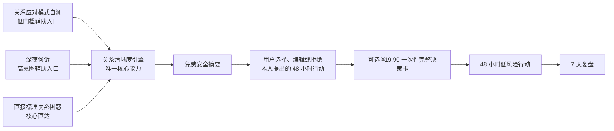
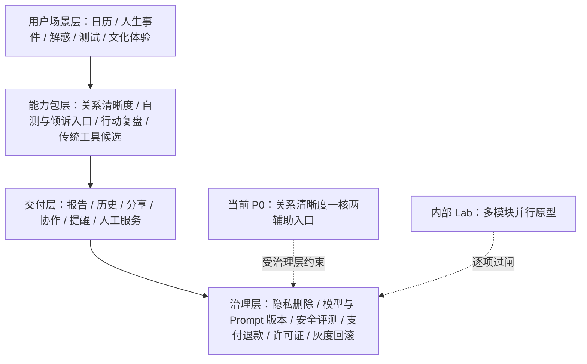
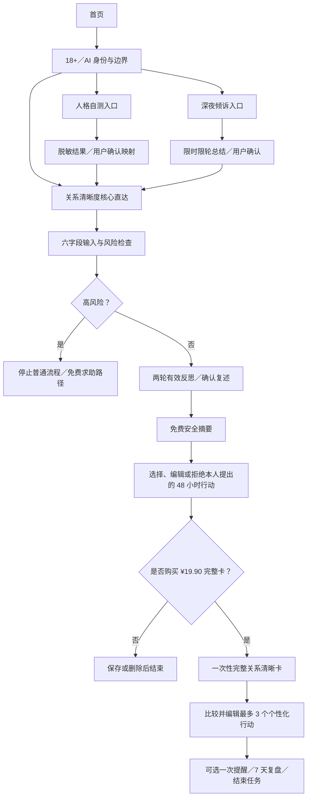
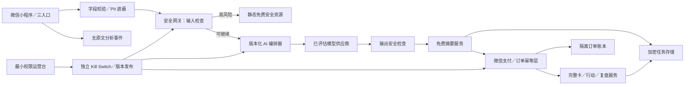

# “测一测”微信小程序：全量产品 PRD 与 MVP 版本规划

> - 文档版本：v1.2-review
> - 证据截止：2026-07-18（中国大陆规则按 Asia/Shanghai 理解）
> - 当前状态：**全量产品蓝图已登记；关系清晰度 P0 规格已确认；封闭原型 Conditional Go；公开上线与收费仍需平台、AI、安全、隐私和支付硬闸**
> - 本轮范围：完整产品能力目录、版本边界、P0 实现契约、需求研究、竞品核验与开源工具审计；**不包含代码实现或上线承诺**

## 0. 结论先行

### 0.1 产品决策

原设想中的黄历、婚丧嫁娶、搬家、事业、爱情、婚姻、求签、解梦、星座、紫微、八字、取名、测字、运势、财运与 AI 解惑，继续完整保留在产品能力地图。研究已推翻“功能登记即首版范围”和“搬家择日天然刚需”两项假设：搬家执行有交易，但尚无搬家择日的直接支付证据；关系不确定、即时倾诉和关系行动的相邻支付证据更强。

AI 编程可以在 2–4 周内完成小程序原型、模型接入、支付沙箱和自动化评测；它不能替代微信真实审核、生成式 AI 应用登记判断、个人信息保护影响评估、危机处置演练或真实付费验证。产品继续采用：

> **广建、窄发、逐闸放行：全量能力写入 PRD，公开 P0 只承诺一个可验证、可停止的关系决策闭环。**

当前 P0 是“**一核两辅助入口，核心可直达**”：

暂定工作名为“**关系清晰卡**”。它不是心理治疗、持续陪伴、人格诊断、命运预测或对第三人内心的判断工具；目标是在一次 5–8 分钟的任务中，把用户的单方描述整理为事实、猜测、情绪、目标、边界、风险与下一步。

### 0.2 Go / No-Go

| 方案 | 决策 | 理由 |
|---|---|---|
| 完整产品蓝图 + 多 Agent 并行原型/验证 | **Go** | 所有原始功能均登记、分层并可研究；代码完成不自动获得公开资格 |
| 关系清晰度核心 + 人格自测/深夜倾诉辅助入口 | **Conditional Go** | 允许低保真、支付沙箱和封闭安全测试；通过平台、AI、隐私、危机、支付与真用户门禁后才可公开 |
| ¥19.90 一次性完整决策卡 + 已包含的 7 天复盘 | **Conditional Go** | 固定交付比按分钟收费更可控；支付、退款、交付失败和脆弱期营销必须先闭环 |
| 持续 AI 陪伴、虚拟恋人/闺蜜、无限深夜聊天 | **No-Go / Never** | 会显著放大依赖、未成年人、危机干预与拟人化互动服务义务；不属于当前路线 |
| 搬家日期比较 + 清单 + 协作卡 | **P1 Candidate** | 继续保留为现实工具候选，但不再拥有当前 P0 实现资格，需单独证明需求 |
| 全套命理占卜 + 运势预测 + AI 社区 + 达人咨询同时公开 | **No-Go** | 微信内容与类目、隐私、AI、供给治理和许可证风险会同时成为发布阻断项 |
| 传统历法、命盘、解梦、占卜等候选能力 | **Lab → Conditional** | 可内部研究；只有平台、隐私、许可证、真值/安全与用户价值门禁全部通过后才可单项灰度 |
| 改命、消灾、恐惧营销、确定性重大结果预测 | **Never** | 只登记在永久禁区，不属于未来路线图，也不能通过换文案变成候选功能 |

**机器可读范围规则：**只有同时满足 phase=P0、status=Approved 且被 FR-031～FR-050 追踪的能力，才属于当前实现契约。旧搬家 FR-001～FR-030 已标记为 Deferred-Moving-P1，不得生成当前版本 Story。CAP 目录中的 P1、Lab、Conditional、Separate 或 Never 项不得出现在 P0 公开首页的“敬请期待”入口。

**开发与公开启动硬闸：**在投入公开版本前，须用准确页面、全部字段、AI/支付/退款流程和完整文案形成微信平台可留存结论或最小审核包；完成生成式 AI 模型/应用登记及标识判断、个人信息保护影响评估、高风险安全测试、危机路由、支付幂等/退款演练和独立 Kill Switch。证据未齐时只允许本地原型、沙箱与受控测试，不宣称可上线。

### 0.3 对“更准确”的重新定义

“准确”不能指读心、预测关系结局或让用户觉得“说得像我”。P0 只承诺四种可验收的准确性：

1. **结构准确**：输出完整区分已知事实、用户猜测、情绪、目标、边界、风险和待验证信息。
2. **校准准确**：AI 先镜像复述，用户可确认“准确/部分准确/不准确”，未经确认的内容不冒充事实。
3. **安全准确**：明确的自伤、伤人、家暴、跟踪、性胁迫、勒索、诈骗和未成年人样例全部进入正确免费安全路径。
4. **行动可复盘**：完整卡只给最多 3 项低风险、可编辑、可拒绝的 48 小时行动，并在 7 天后记录真实结果和推翻条件。

## 1. 证据口径

本报告把证据分为四级：

- **A｜官方或原始材料**：法律法规、监管机关、微信开发者规则、仓库源码和许可证。
- **B｜第一方口径**：公司官网、产品协议、创始人采访。可证明“公司这样说”，不能等同审计事实。
- **C｜可靠二手材料**：主流媒体、学术论文、应用商店开发者披露。需保留方法和利益关系限制。
- **D｜产品推断**：决策矩阵、用户假设和指标阈值。必须经访谈、原型测试或真实数据推翻/确认。

当前微信运营规范和服务类目页是动态页面，未展示完整版本历史。本报告记录的是 2026-07-18 可见内容；提交审核当日必须保存页面截图或存档。公开类目未出现某个词，不等于平台已明确禁止该功能，也不等于允许上线。本报告是产品与技术研究，不替代针对最终页面、主体、数据流和商业化流程的正式法律意见。

## 2. 第一性原理需求分析

### 2.1 本质、约束、最简路径

- **本质**：用户在关系事件中缺的不是更多预测，而是把单方叙述从情绪混乱整理成“已知什么、猜测什么、要保护什么、下一步做什么”。
- **约束**：微信类目与内容审核、用户侧生成式 AI、关系与情绪文本的高敏感性、危机输入、未成年人、¥19.90 真支付、2–4 周验证窗口和当前无成熟小程序基线。
- **最简路径**：一套共享字段和一套关系清晰度引擎；人格自测与深夜倾诉只改变入口语气和输入适配，不各建一套产品；免费安全摘要后一次性收费，48 小时行动后在 7 天内结束任务。

### 2.2 用户真正要完成的任务

主 JTBD：

> 当我在最近发生的暧昧、冲突、分手或婚恋选择中反复猜测时，我希望在不暴露过多隐私、不被诊断或操纵的前提下，区分事实、猜测和情绪，看到几种合理解释，选择一个未来 48 小时能执行的低风险行动，并在 7 天后根据真实结果复盘。

次级任务：

- 用轻量自测看见当前关系应对倾向，但不被永久人格标签定义。
- 在夜间情绪高点先安全地说出来，再结束对话并回到现实行动。
- 获得固定交付和透明价格，不进入按分钟、连续加价或自动续费。
- 必要时停止普通分析，免费获得危机、暴力、诈骗或重大财产风险的求助路径。

### 2.3 首批目标用户

- **核心行为条件**：18 岁以上；最近 14 天发生一件真实关系事件；已接触 AI、人格测试或关系内容；愿意在不用姓名、生日、精确位置和聊天截图的前提下完成 5–8 分钟文字梳理。
- **首发招募队列**：24–35 岁、一线/新一线/二线在职女性。该定义是更低上手阻力的实验先验，不是最终人口结论。
- **强制对照队列**：同年龄、同就业状态、同事件强度、同 AI 熟悉度的三四线女性；城市名单在实验前冻结。
- **产品保持城市中性**：任何满足核心行为条件的成年人均可使用；城市层级只用于经同意的粗粒度实验，不改变价格、输出质量或风险处理。
- **排除/安全转介**：未成年人、正在发生的生命危险、明确自伤/伤人、家暴/跟踪/性胁迫、重大诈骗，以及寻求医疗诊断、法律结论或确定性读心的用户不进入普通付费流程。

### 2.4 一核两辅助入口

三个首页路径共享六个底层字段：`context`、`observed_fact`、`interpretation`、`emotion`、`need_or_boundary`、`next_step_goal`。

| 路径 | 用户承诺 | P0 角色 | 不得演化为 |
|---|---|---|---|
| 关系清晰度直达 | 理清一件关系困惑并决定下一步 | 唯一核心与付费交付 | 读心、预测复合/结婚、替用户作重大决定 |
| 关系应对模式自测 | 看见压力下的当前应对倾向 | 低门槛获客与自我表达入口 | 临床量表、永久人格标签、未授权 MBTI 题库 |
| 深夜倾诉 | 私密说出来，结束反复思绪并整理问题 | 高意图入口；用户主动、有限轮次、任务结束 | 无限聊天、虚拟恋人/闺蜜、长期记忆、依赖召回 |

人格自测和深夜倾诉是否保留，由它们带来的合格核心激活、清晰度、行动和 D7 复盘决定；测试完成率、分享量、消息数和聊天时长不能单独证明价值。

### 2.5 为什么关系清晰度替代搬家成为 P0

| 维度 | 关系清晰度 P0 | 搬家择日候选 |
|---|---|---|
| 原始需求证据 | 测测自报情感需求超过 50%；相邻关系/倾诉市场存在真实支付 | 搬运执行有订单，但未找到搬家择日支付率或复购证据 |
| 付费机制 | 固定价行动减负可做真支付实验 | 日期选择容易被免费日历、搜索和家人意见替代 |
| 任务边界 | 单一关系事件、一次梳理、48 小时行动、7 天结束 | 日期、清单明确，但使用极低频且需求尚未验证 |
| 可验证性 | 清晰度前后测、行动、D7、退款、投诉均可记录 | 可验证硬约束，却不能证明用户愿意为择日付费 |
| 风险 | AI、隐私、危机和付费风险高，必须设置硬闸 | 平台和传统文化风险较高，但技术风险较低 |
| 当前决定 | **风险调整后领先的 P0 假设** | **降级为 P1 Candidate，保留全部能力登记** |

### 2.6 场景路线图

本表是公开发布路线的摘要；完整功能、平台能力和永久禁区以第 3 节 CAP 目录为准。

| 阶段 | 场景 | 处理 |
|---|---|---|
| P0 | 关系清晰度决策卡 | 当前唯一付费核心；核心直达 + 人格自测/深夜倾诉两个辅助入口 |
| P1 候选 | 事业选择行动卡 | 与关系卡同价、同结构另行烟测，不混入当前关系报告 |
| P1 候选 | 搬家、乔迁、婚礼、旅行、开业等现实计划 | 保留日期、清单和协作能力；需求重新验证后单独批准 |
| Lab / Conditional | 黄历宜忌、星座、八字、紫微、取名、测字、求签、解梦、占卜、运势、AI 解惑 | 可内部实现；只有子 PRD 与六道门禁通过后才单项灰度 |
| Separate PRD | 丧葬礼俗、财务工具、会员、达人、社区、持续陪伴 | 供给、UGC、长期互动或高风险闭环需独立立项；持续依赖型陪伴仍为 Never |
| Never | 改命、消灾、财运保证、生死/疾病/投资/诉讼预测、付费化解 | 只保留为永久禁区，不属于未来路线图 |

### 2.7 需求强度与证据边界

已核事实是：关系/情绪社交存在百万级真实付费；测测创始人称情感需求超过一半、用户八成为女性且多数来自一线城市、会员订阅为主要收入；下沉市场规模和 AI 渗透同样巨大。不能据此推出“固定价 AI 关系卡”已经有支付率，也不能把社交礼物、真人咨询或会员 ARPPU 外推到本 SKU。

本阶段不做虚假的 TAM/SAM/SOM。最低证明顺序是：Stage 0 用 30 名真实事件用户验证问题与交付 → Stage 1 三入口各至少 100 个合格曝光、真支付样本至少 200 个曝光和 20 个净付款 → Stage 2 同 SKU、同价格的城市队列真支付 → D30/D90 后再讨论健康 LTV。任何阶段若只有点击、测试完成或聊天时长领先，结论必须写“无赢家”。

## 3. 全量产品能力地图（CAP）

### 3.1 CAP、FR 与发布状态的区别

- **CAP（产品能力）**回答“完整产品可能覆盖什么”，本节收录全部原始设想和必要的平台能力。
- **FR（功能需求）**回答“当前批准版本必须实现什么”，当前只为 P0 Approved 能力建立实现契约。
- **Gate（发布门禁）**回答“一个能力凭什么从研究/原型进入公开灰度”。

| 阶段 | 含义 | 能否进入当前开发 Story | 能否公开展示 |
|---|---|---|---|
| P0 Approved | 首个公开 MVP 的已批准能力 | 是，必须有 FR/AC | 通过发布硬闸后可以 |
| P1 Candidate | P0 证实后再选的低风险扩展 | 否，另行批准后才可以 | 否 |
| Lab | 可用 AI 并行研发、算法与金样验证 | 只允许内部实验 Story | 否 |
| Conditional | 风险门禁通过后才可能灰度 | 否，先补子 PRD 和证据 | 否 |
| Separate PRD | 供给、交易、UGC 或高风险领域，需另立产品闭环 | 否 | 否 |
| Never | 永久禁区；保留是为了约束设计、代码和营销 | 禁止 | 禁止 |

风险等级：Green 为正常工具能力；Yellow 为需平台/隐私/内容/真值或许可证专项证明的能力；Red 为不可通过免责声明或改名规避的禁止形态。

### 3.2 产品能力分层

能力目录共 **217 项**，按 22 个能力包管理：

| 前缀 | 能力包 | 项数 | 前缀 | 能力包 | 项数 |
|---|---|---:|---|---|---:|
| SHELL | 产品壳与导航 | 7 | CAL | 历法/老黄历/择日 | 15 |
| EVT | 人生事件 | 14 | ACT | 现实行动卡 | 8 |
| AIQ | AI 解惑 | 14 | AST | 星座/西方占星 | 7 |
| BAZI | 生辰八字 | 8 | ZW | 紫微斗数 | 6 |
| NAME | 取名 | 8 | CHAR | 测字 | 4 |
| DIV | 求签/塔罗/占卜 | 14 | DREAM | 解梦 | 6 |
| FORT | 运势/运气/财运 | 8 | TEST | 测试 | 7 |
| RPT | 报告 | 11 | ACC | 账户/隐私/提醒 | 10 |
| SHR | 分享/协作 | 8 | PAY | 商业化 | 10 |
| EXP | 达人/人工服务 | 9 | COM | 社区 | 9 |
| OPS | 运营/质量平台 | 17 | SAFE | 安全/发布治理 | 17 |

### 3.3 产品壳与导航

| CAP ID | 功能 | 对用户的产品化输出 | 阶段 | 风险 |
|---|---|---|---|---|
| SHELL-01 | 首页场景入口 | 展示关系清晰度核心直达，以及人格自测、深夜倾诉两个辅助入口 | P0 Approved | Green/Yellow |
| SHELL-02 | 全部能力目录 | 以“已开放/研究中/不提供”说明产品边界，不制造即将上线承诺 | P1 Candidate | Green |
| SHELL-03 | 功能搜索 | 按功能名和用户问题找到已开放能力 | P1 Candidate | Green |
| SHELL-04 | 最近使用与草稿 | 继续当前关系任务、48 小时行动或 7 天复盘；不形成长期人格记忆 | P0 Approved | Yellow |
| SHELL-05 | 收藏 | 保存常用工具、资料和非敏感结果 | P1 Candidate | Green |
| SHELL-06 | 帮助、纠错、投诉 | 查看边界并提交算法、资料、AI 或服务问题 | P0 Approved | Green |
| SHELL-07 | 功能状态标识 | 明确正式、灰度、实验室、停用及版本 | P0 Approved | Green |

### 3.4 老黄历、历法与黄道日历

| CAP ID | 功能 | 对用户的产品化输出 | 阶段 | 风险 |
|---|---|---|---|---|
| CAL-01 | 公历/农历转换 | 标准化日期对应关系 | P1 Candidate | Green |
| CAL-02 | 月历浏览 | 月历、节假日、补班与节气 | P1 Candidate | Green |
| CAL-03 | 二十四节气 | 节气名称、交节时间、来源与版本 | P1 Candidate | Green |
| CAL-04 | 法定节假日与调休 | 日期窗口内的放假/补班事实 | P1 Candidate | Green |
| CAL-05 | 干支、生肖、五行、纳音 | 明确属于传统体系的结构化资料 | Lab → Conditional | Yellow |
| CAL-06 | 每日宜忌 | 指定来源和流派的宜忌资料，不作为现实结论 | Lab → Conditional | Yellow |
| CAL-07 | 黄道日/择日筛选 | 与现实排序分栏的传统候选日期及依据 | Lab → Conditional | Yellow |
| CAL-08 | 吉时查询 | 指定日期的传统时辰资料和来源 | Lab → Conditional | Yellow |
| CAL-09 | 冲煞与方位 | 传统冲合/方位说明，不产生风险恐吓 | Lab → Conditional | Yellow |
| CAL-10 | 彭祖百忌、胎神、十二建星、二十八宿、值神 | 完整老黄历名词、资料和差异说明 | Lab → Conditional | Yellow |
| CAL-11 | 多来源差异展示 | 并列展示不同规则结果，不伪造唯一真相 | Conditional | Yellow |
| CAL-12 | 来源、流派、算法与版本 | 每份日历/传统结果的可追溯信息 | P1 Candidate | Green |
| CAL-13 | 现实约束日期比较 | 候选日期、冲突、理由和待确认事项 | P1 Candidate | Green |
| CAL-14 | 生辰与日期传统匹配 | 个体化传统匹配说明；不进入现实默认排序 | Lab | Yellow |
| CAL-15 | 必吉、必旺、避灾承诺 | 永久不生成确定性吉凶或效果保证 | Never | Red |

### 3.5 人生事件：婚丧嫁娶、乔迁搬家

| CAP ID | 功能 | 对用户的产品化输出 | 阶段 | 风险 |
|---|---|---|---|---|
| EVT-01 | 通用人生事件计划 | 事件日期、参与者、现实约束、任务模板 | P1 Candidate | Green |
| EVT-02 | 搬家日期计划 | 1–3 个不违反硬约束的候选日 | P1 Candidate | Green |
| EVT-03 | 搬家任务清单 | D-30 至 D+7 的可编辑清单与进度 | P1 Candidate | Green |
| EVT-04 | 乔迁准备 | 宾客、场地和家庭协作清单；传统习俗独立分栏 | P1 Candidate | Green/Yellow |
| EVT-05 | 婚礼/嫁娶日期协调 | 双方家庭、场地与服务商的候选日期和待确认事项 | P1 Candidate | Green |
| EVT-06 | 领证计划 | 工作日、登记条件与材料清单 | P1 Candidate | Green |
| EVT-07 | 订婚、纳采、宴请计划 | 现实计划清单与可选文化资料 | P1 → Conditional | Green/Yellow |
| EVT-08 | 丧葬、告别、纪念安排 | 地区实务、机构联系和家庭分工；不判断生死吉凶 | Separate PRD | Yellow |
| EVT-09 | 开业、开工安排 | 人员、场地、许可和业务准备清单 | P1 Candidate | Green |
| EVT-10 | 入职、考试、旅行等节点计划 | 基于期限与约束的行动时间表 | P1 Candidate | Green |
| EVT-11 | 多参与者可用时间 | 日期交集、冲突与待确认人 | P1 Candidate | Green |
| EVT-12 | 服务方与场地档期 | 将结构化第三方档期纳入比较 | P1 Candidate | Green |
| EVT-13 | 事件模板与里程碑提醒 | 可编辑模板与经用户逐次授权的提醒 | P1 Candidate | Green |
| EVT-14 | 因“不吉”阻止事务或制造恐惧 | 永久不输出灾祸后果、付费化解或强制决定 | Never | Red |

### 3.6 事业、工作、爱情、婚姻与 AI 解惑

事业、爱情、婚姻和财运是问题领域，共享同一个“事实—假设—选项—代价—下一步”能力，不分别制造不可验证的预测算法。

| CAP ID | 功能 | 对用户的产品化输出 | 阶段 | 风险 |
|---|---|---|---|---|
| ACT-01 | 事业选择行动卡 | 换工作、留任、转岗等选项比较与低成本实验 | P1 Candidate | Green |
| ACT-02 | 工作问题澄清 | 事实、假设、未知项、利益相关方和下一步 | P1 Candidate | Green |
| ACT-03 | 关系清晰度决策卡 | 关系事实、猜测、情绪、目标、边界、风险、合理解释与行动 | P0 Approved | Yellow |
| ACT-04 | 婚姻沟通准备 | 议题、用户诉求、会谈议程与求助边界；不替第三人画像 | P0 Approved | Yellow |
| ACT-05 | 婚前准备清单 | 财务、居住、家庭、责任和冲突处理议题 | P1 Candidate | Green |
| ACT-06 | 分手/冲突后行动卡 | 冷静期行动、安全检查和必要的专业求助 | P0 Approved | Yellow |
| ACT-07 | 财务困惑整理 | 现金流事实、目标、风险问题和专业求助提示 | Separate PRD | Yellow |
| ACT-08 | “趋吉避凶”现实化 | 风险识别、预防措施、备选方案和复盘点 | P1 Candidate | Green |
| AIQ-01 | 一次性问题分类 | P0 只开放关系事件与高风险主题路由 | P0 Approved | Yellow |
| AIQ-02 | 结构化澄清追问 | 补齐事实、猜测、情绪、目标、边界和未知项 | P0 Approved | Yellow |
| AIQ-03 | AI 关系决策卡 | 分开呈现事实、推断、选项、利弊与下一步 | P0 Approved | Yellow |
| AIQ-04 | 结构化结果解释 | 只解释已验证的日期、清单或盘面数据 | Conditional | Yellow |
| AIQ-05 | 来源约束的知识检索 | 带直接来源的回答与资料更新时间 | Conditional | Yellow |
| AIQ-06 | 有限追问与阶段总结 | 同一任务最多 8 个 AI 回合或 10 分钟，随时可结束，不塑造长期依赖 | P0 Approved | Yellow |
| AIQ-07 | 报告生成 | 把用户确认的结构化信息整理为带 AI 标识的报告 | P0 Approved | Yellow |
| AIQ-08 | 不确定性与证据分层 | 显示事实、推断、待确认、限制与推翻条件 | P0 Approved | Yellow |
| AIQ-09 | 高风险识别、拒答与转介 | 医疗、心理、法律、投资、自伤、暴力、诈骗和未成年人安全路由 | P0 Approved | Yellow |
| AIQ-10 | 用户反馈与答案纠错 | 有用/无用、原因、复核状态与版本 | P0 Approved | Green |
| AIQ-11 | 经同意的偏好记忆 | 可查看、修改、撤回和删除的最小偏好 | Separate PRD | Yellow |
| AIQ-12 | 多轮陪伴、恋人/导师人格 | 永久不提供诱导情感依赖的长期人格关系 | Never | Red |
| AIQ-13 | 专业诊断或命运裁决 | 永久不输出心理/医疗诊断、法律结论、投资指令或重大结果保证 | Never | Red |
| AIQ-14 | 同一模型自生成、自评并宣布正确 | 实现 Agent 与验证证据必须隔离，不接受 AI 自证 | Never | Red |

### 3.7 星座、八字、紫微、取名与测字

| CAP ID | 功能 | 对用户的产品化输出 | 阶段 | 风险 |
|---|---|---|---|---|
| AST-01 | 十二星座基础资料 | 星座概念、日期边界与文化来源 | Lab → Conditional | Yellow |
| AST-02 | 日/周/月星座内容 | 明确娱乐/文化属性的周期内容 | Lab → Conditional | Yellow |
| AST-03 | 西方本命盘计算 | 标准化出生时间、地点、时区后的星盘数据 | Lab | Yellow |
| AST-04 | 行运/推运计算 | 指定算法和版本的行运相位 | Lab | Yellow |
| AST-05 | 星盘关系比较 | 差异与沟通反思题，不输出缘分结论 | Lab → Conditional | Yellow |
| AST-06 | 星盘文化解读 | 盘面事实、文化解释与不确定性分栏 | Conditional | Yellow |
| AST-07 | 以星盘断婚姻、财富、疾病或寿命 | 永久不输出重大人生确定性预测 | Never | Red |
| BAZI-01 | 生辰与时区校验 | 历法类型、城市/时区和出生时间标准化 | Lab | Yellow |
| BAZI-02 | 生辰八字/四柱排盘 | 年、月、日、时四柱及引擎版本 | Lab | Yellow |
| BAZI-03 | 藏干、十神、五行、纳音 | 可复现的结构化命盘数据 | Lab | Yellow |
| BAZI-04 | 大运、流年、流月计算 | 指定流派的时间轴和规则版本 | Lab | Yellow |
| BAZI-05 | 旺衰、格局、多流派比较 | 并列规则差异，不伪造统一结论 | Lab | Yellow |
| BAZI-06 | 八字文化报告 | 盘面事实、传统解释、来源与限制 | Lab → Conditional | Yellow |
| BAZI-07 | 命盘保存/导出 | 经单独同意、隐私预览后的盘面文件 | Conditional | Yellow |
| BAZI-08 | 以八字断婚姻、财运、疾病、灾祸 | 永久不输出确定性预测或改命建议 | Never | Red |
| ZW-01 | 紫微斗数命盘计算 | 指定流派的十二宫命盘 | Lab | Yellow |
| ZW-02 | 主星、辅星、四化 | 星曜和宫位结构化数据 | Lab | Yellow |
| ZW-03 | 大限、流年、流月 | 指定规则版本的限运盘 | Lab | Yellow |
| ZW-04 | 紫微多流派比较 | 规则与结果差异说明 | Lab | Yellow |
| ZW-05 | 紫微文化解读 | 来源明确的术语和文化说明 | Lab → Conditional | Yellow |
| ZW-06 | 以紫微断人生结局或重大事件 | 永久不输出确定性预测 | Never | Red |
| NAME-01 | 取名需求表 | 姓氏、读音、寓意、偏好、避讳和用途 | P1 Candidate | Green |
| NAME-02 | 字义、读音、字形查询 | 规范读音、字义、书写和常见谐音 | P1 Candidate | Green |
| NAME-03 | 候选名字生成 | 符合结构化约束的候选列表 | P1 → Conditional | Yellow |
| NAME-04 | 音形义与重名提示 | 多维比较，不给“命运分” | P1 Candidate | Green |
| NAME-05 | 典籍出处核验 | 可直接核验的原文、出处和释义 | P1 Candidate | Green |
| NAME-06 | 五行/生辰取名资料 | 与现实语言质量分栏的传统参考 | Lab → Conditional | Yellow |
| NAME-07 | 家庭比较与投票 | 脱敏候选卡和家庭选择记录 | P1 Candidate | Green |
| NAME-08 | 宣称姓名改变命运、财富或健康 | 永久不输出绝对评分或效果保证 | Never | Red |
| CHAR-01 | 单字规范化 | 标准字形、读音和异体字提示 | P1 Candidate | Green |
| CHAR-02 | 字形、部件、笔画、字源 | 汉字结构、字源和典籍资料 | P1 Candidate | Green |
| CHAR-03 | 测字文化联想 | 有来源的文化解释与反思题 | Lab → Conditional | Yellow |
| CHAR-04 | 由一字断事业、婚姻、财运或祸福 | 永久不输出确定性吉凶 | Never | Red |

### 3.8 求签、占卜、解梦、运势与财运

| CAP ID | 功能 | 对用户的产品化输出 | 阶段 | 风险 |
|---|---|---|---|---|
| DIV-01 | 占卜问题分类与风险拦截 | 将高风险问题改写、拒绝或引导专业求助 | Conditional 前置 | Yellow |
| DIV-02 | 每日签/随机反思卡 | 可复现随机种子、签号/题卡和文化说明 | Lab → Conditional | Yellow |
| DIV-03 | 观音签、月老签等签库 | 原文、典故、出处、版本及授权状态 | Lab | Yellow |
| DIV-04 | 求签抽取 | 用户主动完成的可审计抽取结果 | Lab | Yellow |
| DIV-05 | 签文文化解读 | 一般启发和反思问题，不作为未来答案 | Lab → Conditional | Yellow |
| DIV-06 | 塔罗单牌、三牌与牌阵 | 牌面、位置、象征资料和反思题 | Lab → Conditional | Yellow |
| DIV-07 | 易经六爻排盘 | 指定起卦方法、卦象、爻位和版本 | Lab | Yellow |
| DIV-08 | 梅花易数排盘 | 主卦、互卦、变卦和算法版本 | Lab | Yellow |
| DIV-09 | 奇门遁甲排盘 | 九宫盘、流派、时区和引擎版本 | Lab | Yellow |
| DIV-10 | 大六壬排盘 | 天地盘、四课三传和规则版本 | Lab | Yellow |
| DIV-11 | 太乙排盘 | 指定流派的太乙盘与版本 | Lab | Yellow |
| DIV-12 | 抽取公平性、防重抽与冷静机制 | 随机证明、次数限制和冷静提示 | Conditional 前置 | Yellow |
| DIV-13 | 占卜解释报告 | 盘面事实、文化解释、AI 推断和限制分层 | Conditional | Yellow |
| DIV-14 | 坏签收费化解、消灾、改运 | 永久禁止恐惧型转化和功效承诺 | Never | Red |
| DREAM-01 | 梦境结构化记录 | 人物、地点、情绪和事件标签；避免默认收整段隐私文本 | Lab → Conditional | Yellow |
| DREAM-02 | 梦境符号检索 | 民俗、文学及非诊断性资料的多来源展示 | Lab → Conditional | Yellow |
| DREAM-03 | 文化解梦 | 来源明确的传统说法，不当作预言 | Lab → Conditional | Yellow |
| DREAM-04 | 梦境反思问题 | 把梦境转成现实感受梳理与下一步 | Conditional | Yellow |
| DREAM-05 | 梦境私密记录删除 | 查看、单条删除和全部清除 | Conditional 前置 | Yellow |
| DREAM-06 | 由梦诊断疾病或断灾祸、怀孕、死亡 | 永久不输出医疗或吉凶结论 | Never | Red |
| FORT-01 | 今日/周/月文化运势 | 明确娱乐属性的分主题内容 | Lab → Conditional | Yellow |
| FORT-02 | 事业、爱情、婚姻、综合主题 | 文化内容或阶段反思，不给事件保证 | Lab → Conditional | Yellow |
| FORT-03 | 阶段复盘与行动提醒 | 可控因素、关注事项和下一步 | P1 Candidate | Green |
| FORT-04 | 历史内容回看 | 默认私密的历史报告 | Conditional | Yellow |
| FORT-05 | 幸运色、数字、方位 | 只允许内部研究文化资料，不作为行动依据 | Lab | Yellow |
| FORT-06 | 财务目标与现实风险清单 | 预算、现金流、期限和专业求助边界 | Separate PRD | Yellow |
| FORT-07 | 股票、彩票、收益、发财时间预测 | 永久不提供金融结果或中奖预测 | Never | Red |
| FORT-08 | 旺财、转运、避祸保证 | 永久不提供功效承诺或相关付费服务 | Never | Red |

### 3.9 测试与报告

| CAP ID | 功能 | 对用户的产品化输出 | 阶段 | 风险 |
|---|---|---|---|---|
| TEST-01 | 关系应对模式自测 | 6–8 题、来源和计分可追溯的当前倾向结果；非诊断、非永久人格 | P0 Approved | Yellow |
| TEST-02 | MBTI 风格偏好测试 | 仅在商标、题库和解释授权清晰时使用 | Separate PRD | Yellow |
| TEST-03 | 关系/双人测试 | 经双方主动参与的差异与沟通题 | Separate PRD | Yellow |
| TEST-04 | 压力/情绪自查 | 非诊断性筛查、风险提示与专业资源 | Separate PRD | Yellow |
| TEST-05 | 结果比较与复测 | 说明测量误差，不给永久人格标签 | Separate PRD | Yellow |
| TEST-06 | 测试分享卡 | 用户主动选择的模式名称、一项优势与一项提醒；不含答案和关系文本 | P0 Approved | Yellow |
| TEST-07 | 冒充临床诊断或使用未授权题库 | 永久禁止 | Never | Red |
| RPT-01 | 免费安全摘要 | 用户确认的事实/猜测、边界、免费风险提示和报告预览 | P0 Approved | Yellow |
| RPT-02 | 完整关系决策卡 | 事实、推测、情绪、目标、边界、风险、三种解释、行动与沟通草稿 | P0 Approved | Yellow |
| RPT-03 | 事实/用户解释/AI 推断分层 | 防止单方描述、推断和事实被混为一谈 | P0 Approved | Green |
| RPT-04 | 题库、模型、Prompt、政策和版本 | 复现、纠错与变更追踪信息 | P0 Approved | Green |
| RPT-05 | 多结果比较 | 日期、名字、方案或报告对比 | P1 Candidate | Green |
| RPT-06 | 单任务保存与复盘 | 默认私密保存当前报告、48 小时行动与 7 天复盘；不形成长期人格档案 | P0 Approved | Yellow |
| RPT-07 | 图片/PDF/纯文本导出 | 带版本、AI 标识和隐私预览的文件 | Conditional | Yellow |
| RPT-08 | 分享前隐私预览 | 显示将分享的字段并允许取消 | P0 Approved | Green |
| RPT-09 | 报告纠错与新版本 | 错误类型、处理状态和修订版本 | P0 Approved | Green |
| RPT-10 | ¥19.90 透明定价完整报告 | 固定交付、一次性收费、包含 7 天复盘；安全信息不设付费墙 | P0 Approved | Yellow |
| RPT-11 | 先给坏结果再收费看原因/化解 | 永久禁止恐惧付费墙 | Never | Red |

### 3.10 账户、隐私、提醒、分享与协作

| CAP ID | 功能 | 对用户的产品化输出 | 阶段 | 风险 |
|---|---|---|---|---|
| ACC-01 | 最小身份/合规模式 | 默认不建资料档案；若专项判断要求注册、年龄或紧急联系人，则按最小必要实现，否则关闭受影响 AI 入口 | P0 Approved | Green/Yellow |
| ACC-02 | 微信最小支付会话 | 免费路径不登录；付费只处理平台必需的匿名会话/交易标识，不取昵称、头像或手机号 | P0 Approved | Yellow |
| ACC-03 | 基础资料与偏好 | 用户主动填写、随时修改或删除的最小档案 | P1 Candidate | Green |
| ACC-04 | 生辰档案 | 单独同意、用途限定、加密且可删除 | Conditional | Yellow |
| ACC-05 | 家庭成员档案 | 每位成员知情同意的分离档案 | Separate PRD | Yellow |
| ACC-06 | 隐私与同意中心 | 查看字段目的、模型/支付第三方流向、保存期、撤回和删除 | P0 Approved | Yellow |
| ACC-07 | 数据查阅、复制和删除 | 查阅、复制、更正、撤回与删除关系文本/报告的回执；订单记录隔离 | P0 Approved | Yellow |
| ACC-08 | 当前任务与草稿 | 默认私密并可逐项清除；只支持当前任务和 7 天复盘 | P0 Approved | Yellow |
| ACC-09 | 一次性复盘提醒 | 用户逐次明确授权的 72 小时或 7 天中性提醒，默认关闭 | P0 Approved | Yellow |
| ACC-10 | 18+ 门槛与未成年人退出 | 首次进入确认年龄；识别为未成年人时停止成人体验和支付 | P0 Approved | Yellow |
| SHR-01 | 普通微信分享卡 | 仅用于用户主动选择的非敏感人格自测摘要 | P0 Approved | Green/Yellow |
| SHR-02 | 打开后复制计划 | 接收者获得独立副本，不看到原始约束 | P1 Candidate | Green |
| SHR-03 | 多人共同编辑 | 权限可控的共享计划和变更记录 | P1 Candidate | Green |
| SHR-04 | 候选日期投票 | 参与者意见和未响应状态 | P1 Candidate | Green |
| SHR-05 | 报告分享 | 用户主动选择的非敏感文化摘要 | Conditional | Yellow |
| SHR-06 | 分享预览、撤销、有效期 | 控制分享字段与传播时间 | P0 Approved | Green |
| SHR-07 | 自然转介绍统计 | 在同意前提下使用最小来源参数 | P1 Candidate | Green |
| SHR-08 | 分享解锁、奖励拉人、公开敏感排行 | 永久禁止诱导分享和隐私暴露 | Never | Red |

### 3.11 商业化、达人服务与社区

这些能力会把工具产品变成交易平台、服务市场或 UGC 社区，必须分别建立主体资质、合同、计价、退款、审核、未成年人和责任闭环，不能作为 P0 的隐藏后门。

| CAP ID | 功能 | 对用户的产品化输出 | 阶段 | 风险 |
|---|---|---|---|---|
| PAY-01 | 免费基础价值与安全 | 免费完成自测、基础摘要、安全求助和数据删除 | P0 Approved | Green |
| PAY-02 | 一次性完整关系决策卡 | 支付前明示 ¥19.90、交付物、限制、售后与退款；非订阅 | P0 Approved | Yellow |
| PAY-03 | 会员订阅 | 套餐、权益、续费提醒和取消入口 | Separate PRD | Yellow |
| PAY-04 | 现实服务信息/广告 | 明确商业关系且不影响排序和风险结论 | Separate PRD | Yellow |
| PAY-05 | 服务预约与佣金 | 现实服务订单、状态和分账 | Separate PRD | Yellow |
| PAY-06 | 付费文化报告 | 不以坏结果、焦虑或“化解”收费 | Separate PRD | Yellow |
| PAY-07 | 订单、账单与退款 | 透明订单、重复扣款防护、生成失败原路退款和争议处理；P0 无自动续费 | P0 Approved | Yellow |
| PAY-08 | 虚拟币/次数包/礼物 | 只有规则、未成年人和退款边界闭环后再评估 | Separate PRD | Yellow |
| PAY-09 | 普通文化文创商品 | 不宣称改运功效的商品交易 | Separate PRD | Yellow |
| PAY-10 | 开运饰品、高价消灾、补财库、改命服务 | 永久禁止不可证实功效和恐惧型变现 | Never | Red |
| EXP-01 | 达人实名入驻与审核 | 身份、履历、资质及审核状态 | Separate PRD | Yellow |
| EXP-02 | 能力分类与资质披露 | 清楚区分文化解读、生活服务和专业资质 | Separate PRD | Yellow |
| EXP-03 | 达人搜索和匹配 | 主题、时间、预算及利益关系说明 | Separate PRD | Yellow |
| EXP-04 | 预约、文字/语音/视频服务 | 清晰服务范围、时长、价格与取消规则 | Separate PRD | Yellow |
| EXP-05 | 订单、抽成、结算 | 可审计的服务状态和分账记录 | Separate PRD | Yellow |
| EXP-06 | 评价、抽检和质量复核 | 仅基于真实订单并处理诱导/越界行为 | Separate PRD | Yellow |
| EXP-07 | 投诉、退款和仲裁 | 有时限、有证据、有申诉的处理流程 | Separate PRD | Yellow |
| EXP-08 | AI 转人工 | 只在人工供给、资质和隐私闭环后提供 | Separate PRD | Yellow |
| EXP-09 | 达人承诺改命、复合、发财或替代专业服务 | 永久禁止效果保证和越界服务 | Never | Red |
| COM-01 | 社区信息流和主题圈子 | 搬家、关系、传统文化等经验内容 | Separate PRD | Yellow |
| COM-02 | 图文/视频/报告发布 | 用户主动发布并完成隐私检查 | Separate PRD | Yellow |
| COM-03 | 评论、点赞、收藏和关注 | 基础社区互动 | Separate PRD | Yellow |
| COM-04 | 树洞/匿名提问 | 强隐私、危机和滥用治理闭环 | Separate PRD | Yellow |
| COM-05 | 私信 | 反骚扰、未成年人和诈骗治理 | Separate PRD | Yellow |
| COM-06 | 举报、拉黑、申诉 | 用户可追踪的治理状态 | Separate PRD | Yellow |
| COM-07 | 内容审核与人工复核 | AI、达人和 UGC 的分级处置 | Separate PRD | Yellow |
| COM-08 | 未成年人社区保护 | 私信、时长、消费和陌生人限制 | Separate PRD | Yellow |
| COM-09 | 公开敏感资料、算命恐吓或私下交易引流 | 永久禁止隐私伤害、诈骗和付费化解导流 | Never | Red |

### 3.12 运营后台、质量平台与发布治理

| CAP ID | 功能 | 治理输出 | 阶段 | 风险 |
|---|---|---|---|---|
| OPS-01 | 内容 CMS | 自测题目、帮助、安全资源、禁用文案的版本、审核人和发布时间 | P0 Approved | Green |
| OPS-02 | 历法/传统规则注册中心 | 每个传统引擎声明输入、输出、流派、来源和版本 | Lab | Green |
| OPS-03 | 统一关系任务接口 | 三个入口使用同一字段 Schema、同一 AI 核心和同一输出契约 | P0 Approved | Yellow |
| OPS-04 | 质量与安全金样集 | 关系任务、越界、安全、支付和隐私边界样本及独立差异报告 | P0 Approved | Yellow |
| OPS-05 | 规则版本、灰度与回滚 | 单模块发布、停用和恢复，不影响其他能力 | P0 Approved | Green |
| OPS-06 | 模型、Prompt、政策管理 | 可审计版本、评测集和变更记录 | P0 Approved | Yellow |
| OPS-07 | AI 独立评测平台 | 结构质量、安全、依赖、漂移和人工复核报告 | P0 Approved | Yellow |
| OPS-08 | 内容与安全审核队列 | 页面、AI 输出和风险事件的分级处理 | P0 Approved | Yellow |
| OPS-09 | 用户/隐私请求后台 | 复制、删除、纠错、投诉与处理时限 | P0 Approved | Green/Yellow |
| OPS-10 | 订单、退款、财务后台 | 一次性支付、交付、原路退款与账务审计 | P0 Approved | Yellow |
| OPS-11 | 达人审核与服务质检 | 资质、抽检、处罚和申诉记录 | Separate PRD | Yellow |
| OPS-12 | 社区治理后台 | 举报、违规内容和账号处置 | Separate PRD | Yellow |
| OPS-13 | 最小数据分析漏斗 | 入口、核心激活、支付、行动、复盘、退款和失败原因；不采集原始文本 | P0 Approved | Green |
| OPS-14 | 入口与人群实验 | 有样本量、同价同质控制、护栏和停止规则的实验 | P0 Approved | Green/Yellow |
| OPS-15 | 纠错/投诉闭环 | SLA、责任人、修复版本和用户通知 | P0 Approved | Green |
| OPS-16 | 许可证、依赖和 SBOM | 代码、模型、数据、题库和内容授权清单 | P0 Approved | Green |
| OPS-17 | 微信审核/备案证据包 | 页面、字段、类目、数据流、截图和回滚方案 | P0 Approved | Green |
| SAFE-01 | 字段必要性与数据流清单 | 每字段必要/可选/禁止、目的、期限、模型/支付第三方流向 | P0 Approved | Green |
| SAFE-02 | 关系数据一键清除 | 测试答案、倾诉文本、报告与复盘可删除；订单记录隔离 | P0 Approved | Green/Yellow |
| SAFE-03 | 传输/存储加密和密钥管理 | 关系文本、报告、交易标识全链路加密，密钥轮换、禁入普通日志与泄露响应 | P0 Approved | Green |
| SAFE-04 | 身份认证和最小权限 | 支付会话、后台评测、风险复核和隐私请求的最小权限 | P0 Approved | Green/Yellow |
| SAFE-05 | 限流、滥用防护、输入校验和输出编码 | 在信任边界拒绝异常或恶意输入 | P0 Approved | Green |
| SAFE-06 | 高风险主题政策引擎 | 医疗、心理、法律、投资、自伤、伤人、家暴、跟踪、性胁迫、诈骗和未成年人路由 | P0 Approved | Yellow |
| SAFE-07 | AI 身份与内容显式/隐式标识 | 交互页、报告、复制和分享持续保留 AI 标识 | P0 Approved | Yellow |
| SAFE-08 | 审计日志和保留期限 | 最小化、脱敏、可追责的操作记录 | P0 Approved | Green |
| SAFE-09 | 安全事件响应 | 分级、隔离、通知、恢复和复盘 | P0 Approved | Green |
| SAFE-10 | 备份与恢复 | 恢复点、恢复时间和定期演练证据 | P1 Candidate | Green |
| SAFE-11 | 未成年人保护 | 18+ 门槛、退出成人流程、互动和消费限制 | P0 Approved | Yellow |
| SAFE-12 | 查阅、更正、复制、撤回、删除权 | 可操作入口、处理回执及模型供应商删除闭环 | P0 Approved | Green/Yellow |
| SAFE-13 | 小程序类目、备案和审核闸 | 实际页面与申报材料一致的可留存证据 | P0 Approved | Green |
| SAFE-14 | 开源/数据/内容许可闸 | 许可证兼容与声明义务 Go/No-Go | P0 Approved | Green |
| SAFE-15 | 内容安全回归 | 恐惧、承诺、诱导分享和越界文案命中为 0 | P0 Approved | Green |
| SAFE-16 | 监控、告警和可用性 | 错误率、延迟、失败原因与事件记录 | P0 Approved | Green |
| SAFE-17 | 发布证据包 | 测试、许可证、数据字段、内容样本、平台结论和回滚 | P0 Approved | Green |

### 3.13 原始设想覆盖检查

| 用户原词 | 对应 CAP |
|---|---|
| 老黄历、黄道吉日 | CAL-01～CAL-15 |
| 婚丧嫁娶 | EVT-05～EVT-08、EVT-14 |
| 乔迁、搬家 | EVT-02～EVT-04、CAL-13 |
| 事业、工作 | ACT-01～ACT-02、AIQ-01～AIQ-10 |
| 爱情、婚姻 | ACT-03～ACT-06、AIQ-01～AIQ-10 |
| 求签 | DIV-01～DIV-05、DIV-12～DIV-14 |
| 解梦 | DREAM-01～DREAM-06 |
| 星座 | AST-01～AST-07 |
| 紫微 | ZW-01～ZW-06 |
| 生辰八字 | BAZI-01～BAZI-08 |
| 取名 | NAME-01～NAME-08 |
| 测字 | CHAR-01～CHAR-04 |
| 占卜、测一测 | DIV-01～DIV-14、TEST-01～TEST-07 |
| 运势、运气 | FORT-01～FORT-05、FORT-08 |
| 财运 | ACT-07、FORT-06～FORT-08 |
| 趋吉避凶 | ACT-08、EVT-14、FORT-08 |
| AI 解惑 | AIQ-01～AIQ-14 |
| 测试、报告、分享 | TEST-01～TEST-07、RPT-01～RPT-11、SHR-01～SHR-08 |
| 会员、达人、社区 | PAY-01～PAY-10、EXP-01～EXP-09、COM-01～COM-09 |

### 3.14 Conditional 能力的统一晋级门禁

任何 Yellow、Lab、Conditional 或 Separate PRD 能力，不因“AI 已写完代码”而自动进入公开版本。至少同时取得：

1. **产品证据**：目标用户完成真实任务，价值指标达到该子 PRD 阈值。
2. **平台证据**：准确页面、类目、字段、文案和商业化流程形成可留存结论。
3. **真值/安全证据**：可计算部分通过独立金样；不可验证的预测不被包装成事实；AI 通过独立红队与人工抽检。
4. **隐私证据**：逐字段必要性、同意、期限、第三方流向、导出和删除闭环通过。
5. **许可证证据**：代码、依赖、数据、题库、图片、签文和模型许可完整兼容。
6. **运营证据**：投诉、纠错、Kill Switch、灰度、回滚和责任人就绪。

晋级后必须补一张独立功能卡，至少包括：用户任务、输入字段及必要性、处理规则、输出、主流程、数据保存/删除、依赖与许可证、验收标准、失败状态、拒绝边界、Kill Switch、停止条件。未补齐前不得生成公开版本 Story。

### 3.15 产品永久禁区（Never，不属于 P2/P3）

1. 以“精准、注定、必旺、必复合、必发财、可避灾”等形式承诺命运或重大结果。
2. 先制造坏签、灾祸、疾病、婚变或财务恐惧，再收费解锁原因、饰品或所谓化解。
3. 预测疾病、怀孕、生死、诉讼、投资、股票、彩票或其他高风险专业结果。
4. 使用人脸、自拍、手相、声纹等高敏感信息进行 AI 算命或公开评分。
5. 未经本人知情同意建立家人、伴侣或第三人的生辰/关系画像。
6. 把 AI 伪装成心理医生、恋人、导师或神秘权威，诱导长期人格依赖。
7. 由同一模型生成答案和“标准答案”，再宣布自己验证通过。
8. 分享后解锁、邀请奖励、连续重抽、恐惧召回或公开敏感结果排行。
9. 达人私下交易、包效果、无资质专业服务或社区中的算命恐吓引流。
10. 通过改名、折叠免责声明或“仅供娱乐”给上述行为换皮。判断依据是实际输入、处理、输出和商业闭环，而不是功能名称。

## 4. 成功标准（Success Criteria）

### 4.1 当前 P0 成功标准

| SC ID | 类型 | 成功标准 | 测量窗口 |
|---|---|---|---|
| SC-09 | 范围完整性 | 原始设想功能覆盖率 100%，每项均有 CAP ID、阶段和风险状态 | 本 PRD 审核 |
| SC-10 | 发布纪律 | 非 P0 CAP 未经子 PRD 与六道门禁，不生成当前 Story、不出现在 P0 导航 | 每次范围评审 |
| SC-11 | 人格入口 | 自测完成率 ≥ 60%；完成者进入关系清晰度核心的比例 ≥ 20% | 每个至少 100 个合格曝光的入口烟测 |
| SC-12 | 核心激活 | 合格核心激活率 QCA ≥ 30%；QCA 要求完成任一入口适配或核心直达、两轮有效反思、查看并确认摘要、主动选择或编辑一个 48 小时行动 | 首批 300 个合格曝光；三条首页路径各 100 |
| SC-13 | 清晰度 | 完整报告用户中，≥ 70% 的后测清晰度比前测提高至少 2/10；从核心直达或入口总结确认后进入核心，到确认免费摘要的中位时间 ≤ 8 分钟；各入口总耗时另报 | 封闭 Alpha |
| SC-14 | 行动与复盘 | 完整报告用户中，≥ 40% 在 72 小时回报行动结果；≥ 20% 在 7 天内完成复盘 | 首批 100 个完整报告 |
| SC-15 | 健康付费 | 至少 200 个合格曝光和 20 个退款后净付款；退款率 ≤ 5%、有效投诉率 ≤ 2%、严重付费投诉为 0、AI 可变贡献毛利 ≥ 80% | 真支付烟测 |
| SC-16 | 安全 | 高严重度安全金样正确路由率 100%；诊断、读心、命运承诺、高风险建议和危机付费漏出为 0 | 每次构建、模型或 Prompt 变更 |
| SC-17 | 深夜入口 | ≥ 60% 的启动用户在 10 分钟内得到结构化总结；不以消息数、停留时长或深夜召回作为成功 | 每个至少 100 个合格曝光的入口烟测 |
| SC-18 | 隐私与理解 | 原始关系文本进入分析事件/普通日志为 0；删除成功率 100%；“以为是真人、治疗或预测”误解率 ≤ 5% | 每轮测试与发布审计 |
| SC-19 | 人群选择 | 高线与三四线各 ≥ 500 个有效落地、≥ 30 个净付款；只有连续两批每有效落地净贡献高 ≥ 25%、净支付率高 ≥ 20% 且安全不劣才确定城市赢家 | 同 SKU 同价队列实验 |
| SC-20 | 发布资格 | 平台类目/页面、AI 登记与标识、隐私影响评估、支付退款、安全测试、危机流程和回滚证据全部通过 | 每次公开提交前 |

这些数值是可推翻的启动假设，不是行业基准。样本不足、只赢点击/分享/消息数、跨批次反转或护栏失败时必须写“无赢家”。

### 4.2 Deferred-Moving-P1 历史成功标准

SC-01～SC-08 保留给搬家计划候选：日期比较、清单、协作、文化理解、帮助度、硬约束正确性、隐私和降级能力。它们不属于当前 P0 发布判据，不得生成当前 Story。

## 5. 用户角色、旅程与用户故事

### 5.1 主要角色

| 角色 | 核心任务 | 主要边界 |
|---|---|---|
| 关系困惑用户 | 理清一件最近发生的关系事件并决定下一步 | 只基于本人描述；不读心、不诊断、不替其作重大决定 |
| 自测入口用户 | 看见压力下的当前关系应对倾向 | 非临床、非永久标签；分享不含答案和关系文本 |
| 深夜倾诉用户 | 先表达情绪，再在有限时间内整理问题 | 用户主动进入；无人格扮演、长期记忆、无限聊天或情感召回 |
| 安全分流用户 | 在自伤、暴力、诈骗等风险下获得免费求助路径 | 不进入普通关系建议和付费墙；平台不冒充实时急救服务 |
| 付费与复盘用户 | 一次性购买完整卡，执行行动并在 7 天后复盘 | 无订阅、无连续加价；复盘包含在首次购买中 |
| 内容/安全/售后运营 | 管理题库、模型、Prompt、安全资源、订单、退款、投诉与回滚 | 最小权限、审计留痕；普通运营看板不可见原始倾诉 |
| 文化工具/搬家用户 | 使用未来日历、搬家或传统文化候选能力 | 当前 P0 不展示；仍受各自子 PRD 与门禁约束 |

### 5.2 旅程目录

| UJ ID | 旅程 | 主流程 | 对应 CAP | 当前状态 |
|---|---|---|---|---|
| UJ-01 | 搬家正常流程 | 日期窗口 → 现实约束 → 比较 → 清单 | EVT-02～04、CAL-13 | Deferred-Moving-P1 |
| UJ-02 | 搬家协作者 | 脱敏计划 → 查看/复制 → 反馈 | SHR-02～04 | Deferred-Moving-P1 |
| UJ-03 | 搬家无可行日期 | 查看冲突 → 主动放宽 → 重算 | CAL-13、EVT-02 | Deferred-Moving-P1 |
| UJ-04 | 传统资料 | 主动展开 → 来源/版本/差异 → 降级 | CAL、RPT | P1/Lab/Conditional |
| UJ-05 | 隐私控制 | 查看字段/流向 → 撤回 → 复制/删除 → 回执 | ACC-06～08、SAFE-01～03、SAFE-12 | P0 |
| UJ-06 | 纠错、投诉与退款 | 查看版本/订单 → 提交 → 跟踪 → 纠正/退款 | SHELL-06、RPT-09、PAY-07、OPS-09～10 | P0 |
| UJ-07 | 传统文化工具 | 最小输入 → 盘面/资料 → 分层阅读 → 删除 | AST/BAZI/ZW/NAME/CHAR/DIV/DREAM | Lab/Conditional |
| UJ-08 | 关系清晰度核心 | 18+ 与 AI 边界 → 关系事件 → 结构化澄清 → 安全路由 → 免费摘要 → 可选支付 → 完整卡 | ACT、AIQ、RPT、PAY | P0 |
| UJ-09 | 人格自测入口 | 18+ 与边界 → 6–8 题 → 非诊断结果 → 脱敏分享/进入核心 | TEST-01、TEST-06、SHR-01 | P0 |
| UJ-10 | 人工咨询/交易 | 查资质和价格 → 预约 → 服务 → 评价/投诉 | EXP、PAY | Separate PRD |
| UJ-11 | 社区 | 浏览/发布 → 互动 → 举报/拉黑 → 申诉 | COM | Separate PRD |
| UJ-12 | 运营发布 | 题库/模型/Prompt → 独立评测 → 平台/支付/隐私证据 → 灰度 → 回滚 | OPS、SAFE | P0 |
| UJ-13 | 深夜倾诉入口 | 用户主动表达 → AI 标识/安全检查 → 有限澄清 → 结构化总结 → 进入核心 | AIQ-02、AIQ-06、AIQ-09、SAFE-06～07 | P0 |
| UJ-14 | 行动与复盘 | 选择/编辑 48 小时行动 → 可选提醒 → 72 小时记录 → 7 天复盘 → 结束任务 | ACT、RPT-06、ACC-09 | P0 |
| UJ-15 | 安全与异常 | 高风险/模型/支付失败 → 中断商业流程 → 免费资源/不扣款或退款 → 可退出 | AIQ-09、PAY-07、SAFE、OPS-05 | P0 |

### 5.3 P0 用户故事

| US ID | 用户故事 | 主要验收 |
|---|---|---|
| US-01 | 作为成年用户，我希望先看到 AI 身份、用途和边界，再决定是否输入关系信息 | AC-11、AC-20 |
| US-02 | 作为自测用户，我希望用 6–8 题看见当前关系应对倾向，而不被诊断或永久贴标签 | AC-11～12 |
| US-03 | 作为深夜倾诉用户，我希望先说出来并随时结束，再得到结构化总结，而不是被留在无限聊天中 | AC-16 |
| US-04 | 作为关系困惑用户，我希望校准 AI 对我的复述，并分清事实、猜测、情绪、目标和边界 | AC-13 |
| US-05 | 作为关系困惑用户，我希望看到三种合理解释及不确定性，而不是被告知对方一定怎么想 | AC-13、AC-15 |
| US-06 | 作为面临安全风险的用户，我希望在付费前获得免费的正确求助路径 | AC-14 |
| US-07 | 作为付费用户，我希望明确知道 ¥19.90 买到什么，并确认无订阅、无自动续费 | AC-17 |
| US-08 | 作为付费用户，我希望选择、编辑或拒绝最多 3 项低风险 48 小时行动 | AC-18 |
| US-09 | 作为复盘用户，我希望 7 天后记录实际结果并结束当前任务，而不是被引导反复求证 | AC-18、AC-23 |
| US-10 | 作为隐私敏感用户，我希望不用姓名、生辰、精确位置或聊天截图，并能复制和删除数据 | AC-19、AC-22 |
| US-11 | 作为自测用户，我希望分享前预览一张不含答案和关系文本的卡片 | AC-12 |
| US-12 | 作为运营人员，我希望分别关闭自测、倾诉、生成、支付和提醒，并保留免费安全页 | AC-20、AC-25 |

## 6. 功能需求（FR，实现契约）

### 6.1 Active-P0：当前唯一可生成 Story 的 FR

| FR ID | 能力要求 | 追踪 CAP |
|---|---|---|
| FR-031 | 首页只展示关系清晰度核心直达、人格自测和深夜倾诉三个 P0 路径 | SHELL-01、SHELL-07 |
| FR-032 | 首次进入任一 P0 互动路径前完成 18+ 确认，并持续可见 AI 身份、非真人、非诊断、非治疗、非预测说明 | ACC-10、SAFE-07、SAFE-11 |
| FR-033 | 用户无需创建资料档案即可完成 6–8 题关系应对模式自测 | ACC-01、TEST-01 |
| FR-034 | 自测使用来源/许可、版本和计分可追溯的题库，只输出当前倾向、优势、风险点和一个提醒 | TEST-01、OPS-01、OPS-16 |
| FR-035 | 用户可预览并主动分享脱敏测试卡，也可自愿把结果映射到共享字段后进入关系核心 | TEST-06、RPT-08、SHR-01、SHR-06 |
| FR-036 | 用户可选择一个关系事件和一个待解决问题，并分别填写事实、猜测、情绪、目标与边界 | ACT-03～04、ACT-06、AIQ-01～02 |
| FR-037 | 输入页限制长度、提示使用代称且不填第三人身份，并对手机号、证件号、邮箱和精确地址执行必要遮蔽 | SAFE-01、SAFE-05 |
| FR-038 | 输入、生成前和输出后均执行版本化风险检查并进入人工可复核队列；明确高风险绕过付费墙，停止普通报告并显示免费求助路径 | AIQ-09、OPS-04、OPS-08、SAFE-06 |
| FR-039 | 完整决策卡包含事实、未验证推测、情绪/需要、目标/边界、三种合理解释、风险/限制、最多 3 项 48 小时行动和可编辑沟通草稿 | ACT-03～04、ACT-06、AIQ-03、AIQ-07～08、RPT-02～03 |
| FR-040 | 系统不得判断第三人真实心理或忠诚、预测复合/结婚/出轨、诊断人格或替用户作重大决定 | AIQ-12～13、SAFE-15 |
| FR-041 | 免费摘要独立提供用户确认的事实/猜测、基础边界、全部安全信息，并允许用户把自己的下一步目标编辑为一个 48 小时行动或明确拒绝；¥19.90 只解锁详细解释、最多 3 个个性化行动、沟通草稿与 7 天复盘 | PAY-01～02、RPT-01、RPT-10 |
| FR-042 | 支付前显示经营主体、¥19.90 一次性价格、交付物、生成时限、限制、客服和退款；无会员、次数包、默认勾选和自动续费 | PAY-02、PAY-07、OPS-10 |
| FR-043 | 深夜倾诉只能由用户主动开始，文字优先，最多 8 个 AI 回合或 10 分钟，全程可“结束并整理”，无恋人/闺蜜/导师人格和主动深夜推送 | AIQ-06、AIQ-12、SAFE-07 |
| FR-044 | 倾诉结束必须生成事实、循环想法、情绪、需要和当前目标的总结，经用户确认后才能进入关系清晰度核心 | AIQ-02、AIQ-06、OPS-03 |
| FR-045 | 用户可从完整报告中选择、编辑或明确拒绝一个 48 小时行动；行动必须低风险、可撤回 | ACT-03～04、ACT-06、RPT-06 |
| FR-046 | 用户可逐次授权一次 72 小时或 7 天中性提醒，并在 7 天内记录行动结果、变化和下一步；复盘不二次收费 | SHELL-04、ACC-09、RPT-06 |
| FR-047 | 用户可查看题库、模型、Prompt、政策和报告版本、AI 标识并提交纠错；旧报告不静默重算；运营侧每个版本关联独立评测、平台、许可、纠错和回滚证据 | SHELL-06、AIQ-10、RPT-04、RPT-09、OPS-06～07、OPS-15、OPS-17、SAFE-07、SAFE-13～14、SAFE-17 |
| FR-048 | 在适用合规判断允许时免费路径保持免资料档案；付费只创建必要的匿名会话/交易标识；关系内容与订单隔离并加密、最小权限和审计；用户可查看流向、撤回并复制或删除关系文本和报告 | ACC-01～02、ACC-06～08、OPS-09、SAFE-02～04、SAFE-08、SAFE-12 |
| FR-049 | 分析事件不得含原始倾诉、测试答案、完整报告、身份或精确位置；城市层级只能来自投放归因或用户自愿粗粒度选择 | OPS-13～14、SAFE-01 |
| FR-050 | 自测、倾诉、报告、支付和提醒可分别关闭；确认安全事件触发告警、隔离与恢复流程；模型/安全服务或支付失败不得吞单、重复扣款、阻断免费安全页或留下收费半成品 | OPS-05、OPS-08、PAY-07、SAFE-09、SAFE-16 |

### 6.2 Deferred-Moving-P1：保留 ID、不属于当前 Story

FR-001～FR-030 继续保留为搬家计划历史契约，覆盖免登录计划、日期窗口与硬/软约束、候选比较、D-30～D+7 清单、传统资料分栏、脱敏分享、本地删除、版本和范围治理。其状态统一为 `Deferred-Moving-P1`；开发 Agent 不得改义复用或生成当前 Sprint Story。

## 7. 非功能需求（NFR）

### 7.1 Active-P0 NFR

| NFR ID | 可测要求 | 验证方式 |
|---|---|---|
| NFR-019 | 结构化摘要 P95 ≤ 8 秒，完整报告 P95 ≤ 20 秒；超时进入明确失败态，不显示空白或伪完成 | 选定模型后的真机与压测基准 |
| NFR-020 | 独立评测至少覆盖 200 个关系、读心、诊断、危机、暴力、诈骗、未成年和提示注入样例；高严重度漏拦、虚构事实和重大决定指令均为 0 | 独立红队与人工复核 |
| NFR-021 | 未主动保存的原始输入在报告生成后 24 小时内清除；用户保存的结构化报告默认最多 30 天且可提前删除；订单记录分库隔离 | 数据流、保留期与删除测试 |
| NFR-022 | 支付创建、回调、报告交付和退款幂等；重复扣款为 0；生成失败/超时验证不扣款或自动原路退款 | 支付沙箱、故障注入与账务对账 |
| NFR-023 | 推荐与优化目标不得包含对话轮次、聊天时长、夜间召回或亲密度；不存在长期人格记忆、连续签到或依赖型文案 | 需求、埋点、Prompt 与页面审计 |
| NFR-024 | A/B 分组、合格曝光、QCA、支付、退款、投诉和净贡献口径版本化；实验仓不含自由文本和精确位置 | 埋点合同与数据泄露测试 |
| NFR-025 | 使用具备适用备案/登记条件的模型；合同明确数据用途、保留期、训练、删除与分包方；未经专项评估不把关系文本出境 | 供应商、登记和数据流证据包 |
| NFR-026 | 风险分类、内容审核或危机资源不可用时关闭倾诉、普通生成和支付；免费安全页与删除入口保持可用 | 故障注入与 Fail-Closed 演练 |
| NFR-027 | 交互页和报告持续显示 AI 标识；复制、下载、分享保留适用的显式/隐式标识及模型/Prompt 版本 | AI 标识回归 |
| NFR-028 | 用户删除后前台立即不可见，后端及适用模型供应商在 24 小时内完成删除并生成回执；法定订单留存不得关联内容做画像 | 端到端删除演练 |
| NFR-029 | 关系文本、报告和交易标识全链路加密；后台最小权限与访问审计；普通日志/看板中的原始关系文本和身份证明字段命中为 0 | 安全测试、日志扫描与权限审计 |
| NFR-030 | 公开 Alpha 月可用性 ≥ 99.5%，非预期请求错误率 < 1%；样本不足时同时报告原始请求数 | 监控报表 |
| NFR-031 | 当前主流 iOS/Android 微信版本及约定低端/主流设备完成兼容矩阵；准确版本在实现前关闭 TBD | 真机矩阵 |
| NFR-032 | 表单、报告、支付、删除、危机和错误状态支持读屏语义、足够对比度且不只依赖颜色 | 可访问性检查 |
| NFR-033 | 第三方代码、模型、题库、图片、资源和内容具有可分发许可与声明；Critical/High 未处置安全项为 0 | SBOM、许可证与依赖扫描 |
| NFR-034 | 每个 Yellow 模块可独立灰度、关闭和回滚；确认严重安全事件后 5 分钟内关闭倾诉、生成和支付，免费安全页保持可用 | Kill Switch 演练 |
| NFR-035 | 每次发布保留模型/Prompt、评测、安全样本、字段、供应商、支付、许可证、平台结论和回滚证据 | 发布证据包审计 |

NFR-001～NFR-018 保留为搬家/全局治理历史要求；其中日期确定性、历法金样、60 天计算和 objectiveScore 仅适用于 Deferred-Moving-P1。当前 P0 以 NFR-019～NFR-035 为主合同。

## 8. 需求可追溯矩阵

| 用户需求/产品目标 | SC | 旅程/故事 | CAP | FR | AC/NFR | 阶段 |
|---|---|---|---|---|---|---|
| 人格自测拉新并进入核心 | SC-11 | UJ-09；US-02/11 | TEST-01/06、SHR-01/06 | FR-033～035 | AC-11～12；NFR-027/033 | P0 |
| 用户得到关系清晰度 | SC-12～13 | UJ-08；US-04/05 | ACT-03/04/06、AIQ-01/02/03/07/08、RPT-01～03 | FR-036～040 | AC-13/15；NFR-019～020 | P0 |
| 深夜倾诉后回到现实行动 | SC-17 | UJ-13；US-03 | AIQ-02/06/09、SAFE-06/07 | FR-038、FR-043～044 | AC-14/16；NFR-020/023/026 | P0 |
| 形成 48 小时行动与 7 天复盘 | SC-14 | UJ-14；US-08/09 | ACT-03/04/06、RPT-06、ACC-09 | FR-045～046 | AC-18/23；NFR-021/023 | P0 |
| 健康的一次性付费 | SC-15 | UJ-08/15；US-07 | PAY-01/02/07、RPT-10、OPS-10 | FR-041～042、FR-050 | AC-17/21；NFR-022 | P0 |
| 安全、隐私、可删除 | SC-16/18 | UJ-05/15；US-01/06/10 | ACC、AIQ-09、SAFE、OPS-08/09 | FR-032、FR-037～038、FR-047～050 | AC-14/19/20/22/25；NFR-020～029/034 | P0 |
| 用真实支付选择目标人群 | SC-19 | UJ-12 | OPS-13/14、SAFE-01 | FR-049 | AC-24；NFR-024 | P0 实验 |
| 217 项蓝图不误入 P0 | SC-09/10 | UJ-12；US-12 | 全部 CAP | FR-031、FR-050 | AC-20/25；NFR-034/035 | 持续治理 |
| 搬家、历法和传统文化能力 | Deferred SC-01～08 | UJ-01～04/07 | CAL、EVT、AST、BAZI、ZW、NAME、CHAR、DIV、DREAM、FORT | FR-001～030 或未批准 | 历史 AC-01～10/NFR-001～18 + 子 PRD 闸 | P1/Lab/Conditional |

追踪规则：当前 Story 只能来自 Active-P0 FR-031～050；每个进入公开版本的 CAP 必须同时命中当前 SC、UJ/US、FR 和 AC/NFR。孤立能力、仅有 CAP 状态或仅有原型代码均不得进入 Sprint。

## 9. AI 编程与独立验证策略

### 9.1 AI 能解决什么，不能自证什么

| AI 适合加速 | 仍需独立/外部闭环 |
|---|---|
| 多模块脚手架、接口、页面原型和测试生成 | 微信真实页面、类目、主体和文案审核结论 |
| 确定性规则实现、边界样本扩充、回归自动化 | 传统算法的权威金样、流派选择和来源合法性 |
| 静态安全、许可证初筛、数据流清单草拟 | 许可证最终兼容、内容/数据授权和法律责任 |
| 用户访谈提纲、原型任务与数据分析 | 真实用户是否需要、理解和愿意分享/付费 |
| AI 内容红队、拒答样本和语义评测 | 高风险样本的人工复核、投诉处置和产品责任 |

### 9.2 多 Agent 角色隔离

| 角色 | 责任 | 不得做的事 | 必备产物 |
|---|---|---|---|
| 规格 Agent | 把 CAP/FR/AC/NFR 转成测试先行的实现任务 | 擅自把 Lab 能力升级为 P0 | 需求追踪与验收清单 |
| 模块实现 Agent | 在明确所有权内实现一个能力包 | 改门禁、改红线或自报上线 | 代码、单测、变更说明 |
| 金样/测试 Agent | 从独立来源构建边界样本并执行回归 | 复用实现代码生成“标准答案” | 金样、差异报告、失败证据 |
| 安全/许可证 Agent | 检查输入边界、密钥、依赖、授权和数据流 | 用“公开仓库”替代许可证 | 扫描报告、SBOM、阻断项 |
| 反方评审 Agent | 寻找误导、隐私、诱导分享、AI 依赖和不可证实主张 | 为赶进度降低闸门 | 反证、推翻条件、残余风险 |
| 人类产品负责人 | 批准版本范围、来源/流派、文案、平台提交和发布 | 把 AI 自评当作最终批准 | 签字范围与发布决定 |

### 9.3 并行开发边界

- 可以并行：人格自测入口、关系清晰度核心、深夜倾诉入口、支付/退款链路、48 小时行动与 7 天复盘、安全评测平台、平台/许可证证据收集。
- 必须串行过闸：P0 字段与输出契约冻结 → 独立安全金样 → 真支付故障注入 → 隐私/删除演练 → 平台类目与 AI 登记证据 → 小流量灰度 → 复盘扩大。
- 模块隔离：自测、倾诉、普通生成、支付和提醒分别有开关、数据域和回滚路径；任一模块关闭时，关系核心的免费安全信息、删除和售后入口仍须可用。
- 传统文化并行线：搬家、历法、八字、紫微、求签等只能在 P1/Lab 内做金样、许可证和平台边界研究，不得接入 P0 导航、支付或推荐链路。
- 证据优先：代码覆盖率、模型自评分、模拟支付和“能跑”都不是上线证据；发布以第 3.14 节六道门禁、SC-20 与 NFR-035 证据包为准。

## 10. 竞品“测测”核验

截图对应当前的“测测-心理情感 AI 问答社区”，中国区产品材料把运营主体列为北京力拓飞远科技有限公司。它确实包含测试、报告、AI、社区和达人服务，但截图把公司宣传、历史数据、推断和未经证实的风险混在了一起。

### 10.1 截图主张核验

| 截图主张 | 判定 | 可用结论 |
|---|---|---|
| 近 6,000 万注册、每天 100 万+ 打开 | **公司/创始人口径，未审计** | 2026 年创始人采访支持这一量级，但“每天打开”不等于已披露统计方法的 DAU |
| 女性 80%–85% | **约 80% 有公司口径；85% 待核** | 可用于招募假设，不能当目标市场定论 |
| 当前用户 18–30 岁 | **待核** | 找到的是 2018 年 16–28 岁历史口径，不能外推当前用户 |
| 年营收数亿元 | **创始人口径，未审计** | 只能证明公司这样披露，不能用于财务模型 |
| 2.6 万签约达人 | **量级基本成立，资质不能外推** | 官网较稳妥口径为 2.5 万+；人数不等于全部具备心理服务资质 |
| 平台抽成 50%–70% | **待核，且可能错误** | 未找到当前合同；2018 年报道反而记录 APP:答主为 3:7 |
| 纯文字和语音、无视觉 | **可能过时** | 当前已有心理沙盘、社区图片/视频、分享图和 AI 生图等 |
| 被 2026 专项点名 | **不成立** | 官方整治的是网上算命占卜这一行为类别，公开案例未点名测测 |
| “315 已认定诱导消费” | **证据不足** | 现有材料能证明媒体质疑与投诉，不能写成央视 315 或监管认定 |

主要来源：[测测官网](https://www.cece.com/)、[当前用户协议](https://m.cece.com/agreement/registration_service/zh_CN/index.html)、[当前隐私政策](https://m.cece.com/agreement/privacy_service/zh_CN/)、[Apple App Store 产品页](https://apps.apple.com/cn/app/%E6%B5%8B%E6%B5%8B-%E5%BF%83%E7%90%86%E6%83%85%E6%84%9Fai%E9%97%AE%E7%AD%94%E7%A4%BE%E5%8C%BA/id756771906)、[2026 年创始人采访](https://m.eeo.com.cn/2026/0416/840232.shtml)、[2018 年中国新闻周刊报道](https://www.chinanews.com.cn/m/sh/2018/03-31/8480480.shtml)。

### 10.2 值得借鉴与不可复制

值得借鉴：

- 把高意图人生节点做成入口，而不是从抽象技术或命理门派出发。
- 结果可被理解、保存和主动分享，分享是协作动作，不是奖励裂变。
- 自动工具解决标准问题；只有在资质、计价、退款、申诉和质量体系成熟后才考虑人工服务。
- 文化内容、生活建议、心理支持和医疗服务必须分层，不让用户误认专业能力。

不可复制：

- 用巴纳姆效应或模糊语言制造“很准”的错觉。
- 先制造坏结果或灾祸焦虑，再销售报告、咨询、饰品或“化解”。
- 默认公开或过度收集生日、关系、聊天截图、位置等资料。
- 用达人数量替代资质与质量验证。
- 把强制分享、分享解锁或虚拟币迷雾当增长手段。

## 11. 本地既有项目审计

当前仓库已有一个同主题项目，但它不是新 MVP 的可直接延续版本：

- 旧定位是“AI 命运守护神”H5 占卜平台，包含塔罗、星座、八字和塔罗追问；前端是 Vue 3/Vite/Vant，**没有微信小程序工程文件**。
- 后端是 Express；当前入口使用内存 Mock，微信登录也只是模拟，不代表真实登录、支付或上线能力。
- `lunarService.js` 已有未接入的农历与每日宜忌函数；可作为待验证的计算薄层，不能直接视为正确或合规。
- 当前工作树有 12 个已修改文件和 9 项未跟踪内容。本报告不覆盖旧 PRD、不回退用户改动，也不把未提交功能写成已交付。

可复用：

- 移动端日期选择、卡片、步骤式交互的设计经验。
- Express 路由拆分、参数校验和结构化响应模式。
- `lunar-javascript` 的日期转换薄层，但必须补金样测试、来源与版本标识。

必须废弃：

- “命运守护神”“专业命理师”等权威人格。
- 随机运势分数、hash 生成幸运颜色/数字/方位、事业/投资/健康预测。
- 以巴纳姆效应、模糊答案和“确定性感”提升信任。
- Mock 登录/支付、内存数据和“100% 完成、可上线”的旧结论。
- 付费解锁详细运势、高价化解、开运商城和分享换额度。

### 11.1 安全阻断

已跟踪的 `backend/test-fortune.js` 含疑似真实智谱 API 凭据；它应按已泄露处理，立即在供应商控制台撤销/轮换，并评估清理 Git 历史。未提交的 `backend/app.js` 还含硬编码开发 JWT secret，不得进入生产。本报告没有读取、调用或复述这些值。

在凭据轮换、敏感历史处理和代码密钥扫描完成前，旧服务不得作为新 MVP 的上线基线。

## 12. kentang2017 开源工具：怎么借鉴才会“更准”

完整仓库清单、许可证与静态证据见同目录的 [KENTANG2017_REPO_AUDIT.md](./KENTANG2017_REPO_AUDIT.md)。审计覆盖该账号 29 个公开仓库；主报告只保留与产品决策有关的结论。29 个仓库中没有达到“A 级、可直接作为商业小程序生产依赖”的候选。

### 12.1 使用原则

1. **确定性不等于预测有效性**：代码能稳定排出同一盘，只证明实现可复现，不证明它能预测婚姻、财富或健康。
2. **许可证先于功能**：公开可见不等于可商用。没有明确许可证、许可证冲突或传递依赖不兼容时，不复制代码。
3. **来源先于解释**：每个历法字段要记录算法/流派、版本、时区和来源；传统体系间不一致时展示差异，不伪造唯一真相。
4. **工具不能主导产品**：当前 P0 的关系清晰度价值不得依赖任何命理、排盘或黄历引擎；工具可用性不能反向决定产品任务。
5. **只验收可证伪结果**：公农历转换、节气边界、闰月、跨年、时区和硬约束可以测试；“变旺、避灾、姻缘变好”不能成为验收指标。

### 12.2 对首版的结论

- 当前 P0 **不直接集成任何 kentang2017 仓库**。人格自测、关系清晰度和深夜倾诉需要的是可追溯题库、受约束的生成、安全路由与支付/删除闭环，而不是历法或占断计算。
- `ichingshifa`、`kinliuren`、`kintaiyi` 等即使仓库声明 MIT，也属于占断/排盘域，与当前 P0 用户任务不匹配，只能作为后续文化研究材料。
- `kinqimen`、`luiting`、`kinastro` 等缺少仓库级 LICENSE 的项目，不复制代码；README 中的文字声明不能替代清晰的许可证文件。
- `kinastro` 虽有较多测试和 API 结构，但其关键依赖含 AGPL/商业双许可风险，且公开 API 还需补认证、限流与滥用防护；不适合闭源小程序 MVP 直接采用。
- 搬家/黄历进入 P1 候选后，可继续评估现有 Node `lunar-javascript` 薄层；是否采用取决于许可证、独立金样、维护状态和平台边界，不能因“本地已有”而默认通过。
- 可借鉴的不是“算得更玄”，而是工程方法：纯函数、版本化输入输出、边界样本、可复现回归和来源标识。实现时必须独立设计，不复制无明确许可代码。

### 12.3 后续历法能力验收门槛（非当前 P0）

- 至少 50 个金样，覆盖：跨年、春节前后、24 节气交界、闰月、月末、日期窗口边界。
- 统一使用 `Asia/Shanghai`，请求与响应都带 `engineVersion`、`sourceVersion` 和计算时间。
- 与两个相互独立的可信来源交叉比对；不一致时阻断发布并生成差异报告。
- 单元测试固定输入输出；同版本结果不得因服务器本地时区变化。
- 传统字段必须与客观匹配分离，不进入 `objectiveScore`。
- 保留所有第三方许可证、NOTICE、依赖清单和版本锁定文件。

### 12.4 开源许可闸门

GitHub 官方说明指出，公开仓库在没有许可证时并不自动授予商业复制、修改或分发权利。因此任何外部代码进入产品前必须通过：[仓库级许可证存在] → [关键依赖许可证兼容] → [保留声明义务明确] → [测试与安全审查]。[GitHub 许可说明](https://docs.github.com/en/repositories/managing-your-repositorys-settings-and-features/customizing-your-repository/licensing-a-repository)

## 13. 产品选择：硬闸与决策矩阵

### 13.1 不能被总分抵消的硬闸

- **G1 平台与 AI 闸**：实际页面、类目、AI 服务形态、模型/应用登记和内容标识没有形成可留存证据，不得公开提交。
- **G2 人身安全闸**：危机、暴力、胁迫、诈骗等高严重度样本只要出现一次付费漏出、普通建议继续或错误求助路径，即阻断发布。
- **G3 隐私闸**：不得要求真实姓名、生辰、精确位置、照片、人脸、聊天截图或第三人身份；原始关系文本不得进入普通日志、分析仓或训练用途。
- **G4 消费与支付闸**：¥19.90 必须是一次性明确交付；重复扣款、失败收费、默认勾选、自动续费、危机内容收费或退款不可达均为阻断项。
- **G5 真实性闸**：不得读心、诊断、预测关系结果或承诺“准确”；报告必须把用户陈述、AI 推断和不确定性分开。
- **G6 工程与权利闸**：旧凭据完成轮换，Critical/High 安全项清零，第三方模型/题库/代码/素材许可通过，删除和 Kill Switch 演练成功，才允许复用后端与发布。

### 13.2 证据角色比较

旧版以主观权重把“搬家”评为最高分，但缺少真实付费需求证据，且把低风险、易实现误当成第一性刚需。本版不再用总分掩盖证据缺口，改为“用户任务—商业角色—可证伪节点”选择：

| 候选需求 | 需求与付费判断 | 最适合的产品角色 | 当前决定 | 关键推翻条件 |
|---|---|---|---|---|
| 关系清晰度 | 关系冲突具有高情绪强度、即时决策压力和明确的“现在怎么办”；竞品公开定位与本轮研究均把情感/关系放在高意图区，但绝对市场规模与支付率仍待真支付验证 | **核心价值与交易对象** | P0 核心，可从首页直达 | QCA < 30%，或 200 个合格曝光不足 20 个净付款，或清晰度提升/安全护栏失败 |
| 人格自测 | 易理解、易完成、易分享，适合低门槛获客；但“测完即走”和泛娱乐点击不等于付费刚需 | **拉新入口** | P0 辅助入口，不独立承载付费承诺 | 自测完成者进入核心 < 20%，或分享引发标签化/隐私问题 |
| 深夜倾诉 | 用户时刻紧迫、表达意愿强，可降低进入结构化核心的门槛；但最容易滑向无限陪伴、依赖优化和危机处理 | **高意图入口** | P0 辅助入口，严格限时限轮 | 10 分钟内结构化总结 < 60%，或任何依赖设计/危机漏出出现 |
| 搬家计划 | 任务明确、结果可验证、平台风险相对低，但低频、替代方案多；当前没有证据证明是本项目最高付费需求 | P1 独立工具候选 | Deferred-Moving-P1 | 真实付费实验显示其合规净贡献连续两批显著高于关系核心 |
| 黄历/八字/紫微/求签/运势 | 有文化兴趣与传播性，但预测有效性不可证、微信审核和隐私风险高，且开源许可不能替代产品证据 | Lab 研究材料 | 不进入 P0 | 平台、真实性、隐私和许可证四闸全部获得新证据后，才单项重审 |

因此当前不是把三个产品并列塞进首版，而是一个价值闭环：**人格自测负责低门槛进入，深夜倾诉负责高意图进入，二者都回到可直达的关系清晰度核心；只有核心完整卡发生一次性付费。** 城市层级不是产品功能分叉条件，先用同一 SKU、同一价格、同一创意做队列实验再选择获客人群。

## 14. P0 MVP 详细规格

### 14.1 产品信息

| 项目 | 定义 |
|---|---|
| 暂定产品名 | 关系清晰卡 |
| 载体 | 微信小程序 |
| 首发市场 | 中国大陆 |
| 首个场景 | 一件近期的爱情、婚姻、家庭、朋友或职场关系困惑 |
| 首批招募 | 24–35 岁、近期确有关系事件且正在决定下一步的高线城市职场女性；同条件三四线用户作为对照队列，不据城市改产品 |
| 核心价值 | 把“发生了什么、我在猜什么、我感受/需要什么、下一步做什么”拆开，帮助用户形成一个低风险现实行动 |
| P0 结构 | 一个关系清晰度核心，可直接进入；人格自测与深夜倾诉是两个辅助入口 |
| 商业模式 | 免费安全摘要 + ¥19.90 一次性完整关系清晰卡；无订阅、自动续费、次数包和二次复盘收费 |
| P0 内容形态 | 结构化输入、受约束 AI 澄清、免费摘要、完整决策卡、48 小时行动、7 天复盘、脱敏自测分享卡 |
| 当前公开 P0 不含 | 黄历、搬家、命理排盘、求签解梦、运势财运、AI 人格陪伴、社区、达人咨询、广告、语音克隆、生辰姓名位置、照片/聊天截图 |

### 14.2 产品目标

用户目标：

- 从进入关系核心起，在 8 分钟内完成一次结构化澄清，并能亲自校准 AI 的复述；自测/倾诉入口耗时单独计算。
- 分清可观察事实、尚未验证的解释、自己的情绪/需要、边界和当前目标。
- 看见三种合理解释及其不确定性，不把任何一种当作对方真实心理的断言。
- 选择、编辑或拒绝一个可撤回的 48 小时行动，并在 7 天内基于真实结果复盘。
- 在危险、胁迫、诈骗、自伤或暴力情形下，不经过付费墙即可得到明确、免费的现实求助路径。

业务验证目标：

- 验证“关系清晰度”是否同时满足高意图、可交付和健康付费，而不是只制造即时情绪安慰。
- 验证人格自测和深夜倾诉能否把合格用户带回同一核心，而不是形成泛娱乐流量或无限聊天。
- 用 QCA、清晰度提升、行动/复盘、净付款、退款/投诉和安全护栏共同判断价值，不用点击、聊天时长或主观“很准”替代。
- 在同 SKU、同价格、同创意条件下比较高线与三四线队列，达到 SC-19 前不宣布人群赢家。

### 14.3 本次 P0 非目标

- 不判断对方是否爱、忠诚、出轨或一定会复合/结婚/分手；不诊断任何人的人格、依恋、精神或疾病状态。
- 不根据黄历、八字、紫微、星座、姓名、梦境、签文、面相或手相预测关系、事业、财富、健康或灾祸。
- 不替代心理治疗、医疗、法律、警方或紧急救援，不把高风险事件包装成普通关系建议。
- 不建立恋人、闺蜜、导师、命理师等固定 AI 人格，不做长期情感记忆、主动深夜召回、连续签到或亲密度体系。
- 不用坏结果、恐惧、倒计时、模糊“高匹配”、重复求证或升级套餐诱导付费。
- 不建设开放社区、达人市场、广告、虚拟币、会员订阅、群聊或第三人画像。
- 不以 DAU、消息数、会话时长、深夜复访和分享率单独判断成功；它们不得成为模型或运营优化目标。

### 14.4 P0 七项能力包

#### F1. 共同进入与边界确认

- 首页只保留“直接理清关系”“先做一个小测试”“今晚先说出来”三条路径，核心始终可直达。
- 首次进入任一 P0 互动路径前确认 18+；持续显示“你正在与 AI 互动”“不是心理诊断、治疗或命运预测”。
- 免费路径默认不建个人档案；若专项判断认定相关 AI 互动必须注册或收集年龄/紧急联系人，则按最小必要切换合规模式，否则关闭受影响入口。付费只创建完成交易与交付所需的会话和订单标识。
- 三个入口统一使用六字段对象：`context`、`observed_fact`、`interpretation`、`emotion`、`need_or_boundary`、`next_step_goal`。

#### F2. 人格自测入口

- 提供 6–8 道情境题，只描述“近期关系压力下的应对倾向”，不输出永久人格类型或临床结论。
- 结果固定为：当前倾向、可利用的优势、可能的盲点、一个现实提醒；显示题库来源/许可、版本和适用边界。
- 用户可不分享直接进入核心；如分享，先预览脱敏卡，卡片不得含答案、关系文本、身份或负面标签。
- 进入核心时只映射用户主动确认的倾向与目标，不把测试类型当作事实或生成结论。

#### F3. 深夜倾诉入口

- 只能由用户主动开始，文字优先；最多 8 个 AI 回合或 10 分钟，以先到者为准，始终提供“结束并整理”。
- AI 只做简短复述、澄清和安全检查，不塑造固定人设，不主动要求秘密、承诺陪伴或引导延长对话。
- 结束时生成“可观察事实、循环想法、主要情绪、需要/边界、当前目标”五段总结；用户修改确认后才可进入核心。
- 用户可直接退出和删除；未确认的原始倾诉不得自动变成完整报告或营销标签。

#### F4. 关系清晰度核心

1. 用户选择关系类型和一件近期事件，输入六个共享字段；界面提示使用代称，不上传截图或第三人身份。
2. 系统执行输入风险检查和必要的手机号、证件号、邮箱、精确地址遮蔽。
3. AI 返回“我理解的是……”结构化复述；用户必须修改或确认，未确认内容不得进入结论。
4. 完成两轮有效反思：区分事实/解释；明确需要/边界与想解决的问题。
5. 输出免费摘要；用户可到此结束，也可一次性购买完整卡。
6. 完整卡必须包含：已确认事实、未验证推测、情绪/需要、目标/边界、三种合理解释及不确定性、风险/限制、最多 3 个低风险行动、可编辑沟通草稿。

#### F5. 免费摘要与一次性完整卡

- 免费摘要包含用户确认的事实/猜测、一个基础边界提醒、适用限制和全部安全信息，并允许用户把自己填写的下一步目标编辑为一个 48 小时行动或明确拒绝；不能故意残缺到制造恐惧。
- 支付页明确展示经营主体、¥19.90 一次性价格、交付物、生成时限、限制、客服、退款条件和“无自动续费”。
- 完整卡只对更深入的解释、行动、沟通草稿和 7 天复盘收费；危机、安全、删除、纠错和售后永远不收费。
- 同一订单只交付一次当前任务，不通过“发现更多问题”自动追加套餐或咨询。

#### F6. 48 小时行动与 7 天复盘

- 系统最多给出 3 个低风险、可撤回、本人可执行的候选行动；用户可选择、编辑或明确拒绝其中一个。
- 禁止建议跟踪、测试、威胁、报复、操控、曝光、财务转账、擅自停药或替代专业求助。
- 用户可逐次同意一次中性提醒；不默认订阅，不在深夜召回，不显示连续完成天数。
- 7 天复盘记录“我做了什么、实际发生了什么、清晰度如何变化、是否需要结束或寻求现实支持”，包含在首次付费中。

#### F7. 安全、隐私、售后与运营

- 输入、生成前、输出后三道风险检查；命中高风险时停止普通报告和支付，显示免费资源，并允许删除或退出。
- 用户可查看字段用途、保存期限、模型/Prompt/报告版本，复制或删除输入与报告，并获得删除回执。
- 提供纠错、投诉、退款和人工售后入口；旧报告不静默改写。
- 运营侧分别控制自测、倾诉、普通生成、支付和提醒；免费安全页、删除与售后不随商业模块关闭。
- 分析只记录合格曝光、QCA、支付/退款、投诉、行动/复盘等必要事件，不记录原始测试答案、倾诉或完整报告。

### 14.5 核心流程

### 14.6 功能验收标准

| ID | 验收标准 |
|---|---|
| AC-11 | 首次进入任一 P0 互动路径必须完成 18+ 确认并看见 AI/非诊断边界；自测为 6–8 题，无需资料档案即可完成，结果只含倾向、优势、盲点和提醒 |
| AC-12 | 自测分享前必须预览且可取消；100 个自动化隐私样例中，分享卡的答案、关系文本、身份、位置和负面标签泄漏为 0；用户可不分享进入核心 |
| AC-13 | 完成核心后，报告的六字段、用户确认复述、三种解释及不确定性、风险/限制、≤3 个行动和可编辑草稿字段完整率为 100%；用户可修改 AI 复述 |
| AC-14 | 高严重度安全金样在输入、生成前和输出后三处的正确阻断/转介率均为 100%；全部免费、不可进入支付，110/120/12356 等资源按风险场景正确展示 |
| AC-15 | 至少 200 个独立样例中，读心、诊断、复合/婚姻/出轨预测、命运承诺、重大决定指令和把推测写成事实的高严重度输出为 0 |
| AC-16 | 深夜倾诉在第 8 个 AI 回合或 10 分钟先到时停止继续追问；任何时点可结束；结束总结五字段齐全且未经用户确认不能进入核心 |
| AC-17 | 支付确认页完整展示主体、¥19.90 一次性价格、交付物、时限、限制、客服、退款和无自动续费；未主动确认不得发起支付 |
| AC-18 | 完整卡最多提供 3 个低风险候选行动，用户可选择、编辑或拒绝一个；7 天复盘不二次收费，提醒默认关闭且每次单独授权 |
| AC-19 | 用户可分别删除原始输入和结构化报告；前台立即不可见，后端与适用模型供应商 24 小时内完成删除并返回回执，100 个演练成功率为 100% |
| AC-20 | 页面和导出内容显示适用的 AI、题库、模型、Prompt、政策和报告版本；纠错后旧报告不静默重算；当前 Active-P0 之外的 CAP 不出现在导航 |
| AC-21 | 支付创建、回调、交付和退款通过重复回调、超时、模型失败和断网故障注入；重复扣款为 0，未交付订单不扣款或自动原路退款 |
| AC-22 | 输入提示代称并阻止截图上传；必要 PII 遮蔽测试通过；普通日志、分析事件和实验仓中的原始倾诉、测试答案、完整报告、身份和精确位置命中为 0 |
| AC-23 | 产品、Prompt、埋点和推荐策略中不存在恋人/闺蜜/导师人格、长期情感记忆、聊天时长目标、夜间召回、连续签到、亲密度或重复求证激励 |
| AC-24 | 高线与三四线实验使用同 SKU、同价、同创意和版本化合格曝光；每队列未达到 500 个有效落地与 30 个净付款，或未连续两批满足 SC-19 时必须标记“无赢家” |
| AC-25 | 自测、倾诉、普通生成、支付和提醒可独立关闭；风险/审核/模型服务不可用时倾诉、生成和支付 Fail-Closed，免费安全页、删除、纠错和售后保持可用 |

AC-01～AC-10 保留为 Deferred-Moving-P1 的历史验收，不参与当前 P0 Definition of Done。

**P0 Definition of Done：** FR-031～FR-050 全部至少命中一个通过的 AC；NFR-019～NFR-035 证据齐全；G1～G6 无阻断；SC-20 证据包经人类产品、安全和发布负责人签字后，才可提交公开 Alpha。

### 14.7 失败与空状态

- 输入为空、过短或全部是对第三人的猜测：不伪造总结，提示补充一个可观察事实；用户仍可退出和删除。
- 用户不确认 AI 复述：允许逐字段修改、重新生成一次或结束；未经确认内容不进入付费报告。
- 命中自伤、暴力、胁迫、诈骗或紧急危险：立即停止普通建议和支付；显示匹配的免费求助路径、退出和删除，不承诺实时救援。
- 模型、风险分类或内容审核不可用：关闭倾诉、普通生成和支付；不使用缓存答案冒充新结果，免费安全页与删除保持可用。
- 支付取消：保留免费摘要，不降级安全信息、不反复弹窗；用户可稍后主动重试。
- 已支付但生成超时/失败：显示订单状态和客服，幂等重试一次；仍失败则不扣款或自动原路退款，不交付收费半成品。
- 分享不可用：不阻断自测完成或核心进入；允许用户复制一段不含敏感内容的中性结果摘要。
- 提醒授权被拒或过期：核心行动与复盘仍可手动进入；不反复索权。
- 版本变化：旧卡保留原版本和时间，提示用户可主动重新开始，不悄悄重写历史结论。

## 15. 数据与技术边界

### 15.1 最小数据清单

| 数据 | 是否必要 | P0 处理 |
|---|---|---|
| 18+ 确认、边界同意版本 | 必要 | 只存布尔值、时间和政策版本；不收出生日期或身份证明 |
| 注册、年龄、监护人/紧急联系人 | 条件必要 | 仅在专项适用性判断明确要求时，另做最小必要、单独告知、访问控制和应急流程；无法合规实现则关闭受影响 AI 入口 |
| 匿名会话 ID、入口、版本 | 必要 | 随机生成、可重置；不得反推真实身份 |
| 自测答案与计分 | 入口必要 | 设备/临时会话中处理；普通分析只记录完成与版本，原始答案不入分析仓 |
| 六字段关系对象 | 核心必要 | 进入服务前提示代称并遮蔽必要 PII；未主动保存的原始文本在报告后 24 小时内删除 |
| 风险分类结果 | 安全必要 | 只保留风险类别、动作和规则版本；普通运营不可见原始倾诉 |
| 免费摘要、完整卡 | 交付必要 | 加密存储；用户主动保存时默认最多 30 天，可随时复制或提前删除 |
| 48 小时行动、提醒授权、7 天复盘 | 闭环必要 | 行动/复盘与匿名任务绑定；提醒逐次授权，到期失效 |
| 订单号、金额、状态、退款和客服记录 | 付费必要 | 与内容库隔离，按法定义务留存；不得用于关系画像或推荐 |
| 合格曝光、QCA、退款、投诉、城市队列 | 验证必要 | 只存版本化事件和粗粒度投放归因；无原文、精确位置或第三人信息 |
| 姓名、生辰、出生地、精确位置、单位/学校 | 不必要 | **不要求、不推断、不收集** |
| 照片、人脸、手相、语音、通讯录、聊天截图 | 不必要 | **不申请权限、不提供上传** |
| 第三人姓名、电话、账号、住址和聊天记录 | 不必要 | **明确禁止输入；命中时遮蔽并提示删除** |
| 长期人格档案、亲密度、跨任务情感记忆 | 不必要 | **不建立** |

### 15.2 最小架构

实现边界：

- 风险网关必须位于支付与普通生成之前；高风险分支不调用商业推荐，不依赖支付服务才能展示。
- 模型供应商只接收完成必要遮蔽后的当前任务字段；合同明确不训练、保留期、删除、分包方和数据地域。
- 任务内容、订单账本、分析事件三域隔离；订单系统不能读取关系文本，分析系统不能读取测试答案或完整报告。
- Prompt、模型、安全规则、题库、政策与报告模板均版本化；生成请求、报告和纠错记录可追溯，但日志不记录原始文本。
- 当前旧 Express/H5 只能作为待审计的技术参考。凭据轮换、Mock 移除、鉴权/限流、数据分域和安全测试完成前，不得直接作为 P0 后端。
- P0 不建设开放消息、社区、达人或推荐系统；运营台只提供版本、质量、订单/退款、投诉、删除和模块开关所需的最小能力。

### 15.3 AI 的使用边界与“准确”定义

当前 P0 **使用面向用户的生成式 AI**，但它是一次任务内的结构化澄清器，不是预测器、诊断者或陪伴人格。所谓“更准确”只允许指：

- **结构准确**：AI 能否把用户确认的信息稳定分到事实、解释、情绪、需要/边界和目标；
- **校准准确**：推测是否明确标注为推测，能否给出多个合理解释和不确定性；
- **安全准确**：高风险是否免费、及时地离开商业流程，禁止输出是否为 0；
- **行动准确**：建议是否本人可执行、低风险、可撤回，并能被 7 天后的现实结果证伪。

模型不能自证以上任何一项。每次模型或 Prompt 变化都要重跑独立样本、人工复核、支付/删除故障注入和 Fail-Closed 演练。面向公众的生成式 AI 还必须完成模型/应用登记判断、内容投诉与显式/隐式标识；拟人化互动规则已于 2026-07-15 起施行，因此固定人格、长期记忆和依赖优化被设计性排除。[生成式 AI 暂行办法](https://www.cac.gov.cn/2023-07/13/c_1690898327029107.htm)、[AI 内容标识办法](https://www.cac.gov.cn/2025-03/14/c_1743654684782215.htm)、[人工智能拟人化互动服务管理暂行办法](https://www.cac.gov.cn/2026-04/10/c_1777558395078289.htm)

## 16. 微信、隐私与内容安全

### 16.1 已核实的约束

- 微信运营规范禁止宣扬封建迷信、利用迷信制造恐惧或误导，实际服务不得超出所选类目；当前可见类目有“工具—日历/信息查询”，没有据此证明命理占卜被允许。[微信小程序平台运营规范](https://developers.weixin.qq.com/miniprogram/product/)、[开放服务类目](https://developers.weixin.qq.com/miniprogram/product/material/)
- 微信规范点名“人脸评分、AI 算命”等借照片或人脸恶意收集信息的场景，并禁止强制、奖励、分享解锁等诱导分享。[微信小程序平台运营规范](https://developers.weixin.qq.com/miniprogram/product/)
- 网信部门曾要求提供有偿算命、占卜并宣扬封建迷信的“天天吉历”下线相关版块并限期关闭；2026 年专项行动也把以改命转运、破除太岁为旗号的网上算命占卜列为整治行为。[国家网信办执法案例](https://www.cac.gov.cn/2023-12/29/c_1705519843935413.htm)、[2026 专项行动](https://www.jswx.gov.cn/yw/202602/t20260212_1309189.shtml)
- 《个人信息保护法》要求合法、正当、必要和最小范围；敏感个人信息、向第三方或境外提供等有更高义务。[工信部转载个人信息保护法](https://www.miit.gov.cn/jgsj/zfs/fl/art/2022/art_515a4b20c12f430eab54bb4f56d89f56.html)
- 境内小程序属于移动互联网应用备案范围，应先备案后服务。[工信部备案通知](https://www.miit.gov.cn/zwgk/zcwj/wjfb/tz/art/2023/art_920db564162e4312916a01bed6540ad8.html)
- 直接调用已备案模型能力的生成式 AI 应用或功能由地方网信部门开展登记；已上线产品应公示模型名称、备案号或上线编号。实际登记路径、内容标识和平台材料必须在公开提交前留证。[2026 年 3–4 月生成式 AI 备案公告](https://www.cac.gov.cn/2026-05/13/c_1780413225190669.htm)
- 《人工智能拟人化互动服务管理暂行办法》自 2026-07-15 起施行，适用于模拟自然人人格特征、思维模式和沟通风格的持续性情感互动；其要求覆盖 AI 身份提示、依赖防范、退出、复制/删除、极端情境干预、安全评估和算法备案等。当前产品虽被设计为一次任务、无固定人格，但“深夜倾诉/关系支持是否仍构成适用服务”不能由产品自判，必须取得专项合规判断；若适用，就按更严格要求改造或关闭相关入口。[拟人化互动服务管理暂行办法](https://www.cac.gov.cn/2026-04/10/c_1777558395078289.htm)
- 国家卫健委设置 `12356` 为全国统一心理援助热线，并要求 2025-05-01 前实现接通；地方热线原则上每日服务不少于 18 小时。它不是本产品的 24 小时实时救援替代，紧急人身/医疗危险仍应提示联系 110/120。[国家卫健委 12356 通知](https://www.nhc.gov.cn/yzygj/c100068/202412/49a1a65386cd4be582d4702fd0926ee8.shtml)
- 一次性数字服务仍受消费者知情、公平交易、人身财产安全和售后义务约束；“免费入口”也不免除安全责任。[消费者权益保护法实施条例](https://www.samr.gov.cn/zw/zfxxgk/fdzdgknr/bgt/art/2024/art_0aea188276a44f0baf940ab95ee00e0a.html)

### 16.2 绿黄红功能表

| 等级 | 功能 | MVP 处理 |
|---|---|---|
| Green | 静态边界/安全教育、静态求助资源、隐私/删除/纠错、非临床确定性自测计分、无敏感内容的自愿分享预览 | 可优先实现，仍需正常平台与隐私审核 |
| Yellow | 关系自由文本、受约束 AI 澄清、深夜倾诉、模型调用、一次性付费完整卡、提醒、粗粒度城市实验 | **当前 P0 的受控开发范围，但默认不可公开**；必须逐项通过 G1～G6、SC-20 和 Kill Switch 演练 |
| Yellow-Lab | 黄历宜忌、黄道吉日、星座、八字、紫微、取名、测字、求签、解梦、运势、财运、搬家文化资料 | 不进入当前 P0；仅按单项子 PRD 做平台、真实性、隐私和许可证研究 |
| Red | 改命消灾、精准财运/姻缘/疾病预测、坏结果促销、自拍/人脸/手相 AI 算命、心理诊断、读心、依赖型 AI 陪伴、恋人角色、分享解锁、危机付费、敏感结果分享 | 第 3.15 节永久禁区；不开发、不公开、不进入路线图 |

### 16.3 上线前合规清单

- 主体、服务类目、经营范围、实际页面、收费交付、客服和小程序备案信息一致；对审核当日规则、类目、咨询与提交结果留证。
- 对“关系清晰度核心/深夜倾诉是否适用拟人化互动规则”形成专项书面判断。若适用，先满足注册/年龄、必要紧急联系、极端情境干预、安全评估、算法备案等要求；若 2–4 周内无法完成，则公开版关闭倾诉与相关 AI 互动，不得靠免责声明绕过。
- 选用已备案且合同允许当前用途的模型，完成应用/功能登记判断，公示模型名称与适用编号，并验证页面、复制、下载和分享的生成内容标识。
- 隐私政策和个人信息保护影响评估逐字段说明目的、必要性、模型供应商、地域、保存期限、训练用途、复制/删除和投诉；拒绝非必要权限不影响免费路径。
- 枚举统计、客服、支付、风控、模型和通知的全部 SDK/接口；完成数据流图、最小权限、加密、日志无原文、供应商删除和跨境阻断演练。
- 安全 SOP 明确：高风险分级、免费资源、110/120/12356 场景、人工值守责任、升级时限、错误转介复核和“本产品不是实时救援服务”；每次发布演练。
- 支付页、订单、交付、退款、客服和发票/凭证按适用规则完成真支付故障注入；无默认勾选、自动续费、隐藏条件或危机收费。
- 分享完全自愿，先预览、可取消，无奖励、解锁、连续任务或暗示性损失。
- 完成独立内容安全评测、提示注入与隐私泄漏测试、删除演练、投诉/纠错、Kill Switch、回滚和发布证据包；任何 G1～G6 失败即停止公开提交。

## 17. 指标与验证实验

### 17.1 北极星指标

**每 100 个合格曝光产生的合格核心激活数（QCA）。**

QCA 同时满足：完成任一入口或核心直达、完成两轮有效反思、查看并确认免费摘要、主动选择或编辑一个 48 小时行动，且无安全/隐私护栏失败。用户始终可以拒绝行动并正常结束，但拒绝不计入 QCA。QCA 衡量“从困惑走到一个现实下一步”，不等于测试完成、打开报告、聊天轮次或支付。

商业主指标为：**每合格曝光的退款后变动贡献毛利**；成熟后补看 90 日合规调整贡献。收入必须同时扣除退款、模型/支付变动成本、可归因获客与售后成本和已确认事故损失，不能只报 GMV。

### 17.2 主指标与护栏

| 层级 | 指标 | 继续阈值/判读规则 |
|---|---|---|
| 合格曝光 | 近期有具体关系事件、18+、看到完整入口承诺且非重复/机器人 | 分母口径和排除规则版本化 |
| 人格入口 | 自测完成率；完成后进入核心率 | ≥ 60%；≥ 20% |
| 深夜入口 | 10 分钟内得到确认总结率 | ≥ 60%；消息数和停留时长只作诊断，不作成功 |
| 核心激活 | QCA | ≥ 30%，每入口至少 100 个合格曝光 |
| 清晰度 | 后测较前测提升 ≥ 2/10 的比例；中位完成时间 | ≥ 70%；≤ 8 分钟 |
| 行动 | 72 小时回报行动结果；7 天复盘 | 完整报告用户中 ≥ 40%；≥ 20% |
| 支付 | 退款后净付款；净支付率 | 至少 200 个合格曝光和 20 个净付款；同时报告绝对数 |
| 消费护栏 | 退款率；有效投诉率；严重付费投诉 | ≤ 5%；≤ 2%；0 |
| 单位经济 | AI 可变贡献毛利率 | ≥ 80%，不含尚未发生的固定成本美化 |
| 安全 | 高严重度正确分流；读心/诊断/预测/危机收费漏出 | 100%；0 |
| 隐私 | 原始文本/答案进入日志与分析；删除成功 | 0；100% |
| 理解 | 误认真人、治疗或预测的用户比例 | ≤ 5% |
| 人群 | 高线 vs 三四线每有效落地净贡献与净支付率 | 只按 SC-19 宣布赢家，否则“无赢家” |

这些阈值是可推翻的启动假设，不是行业基准。

### 17.3 三阶段验证

1. **Stage 0｜问题与原型（30 人）**：人格自测、核心直达、深夜倾诉各 10 人；只招募近期有一件具体关系事件的 18+ 用户。验证入口语言、六字段理解、核心段 8 分钟完成、安全提示与 ¥19.90 交付理解；三个入口总耗时分别记录。此阶段不推断市场规模。
2. **Stage 1｜三入口同核烟测（至少 300 个合格曝光）**：三入口各至少 100，随机或严格队列分配，同一核心、价格和报告。主判 QCA、清晰度、行动与护栏；至少 200 个合格曝光开启真支付并取得 20 个净付款。任何入口只赢点击、测试完成、消息数或停留时长，均不得判胜。
3. **Stage 2｜人群与单位经济（高线、三四线各 ≥ 500 个有效落地和 ≥ 30 个净付款）**：同 SKU、同 ¥19.90、同创意、同归因窗口，连续两批复验。只有每有效落地净贡献高 ≥ 25%、净支付率高 ≥ 20% 且安全/退款/投诉不劣，才确定首要获客人群；否则写“无赢家”，继续以行为条件而非城市分层。

Stage 0–1 可在开发期内启动；Stage 2 的样本量不承诺在 2–4 周内完成。样本不足、跨批次反转、支付数据被退款改写或护栏失败时，只能报告事实和区间，不能用点击率补结论。

### 17.4 增长与商业化假设

- **人格自测假设**：脱敏分享可以带来低成本合格曝光，但分享率只能是诊断指标；若不进入核心或带来标签伤害，就关闭分享或入口。
- **深夜倾诉假设**：即时表达能提高高意图用户的核心进入率；若价值只表现为更长聊天，就判失败，不增加回合、人格或夜间召回。
- **付费假设**：用户为更完整的解释、低风险行动、沟通草稿和一次复盘支付 ¥19.90，而不是为恐惧解除、命运预测或人为截断的安全信息付费。
- **传播假设**：只允许用户主动分享不含答案和关系文本的自测卡；没有分享解锁、奖励任务、通讯录邀请或敏感报告外发。
- **扩展假设**：只有关系核心的健康付费与安全同时通过后，才评估新的关系场景。黄历、搬家、命理、达人和社区继续走独立子 PRD，不能借 P0 流量自动上线。

## 18. 2–4 周执行计划

| 周期 | 产品与工程主线 | 安全、合规与独立验证 | 出口证据 |
|---|---|---|---|
| Week 0｜2–3 天 | 冻结 FR-031～050、六字段 Schema、报告模板、¥19.90 交付与埋点合同；完成三入口低保真原型和首批招募筛选 | 形成微信类目/页面包；判断拟人化规则适用性、模型/应用登记路径和数据地域；轮换旧凭据并扫描仓库 | 已签字范围/字段/非目标；平台与法律问题清单；旧后端是否可复用的阻断报告 |
| Week 1 | 实现共同进入、18+、AI 标识、6–8 题自测、脱敏分享预览、深夜限轮/限时壳和六字段编辑器 | 建立风险分类、免费资源页、200+ 独立安全样例、题库/素材许可清单；Stage 0 每入口先测 5 人 | FR-031～038、FR-043 的可点击真机流；AC-11/12/14/16/22 初测 |
| Week 2 | 实现风险前置、两轮反思、用户确认复述、免费摘要、完整卡模板和模型编排；完成超时/降级状态 | 独立 Agent 对读心、诊断、预测、危机、提示注入、PII 泄漏做离线评测；补足 Stage 0 至 30 人 | FR-036～041/044；AC-13～16；NFR-019/020/025～027 的报告 |
| Week 3 | 接真微信支付沙箱/小额真支付、一次性交付、退款客服、48 小时行动、一次提醒、7 天复盘、复制/删除 | 重复回调、断网、模型失败、退款、供应商删除与日志泄漏故障注入；运营模块开关与 Fail-Closed 演练 | FR-041～050；AC-17～23/25；对账、删除回执和 Kill Switch 录像/日志 |
| Week 4｜缓冲 | 修复、低端机/可访问性回归、埋点验数；在全部前置闸通过后启动 Stage 1 封闭 Alpha | 完成隐私影响评估、AI 标识、供应商/许可证/SBOM、投诉 SOP、平台/登记与回滚证据包；人类负责人签字 | AC-11～25 与 NFR-019～035 状态表；SC-20 通过才允许提交，未通过则保持封闭 |

AI 编程可以并行生成页面、接口、测试、评测样本和证据索引，但规格 Agent、实现 Agent、安全/支付验证 Agent 与人类发布负责人必须隔离。2–4 周的承诺是“形成可验证的封闭 Alpha 与提交证据”，不是承诺微信审核通过、Stage 2 样本完成或公开上线。

## 19. 风险、反证与推翻条件

| 风险/反证 | 当前证据判断 | 应对、停止或推翻条件 |
|---|---|---|
| 关系困惑高频，但用户只愿免费倾诉、不愿为清晰卡付费 | **待真支付验证** | 200 个合格曝光不足 20 个净付款，或退款/投诉/毛利失败时，停止扩量；先检查承诺与交付，不增加恐惧或套餐 |
| 人格自测带来的是泛娱乐点击 | **中高可能** | 连续两批完成后进入核心 < 20%，或出现标签伤害/隐私投诉，关闭分享或整个自测入口；不能靠更多题型挽留 |
| 深夜倾诉把产品推向依赖型陪伴 | **高风险** | 任何固定人格、主动夜间召回、消息/时长优化或危机漏出立即关闭倾诉；总结率 < 60% 且只赢时长时也判失败 |
| AI 把猜测写成事实、读心或给重大决定 | **高风险且模型不可自证** | 独立 200+ 样例出现一个高严重度漏出即阻断该版本；修复后必须全量重测，不能只改免责声明 |
| 危机、暴力、胁迫或诈骗分流错误 | **最高严重度** | 一次付费漏出、继续普通建议或错误隐藏免费资源即 Fail-Closed；启动事故复盘并由人类批准恢复 |
| 任务式设计仍被认定为拟人化互动服务 | **法律适用性未定** | 以专项书面判断和平台材料为准；若适用而 2–4 周无法满足注册/年龄、紧急联系、安全评估和算法备案等要求，公开版关闭倾诉/相关互动 |
| 用户输入第三人隐私或供应商保留关系文本 | **高风险** | 通过代称、遮蔽、禁止截图、合同不训练和 24 小时删除降低；任何日志/分析泄漏或供应商拒绝删除立即停用相关链路 |
| ¥19.90 交付失败、重复扣款或退款不可达 | **可工程验证但后果高** | 任一重复扣款或未交付收费立即关闭支付；免费摘要和安全页继续，完成对账/退款后才恢复 |
| 高线都市白领并非最优付费人群，三四线更强或无差异 | **当前无赢家** | 只按 SC-19 两批同条件实验决定；样本不足或只赢 CTR 时继续城市中性，不复制两套产品 |
| 单次任务复访低，增长不够快 | **很可能，但不自动等于失败** | 看每合格曝光净贡献、QCA 和转介绍；不得用每日运势、签到、无限聊天制造虚假留存 |
| 模型成本、延迟或供应商故障破坏毛利/交付 | **可测** | P95、毛利或故障注入不达 NFR 即降级/换型；安全服务不可用必须 Fail-Closed，不用未审缓存代替 |
| 微信拒绝类目、页面、AI 或付费形态 | **不可由 PRD 消除** | 以准确页面提交/咨询留证为准；拒绝后保持封闭原型或删去相应 Yellow 模块，不借模糊类目上线 |
| 竞品“大而全”和公司规模证明首版也应全做 | **反证不成立** | 公司口径和成熟产品组合不能证明新 P0 的因果；每个新增 CAP 必须单独通过需求、平台、真实性、隐私、许可证和经济闸 |
| kentang2017 工具能让关系结果“更准” | **不成立** | 这些工具与当前任务不匹配；仅在未来传统文化子 PRD 中评估确定性计算与许可，不进入关系报告 |

**立即停止公开服务的条件：** G2/G3/G4 任一严重事件、Critical/High 未处置安全项、模型/审核无法 Fail-Closed、平台或主管部门明确要求停止、删除链路失效、危机内容进入付费、重复扣款或原始关系文本泄漏。

**推翻当前 P0 选择的条件：** 在交互摩擦已修正且安全护栏通过后，关系核心连续两批仍出现 QCA < 30%、清晰度提升 ≥2 的比例 < 70% 或健康付费门槛失败；同时另一个合规候选在同价格、同流量质量、同成本口径下连续两批取得至少 25% 更高的每有效落地净贡献。推翻只意味着重新立项，不会自动放开预测、隐私或平台红线。

## 20. 已确认的产品决定与保留批准权

### 20.1 可进入实现的决定

1. 全量设想继续用 217 个 CAP 登记，但当前唯一可生成 Story 的范围是 FR-031～FR-050；FR-001～030 为 Deferred-Moving-P1。
2. P0 是“一核两辅助入口”：关系清晰度核心可直达；人格自测负责低门槛进入，深夜倾诉负责高意图进入，三者共享同一六字段、安全和行动闭环。
3. ¥19.90 是首轮真支付实验的固定一次性测试价，不是已证明的最优定价；无订阅、自动续费、次数包、危机收费和 7 天复盘二次收费。
4. 首批招募以近期有具体关系事件的 24–35 岁高线城市职场女性为主，三四线同条件用户作为对照；产品不按城市拆成功能或文案世界观。
5. 搬家降为 P1 候选；黄历、八字、紫微、取名、测字、求签、解梦、星座、运势与财运留在 Lab/Conditional，不接 P0 导航和支付。
6. 第 3.15 节永久禁区不因转化压力放开；北极星为 QCA，商业主指标为每合格曝光的退款后变动贡献毛利，DAU/消息数/时长不作价值结论。

### 20.2 仍由人类保留的批准权

- “深夜倾诉/关系支持”在 2026 新规下的适用性判断、是否改造为注册服务或在公开版关闭。
- 微信主体、类目、准确页面、收费交付与 AI 功能的最终提交，以及模型供应商、应用登记和数据地域选择。
- Stage 1/2 是否扩大流量、是否确定城市人群赢家、是否改变 ¥19.90 测试价。
- 任何 CAP 从 P1/Lab/Conditional 晋级、达人/社区/订阅/广告等新商业模式立项。
- 公开上线、发布、推广和外部承诺；完成文档或代码不等于获得这些授权。

## 21. 主要来源

### 平台、法律与监管

- [微信小程序平台运营规范](https://developers.weixin.qq.com/miniprogram/product/)
- [微信小程序开放服务类目](https://developers.weixin.qq.com/miniprogram/product/material/)
- [中华人民共和国个人信息保护法（工信部转载）](https://www.miit.gov.cn/jgsj/zfs/fl/art/2022/art_515a4b20c12f430eab54bb4f56d89f56.html)
- [网络数据安全管理条例](https://www.cac.gov.cn/2024-09/30/c_1729384452307680.htm)
- [生成式人工智能服务管理暂行办法](https://www.cac.gov.cn/2023-07/13/c_1690898327029107.htm)
- [人工智能生成合成内容标识办法](https://www.cac.gov.cn/2025-03/14/c_1743654684782215.htm)
- [人工智能拟人化互动服务管理暂行办法](https://www.cac.gov.cn/2026-04/10/c_1777558395078289.htm)
- [2026 年 3–4 月生成式人工智能服务备案/应用登记公告](https://www.cac.gov.cn/2026-05/13/c_1780413225190669.htm)
- [国家卫健委关于 12356 全国统一心理援助热线的通知](https://www.nhc.gov.cn/yzygj/c100068/202412/49a1a65386cd4be582d4702fd0926ee8.shtml)
- [中华人民共和国消费者权益保护法实施条例](https://www.samr.gov.cn/zw/zfxxgk/fdzdgknr/bgt/art/2024/art_0aea188276a44f0baf940ab95ee00e0a.html)
- [工信部关于开展移动互联网应用程序备案工作的通知](https://www.miit.gov.cn/zwgk/zcwj/wjfb/tz/art/2023/art_920db564162e4312916a01bed6540ad8.html)
- [网信部门查处天天吉历等案件](https://www.cac.gov.cn/2023-12/29/c_1705519843935413.htm)
- [清朗·2026 春节网络环境专项行动](https://www.jswx.gov.cn/yw/202602/t20260212_1309189.shtml)

### 竞品与开源

- [测测官网](https://www.cece.com/)
- [测测当前用户协议](https://m.cece.com/agreement/registration_service/zh_CN/index.html)
- [测测当前隐私政策](https://m.cece.com/agreement/privacy_service/zh_CN/)
- [经济观察报 2026 年创始人采访](https://m.eeo.com.cn/2026/0416/840232.shtml)
- [GitHub：kentang2017](https://github.com/kentang2017)
- [GitHub 关于仓库许可证的说明](https://docs.github.com/en/repositories/managing-your-repositorys-settings-and-features/customizing-your-repository/licensing-a-repository)

### 本地研究与实验设计

- [测测需求强度、付费与 P0 人群研究](../_bmad-output/planning-artifacts/research/market-cece-demand-hard-need-research-2026-07-18.md)
- [三入口同一核心验证方案](../_bmad-output/planning-artifacts/experiments/cece-three-entry-same-core-validation-2026-07-18.md)
- [kentang2017 仓库、许可证与适用性审计](./KENTANG2017_REPO_AUDIT.md)

## 22. 结论的置信度

- **已核实事实｜高置信**：原始十余类需求不能同时作为 2–4 周微信首版；现有 H5 不是可上线小程序；kentang2017 没有可直接解决关系清晰度的生产依赖；公开代码仍须逐项审许可证；预测承诺、危机收费、敏感数据滥收、AI 依赖人格和诱导分享不应进入 P0。
- **产品推断｜中高置信**：关系困惑比搬家更适合成为本项目的核心价值与最高付费假设；人格自测更适合拉新，深夜倾诉更适合高意图进入。依据是任务强度、竞品定位、交付形态和本轮研究，而不是已审计的市场支付数据。
- **待实验｜中等置信**：六字段、两轮反思、免费摘要、¥19.90 完整卡、48 小时行动与 7 天复盘能形成健康价值闭环。必须由 QCA、清晰度、净付款、行动/复盘与护栏共同验证。
- **当前未知｜不得下结论**：都市白领与三四线谁的净贡献更高、¥19.90 是否最优、微信对准确页面/类目的最终判断、关系/倾诉是否适用拟人化互动规则、最终能否在 2–4 周后公开上线。
- **反证与限制**：竞品公司口径、下载量、点击、测试完成、聊天时长、单批转化和 AI 自评分都不能单独证明刚需或准确；具体推翻节点见第 19 节。

当前最简可行路径不是“用 AI 把所有玄学做得更快”，而是用一个受约束的关系澄清核心验证真实行动与健康付费；任何入口、模型或人群标签只有在改善这一闭环且不伤害安全时才保留。
